<div align="center">

# ClinicBook

### Multi-Tenant Healthcare SaaS & Clinical Practice Management System

**A Semester Project for Appointment Scheduling, Simplified Clinical Records, and Clinic Operations**

<p align="center">
  <a href="#executive-summary">Overview</a> •
  <a href="#core-features-and-ui-showcase">Features & UI</a> •
  <a href="#system-architecture">Architecture</a> •
  <a href="#rbac-access-matrix">RBAC Matrix</a> •
  <a href="#local-development-and-quickstart">Quickstart</a> •
  <a href="#test-suite-and-verification">Testing</a> •
  <a href="#academic-documentation-and-research-context">Documentation</a>
</p>

[](https://nextjs.org/)
[](https://react.dev/)
[](https://www.typescriptlang.org/)
[](https://tailwindcss.com/)
[](https://sqlite.org/)
[](https://www.postgresql.org/)
[](docs/QUALITY_GATES.md)
[](docs/QUALITY_GATES.md)
[](docs/ACCESSIBILITY_AUDIT_REPORT.md)

<br />

<p align="center">
  <a href="docs/screenshots/showcase/01-landing-page.png">
    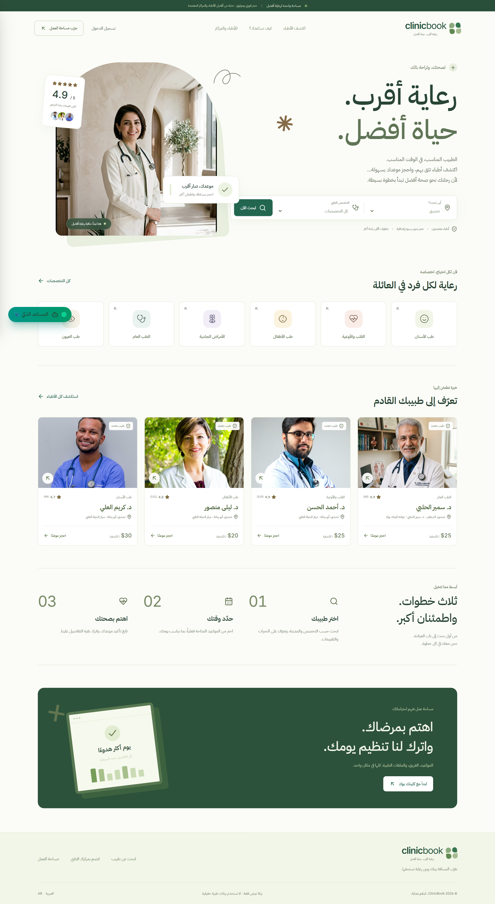
  </a>
</p>

<p align="center">
  <b>🌐 [الانتقال إلى النسخة العربية من دليل التوثيق](README.md)</b>
</p>

</div>

---

## Executive Summary

> **Deployment boundary:** The hardening changes are not approval to operate real patient data. Review [deployment constraints](docs/PRODUCTION_HARDENING.md), and verify staging migrations, backups and restoration before deployment. Old reports and screenshots are historical illustrations, not evidence for the current release.

**ClinicBook** is an educational clinic-management prototype with an Arabic doctor directory, appointment booking, reception and doctor workspaces, cash-payment recording, and simplified clinical notes. The repository contains no published field study or measurements of waiting-time reduction or clinical outcomes.

Its **multi-tenant** design uses a shared PostgreSQL schema with RLS policies and application guards, not one separate database per organization. Application fonts and illustrative images are self-hosted; Supabase and optional LLM generation still require external services. Offline operation is not claimed.

> **Verification scope:** Demo names, portraits and licensing states are illustrative, not verified provider identities. Local/CI tests cover application logic and isolated PostgreSQL 17 fixtures, not a certified live Supabase deployment. See the [claim-to-code matrix](docs/TRACEABILITY.md) and [asset sources](docs/ASSETS.md).

---

## Core Features and UI Showcase

The screenshots illustrate an earlier local demo. A screenshot alone does not prove a passing test or match the latest revision; implementation/test boundaries are linked in [TRACEABILITY.md](docs/TRACEABILITY.md).

### 1. Atomic Concurrency Slot Engine

The slot engine uses half-open intervals `[start, end)` and converts local shifts to UTC using `Asia/Damascus`. Demo writes use SQLite `IMMEDIATE` transactions; PostgreSQL's `appointment_no_overlap` constraint rejects overlapping active visits for the same doctor. The PostgreSQL suite races 50 requests for one slot; this is not a production-capacity benchmark.

<p align="center">
  <a href="docs/screenshots/showcase/03-doctor-profile-slots.png">
    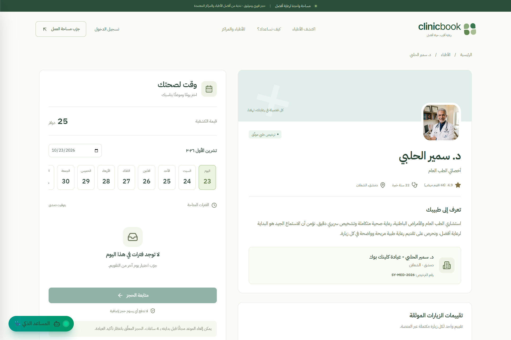
  </a>
</p>

- **Slot Slicing:** Configured durations of 10, 15, 20, 30, 45 or 60 minutes.
- **Exceptions:** Excludes recorded leave and gaps between shifts; no automatic public-holiday calendar.
- **Conflicts & Expiry:** Rejects active overlap and marks expired pending holds `expired`, rather than deleting them.

---

### 2. Clinical Directory, Faceted Search & Advanced Filtering

A real-time medical discovery engine allowing patients to find practitioners and clinics across multiple clinical and geographic dimensions.

<p align="center">
  <a href="docs/screenshots/showcase/02-search-and-filters.png">
    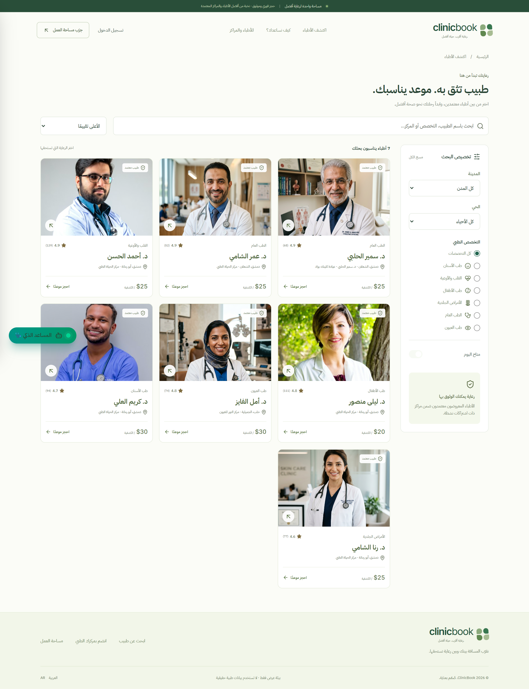
  </a>
</p>

- **Current Filters:** Name/specialty/clinic text, city, district, specialty and available-today toggle.
- **Current Sorts:** Rating or lowest consultation fee. Fee-range/experience filters and general earliest-slot sorting are not implemented.
- **Interactive Physician Cards:** Quick-view clinic locations, weekly schedule summaries, and direct links to live booking calendars.

---

### 3. Clinic Operations & Financial Analytics

Shows role-scoped appointments and derived operational indicators, without claiming guaranteed instant updates or clinical analytics.

<p align="center">
  <a href="docs/screenshots/showcase/07-clinic-owner-dashboard.png">
    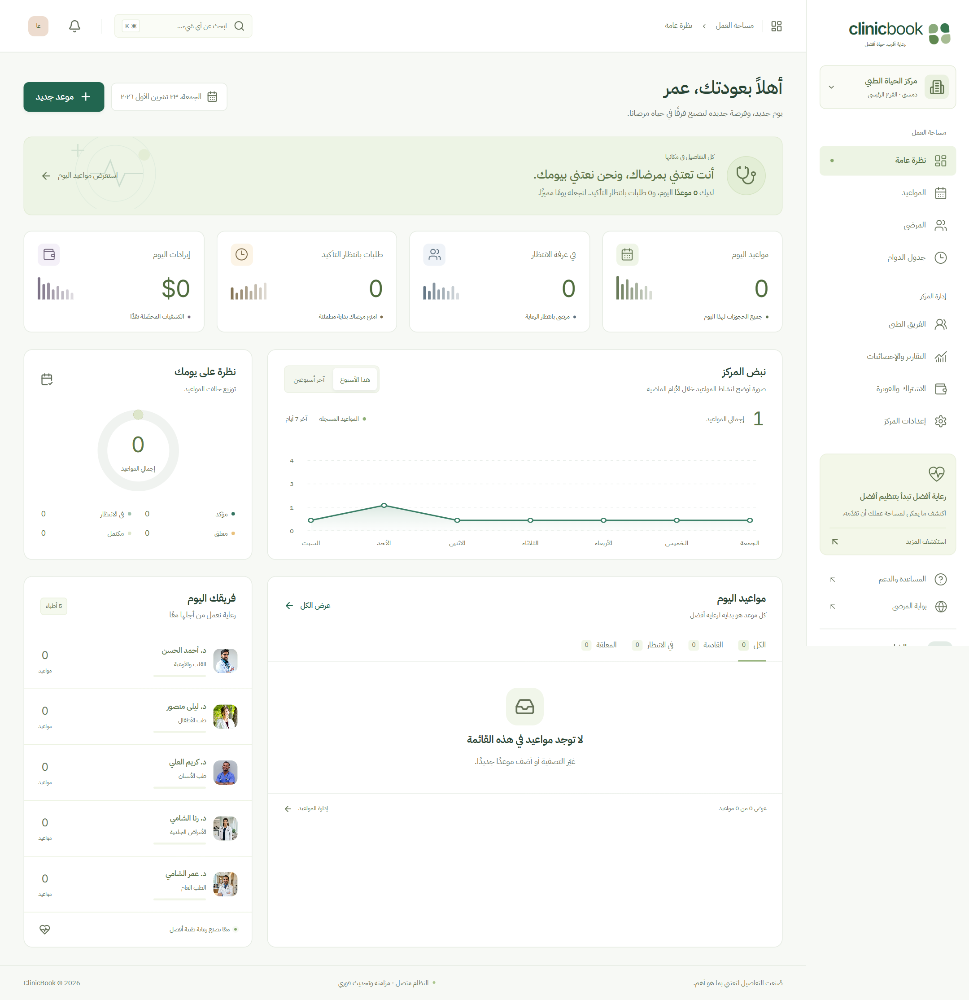
  </a>
</p>

- **Operational Indicators:** Appointment counts/statuses and fee totals; these are not audited financial statements or field-measured occupancy.
- **Staff & Branch Provisioning:** Onboard physicians, configure multi-branch assignments, and manage subscription tier limits.
- **CSV Export:** Quotes cells and replaces the first character with an apostrophe when it is `=`, `@`, `+` or `-`. This is the specific `DownloadCSV` behavior, not comprehensive spreadsheet-injection protection.

---

### 4. Simplified Clinical Records & Printable Prescriptions

A treating-doctor workspace with record authorization and patient-visibility controls.

<p align="center">
  <a href="docs/screenshots/showcase/09-doctor-clinical-emr.png">
    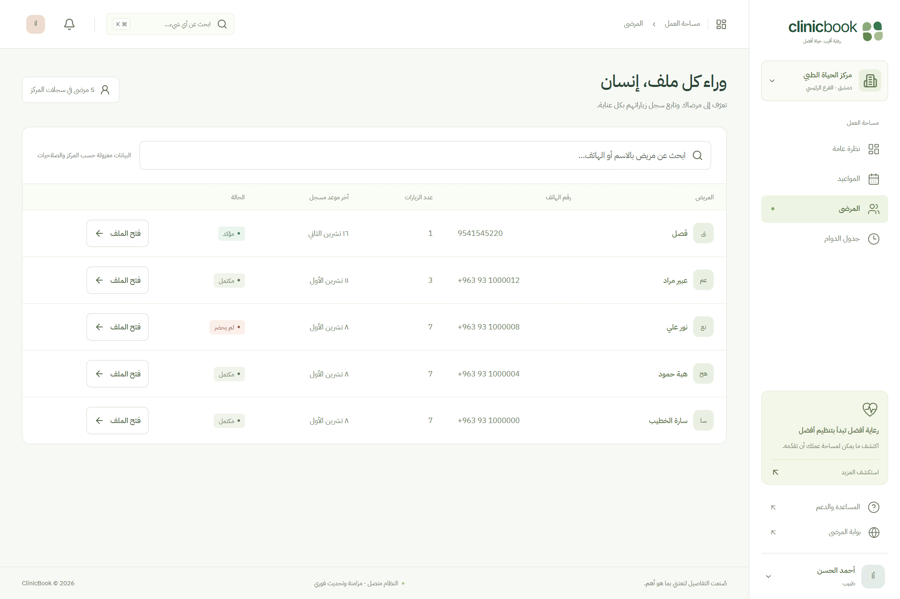
  </a>
</p>

- **Simplified Record:** Complaint, diagnosis, doctor notes and follow-up date, not a full structured SOAP/history/allergy model.
- **Medication Entries:** Name, dose, frequency and duration, with no automated drug-interaction checking.
- **Browser Printing:** A printable template with optional browser save-as-PDF, not a server-generated PDF, barcode, verification code, digital signature or FHIR/HL7 implementation.
- **Clinical Boundary:** Receptionists, owners and platform admins cannot read diagnoses through application/user-role access. Patients read their own records when visibility is enabled. This is not healthcare privacy certification.

---

### 5. Doctor Shift Scheduling, Breaks & Exception Management

A flexible calendar utility allowing practitioners and clinics to configure consultation windows and shift exceptions.

<p align="center">
  <a href="docs/screenshots/showcase/10-doctor-schedule.png">
    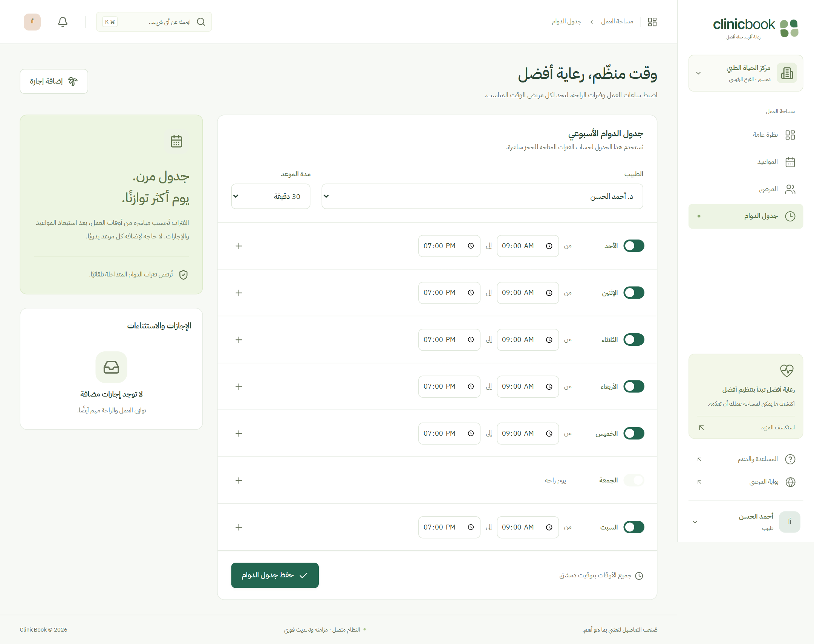
  </a>
</p>

- **Shift Definition:** Configure daily start and end working hours, break periods, and custom consultation slot durations.
- **Scheduled Rest Periods:** Block lunch and break intervals from appearing in patient booking slots.
- **Leave:** Records an exception and shows affected appointment counts. Existing visits are not automatically cancelled or rescheduled.

---

### 6. Reception Queue & Point-of-Care Check-In

Designed specifically for front-desk receptionists to manage patient queues and record cash settlements in clinic waiting rooms.

<p align="center">
  <a href="docs/screenshots/showcase/08-reception-appointments.png">
    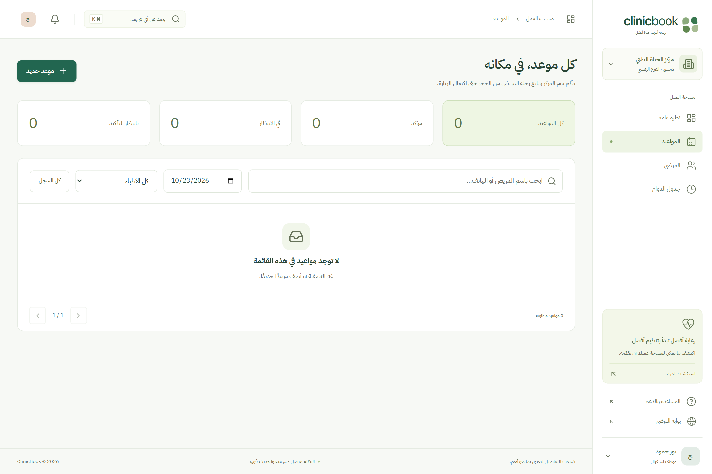
  </a>
</p>

- **Check-In:** Transitions the visit to `checked_in` in the doctor's authorized visit list.
- **Cash Recording:** Sets `paid_cash`, not a tax-invoice or signed-receipt system.
- **Walk-In Scheduling:** Books a named visitor with a phone number into an available slot, subject to treating-doctor/reception-branch authorization; not emergency triage.

---

### 7. Booking & General-Guidance Assistant (Eve)

A rule-based language router with optional LLM text generation. The name Eve does not indicate an installed durable-agent framework.

<p align="center">
  <a href="docs/screenshots/showcase/04-ai-assistant-eve.png">
    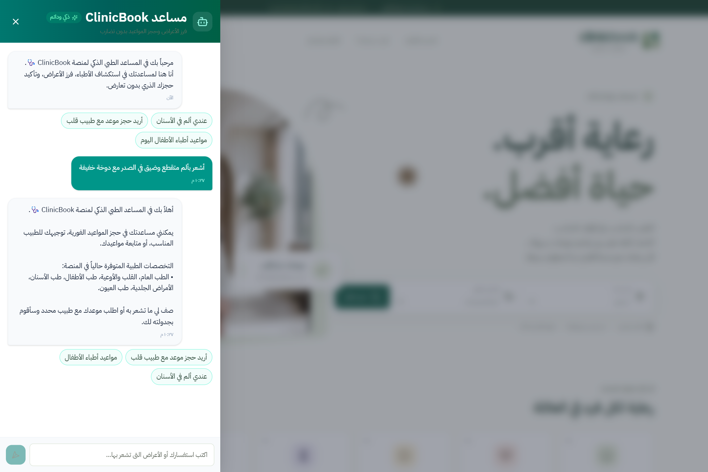
  </a>
</p>

- **Precautionary Alerts:** Emergency words/phrases are checked before database or LLM work. They do not diagnose or provide validated clinical triage.
- **Search & Booking:** Matches words to specialties/doctors, shows slots, and books only after user confirmation and authentication.
- **Optional Generation:** Local replies work without an AI key. No LLM-directed tool execution or durable workflow runtime is implemented.
- **Safety Limits:** No alert does not mean symptoms are safe. Synthetic-rule measurements and known false alarms are documented in [AGENT_TRIAGE.md](docs/AGENT_TRIAGE.md).

---

### 8. Patient Portal & Booking Management

A patient portal for managing appointments and reading records/prescriptions allowed by the visibility policy; it does not automatically monitor health.

<p align="center">
  <a href="docs/screenshots/showcase/06-patient-appointments.png">
    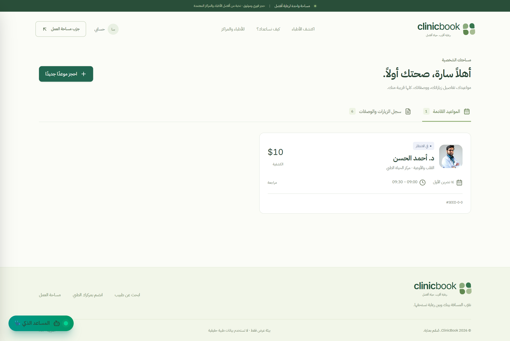
  </a>
</p>

- **Upcoming Visits:** Doctor/clinic details, a shortened text reference and a pending-hold expiry countdown, not a check-in barcode.
- **Cancellation:** Pending holds can be cancelled; confirmed visits use the clinic's configured window (two hours by default).
- **Visit History:** Authorized appointment/record views, one review per completed visit, and browser printing.

---

### 9. Multi-Role Authentication & Direct Persona Simulator

A login/sign-up portal with role-preview buttons only in local demo mode, not in production runtime.

<p align="center">
  <a href="docs/screenshots/showcase/05-multi-role-login.png">
    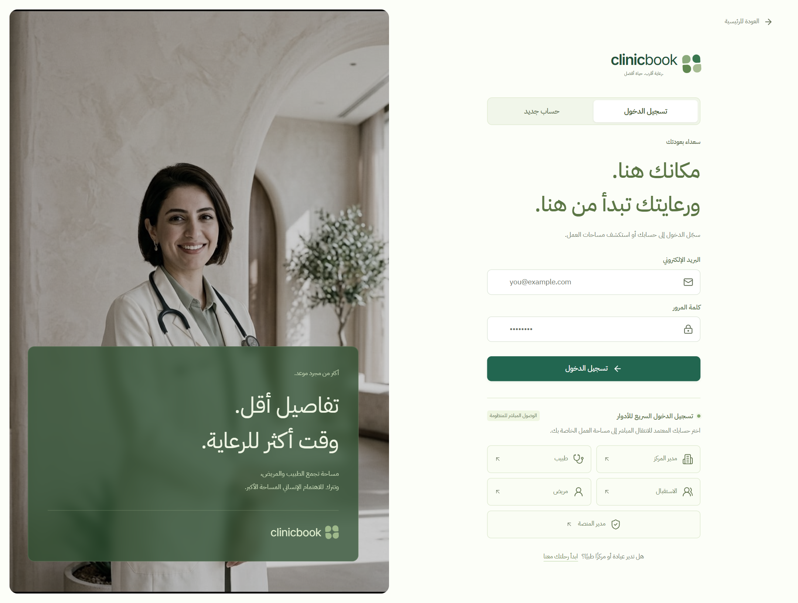
  </a>
</p>

- **Demo Personas:** `clinic_owner`, `doctor`, `receptionist`, `patient` and `super_admin` in demo only.
- **Demo Authentication:** `scrypt` password hashes, random opaque session tokens stored as SHA-256 hashes, and `HttpOnly` cookies. A session identifier is not encrypted session data.
- **Supabase Authentication:** Supabase Auth manages cloud credentials/sessions; authority is resolved from an active database profile. The local hashing algorithm does not describe Supabase's password storage.
- **Sign-Up Pipelines:** Dedicated registration flows for patients and clinic owners with strict schema validation.

---

### 10. Multi-Step Clinic Onboarding & Verification Wizard

A guided multi-step onboarding wizard for registering new outpatient clinics and specialist practices.

<p align="center">
  <a href="docs/screenshots/showcase/11-clinic-registration-wizard.png">
    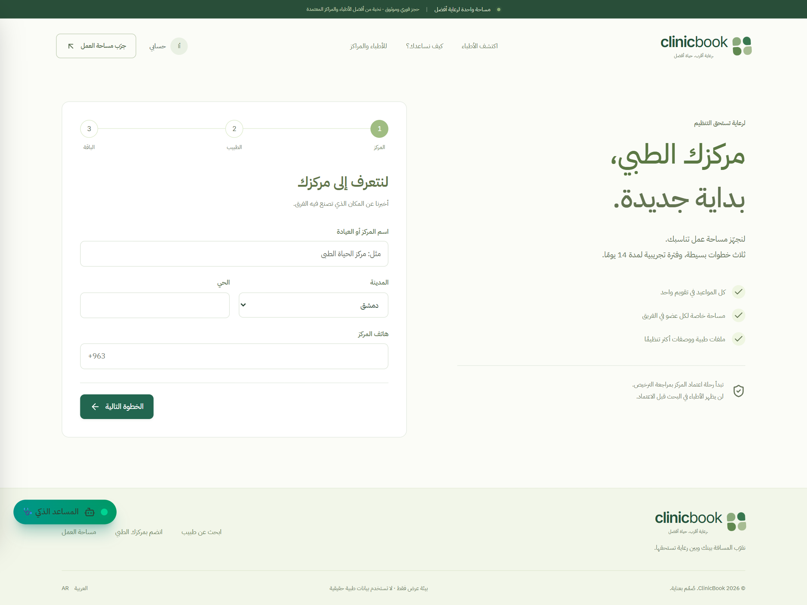
  </a>
</p>

- **Licensing Data:** Entered license numbers and administrative review, not a government-registry lookup.
- **Subscription:** Production onboarding starts a 14-day Starter trial with one doctor and one clinic. Upgrades require a request and administrative activation; demo behavior is not the production entitlement policy.
- **Pending Verification Gate:** Quarantines new clinics until authenticated and reviewed by platform administrators.

---

### 11. Platform Governance & Tamper-Evident Audit Trail

A governance console for verification, subscriptions and references, without tenant-appointment or clinical-record access.

<p align="center">
  <a href="docs/screenshots/showcase/12-super-admin-console.png">
    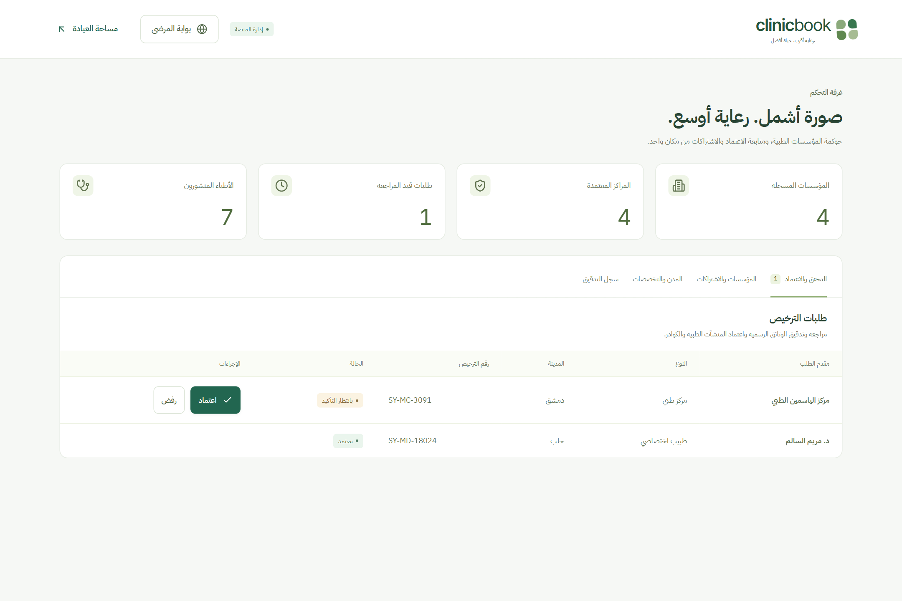
  </a>
</p>

- **Verification Queue:** Reviews entered data and approval/rejection state; not official KYC verification.
- **Audit Logging:** Database triggers record committed changes without copying clinical values; application clients cannot write or edit the log. This does not protect against the database owner or a leaked privileged key. Legacy rows are not authoritative payment/approval evidence.
- **References:** Manage specialties/cities; districts are branch data, not an official licensing registry.

---

### 12. Scheduled Operational Jobs (Retention Cron)

The repository defines `GET/POST /api/cron/retention`. An endpoint/schedule definition alone does not prove deployed execution or reduced no-shows:

- **Production Jobs:** One atomic RPC handles pending expiry, conditional no-shows, in-app reminders for confirmed visits within 24 hours, subscription expiry and eligible record archival. No SMS/WhatsApp delivery or autonomous treatment follow-up.
- **Authorization:** Explicit `CRON_SECRET`, `timingSafeEqual` comparison, count-only output and duplicate-safe reminders.
- **Operations:** `vercel.json` requests hourly execution; secrets and hosting-plan support still need verification. Demo simulates scanning/expiry, not every SQL job.

---

### 13. Mobile Responsive Viewports

Responsive CSS is covered by selected mobile checks, including home text at 360px/390px and desktop/mobile portrait sizing. Every page/state/viewport and screen reader has not been tested.

<p align="center">
  <a href="docs/screenshots/showcase/mobile-01-home.png">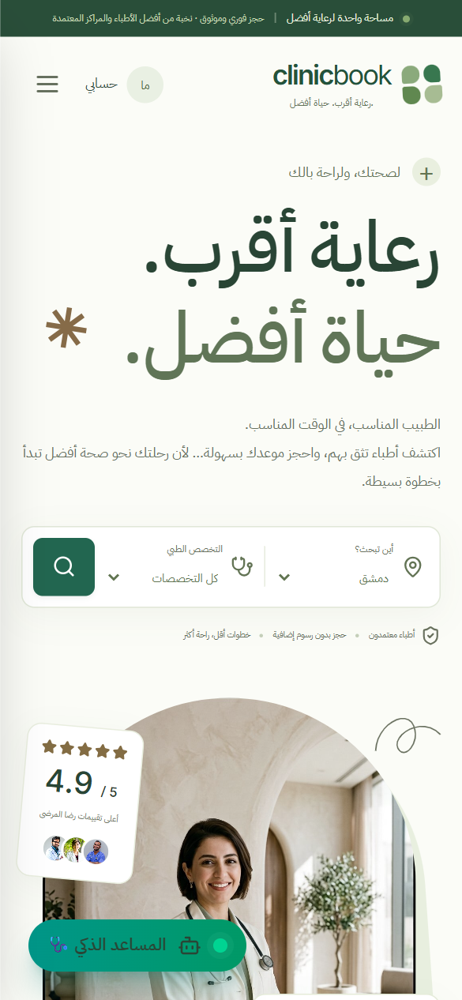</a> &nbsp;
  <a href="docs/screenshots/showcase/mobile-02-search.png">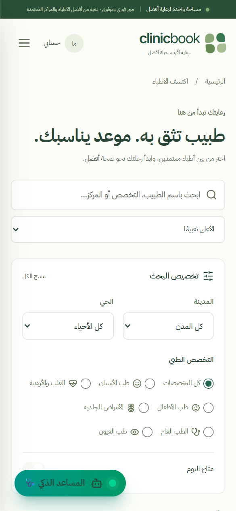</a> &nbsp;
  <a href="docs/screenshots/showcase/mobile-03-dashboard.png">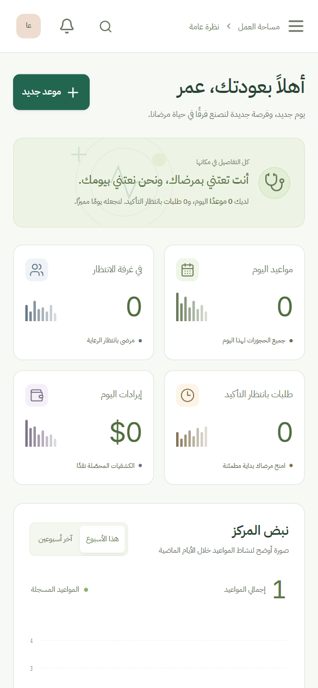</a>
</p>

---

## System Architecture

ClinicBook employs a clean three-tier architecture separating declarative UI components, business logic invariants, and isolated storage layers:

```text
┌────────────────────────────────────────────────────────────────────────┐
│                        Presentation & UI Layer                         │
│      Next.js 15 App Router • React 19 • Tailwind 4 • Motion • Radix     │
│             (RTL Arabic • Self-hosted Fonts and Demo Images)            │
└───────────────────────────────────┬────────────────────────────────────┘
                                    │
                                    ▼
┌────────────────────────────────────────────────────────────────────────┐
│               Business Logic, Invariants & Security Gates              │
│       • Slots Engine: Asia/Damascus → Half-Open UTC Intervals          │
│       • Lifecycle State Machine: Pending → Confirmed → Completed       │
│       • RBAC Authorization: EMR Data Quarantined from Administration   │
│       • Input Validation: Zod Schemas + Excel Injection Defense        │
└──────────────────┬──────────────────────────────────┬──────────────────┘
                   │                                  │
          (Local / Evaluation)               (Cloud Production)
                   ▼                                  ▼
┌──────────────────────────────────────┐  ┌──────────────────────────────┐
│       Local High-Speed Engine        │  │    PostgreSQL 17 + Supabase  │
│   • Better-SQLite3 (WAL Mode)        │  │  • Row-Level Security (RLS)  │
│   • IMMEDIATE Transactions          │  │  • Stored Atomic RPCs        │
│   • Transactional Conflict Checks   │  │  • Database Mutation Audit   │
└──────────────────────────────────────┘  └──────────────────────────────┘
```

---

## RBAC Access Matrix

Enforces the **Principle of Least Privilege** to maintain patient confidentiality and role isolation:

| Role                 |    Role Key    |                 Appointments                 |   Clinical EMR & Diagnosis    |      Staff & Branch Mgmt      |          Financial Operations          |
| :------------------- | :------------: | :------------------------------------------: | :---------------------------: | :---------------------------: | :------------------------------------: |
| **Clinic Owner**     | `clinic_owner` |   View/confirm/reject/cancel under policy    |         🚫 Forbidden          |     Manage staff/branches     | Request upgrade; scoped cash recording |
| **Attending Doctor** |    `doctor`    |           Manage assigned schedule           | ✅ Full create/edit EMR & Rx  |         🚫 Forbidden          |        View personal fee totals        |
| **Receptionist**     | `receptionist` | Book/confirm/check in within assigned branch |         🚫 Forbidden          |         🚫 Forbidden          |      Branch-scoped cash recording      |
| **Patient**          |   `patient`    |   Book/view/cancel own visits under policy   | View own records when visible |         🚫 Forbidden          |   View appointment fee/payment state   |
| **Super Admin**      | `super_admin`  |          🚫 Tenant visits forbidden          |         🚫 Forbidden          | Approve organizations/doctors | Administrative subscription activation |

These are application/`authenticated` boundaries, not restrictions on the database owner. Patient record visibility is conditional. Sources: `canAccess`, `canTransition` and the SQL policies linked in [TRACEABILITY.md](docs/TRACEABILITY.md).

---

## Local Development and Quickstart

### Prerequisites

- **Node.js**: Version 22.12.0 or newer within the 22.x series (`^22.12.0` in `package.json`).
- **npm**: Version 10 or higher.

> ⚠️ **Deployment Constraints**:
>
> - **Production (`CLINICBOOK_MODE=production`)**: Uses Supabase Auth/PostgreSQL and shared Redis. Build/start tests use isolated services; deployment requires staging verification. CI runs PostgreSQL 17, while `supabase/config.toml` still specifies 16; target-version alignment/verification remains outstanding.
> - **Demo (`CLINICBOOK_MODE=demo`)**: Local development/evaluation through `npm run dev` with writable disk. The application rejects demo at `NODE_ENV=production`, even on a writable host. Do not use `npm run build` / `npm start` to run demo.

### Quick Setup Steps

```bash
# 1. Install dependencies with exact lockfile guarantees
npm ci

```

Create a local `.env.local` with these demo-only values (do not overwrite an existing secrets file). `.env.example` defaults to production, so do not copy it unchanged for demo:

```dotenv
CLINICBOOK_MODE=demo
NEXT_PUBLIC_APP_URL=http://localhost:3000
COOKIE_SECURE=false
```

Then:

```bash
npm run db:seed
npm run dev
```

Open `http://localhost:3000`. SQLite demo data is created locally, not supplied by Git. An AI provider is optional for generated replies, not required for demo search/booking.

### Interactive Multi-Role Exploration

In local demo, explore the five personas through `/login` without registering accounts. These buttons do not grant production privileges:

1. **Clinic Owner:** Inspect the operational dashboard, manage clinic branches, and view analytics.
2. **Attending Doctor:** Review today's queue, author SOAP clinical notes, and print medical prescriptions.
3. **Receptionist:** Check in arriving patients and record cash fee collections.
4. **Patient:** Search available specialists, reserve a slot, and test real-time cancellation deadlines.
5. **Super Admin:** Review incoming clinic verification requests and inspect the system audit trail.

---

## Test Suite and Verification

The repository contains unit, integration, browser and database tests. Their presence or TDD names do not prove that every feature was developed test-first or that the system is defect-free:

```bash
# 1. Strict static type analysis (Zero TypeScript diagnostics)
npm run typecheck

# 2. ESLint and unit/integration tests with enforced coverage thresholds
npm run lint
npm run test:coverage

# 3. Separate HTTP exercise, not a capacity benchmark; rate limits may reject requests
# Requires a local demo server running in another terminal
npm run test:concurrency

# 4. End-to-end browser test automation & accessibility suite (Playwright)
npm run test:e2e

# 5. Selected axe checks, not comprehensive conformance certification
npx playwright test tests/e2e/accessibility.spec.ts

# 6. Production build/start against isolated Supabase/Redis fixtures
npm run test:production
```

### Verification Snapshot:

These results apply to revision `1c84859` on 2026-11-13, not every future release. See [QUALITY_GATES.md](docs/QUALITY_GATES.md) for scope:

- **269/269 unit/integration tests** across 21 files: 78.43% statements, 60.84% branches, 82.51% functions and 80.01% lines over library/API/agent modules, not all UI code.
- **38/38 demo browser tests**, including 11 axe tests covering 10 routes and the assistant-drawer state. Login also scans the sign-up tab. Passing is not comprehensive WCAG conformance.
- **16/16 production build/browser tests** against local protocol fixtures, not real Supabase Auth or Upstash services.
- **PostgreSQL 17:** `tests/postgres/verify.ts` covers RLS/RPC and 50 competing bookings (one winner, the rest `23P01`). This is separate from HTTP's token bucket (capacity 10, replenished over one minute).
- **Still required:** Upgrade/restore testing, live integrations and broader manual accessibility checks. See [POSTGRES_TESTING.md](docs/POSTGRES_TESTING.md) for a disposable database; never run the bootstrap on a live database.

---

## Repository Layout

```text
clinicbook/
├── docs/                       # Academic reports, architectural specs, and screenshots
│   ├── ACADEMIC_REPORT.md      # Full university semester project engineering report
│   ├── COMPREHENSIVE_PROPOSAL.md # Technical implementation proposal and architecture
│   ├── ACCESSIBILITY_AUDIT_REPORT.md # Scope of selected accessibility checks
│   ├── AI_AGENT_EVE_BLUEPRINT.md     # Current assistant vs future agent ideas
│   ├── TRACEABILITY.md         # Requirements/claims linked to code and tests
│   └── screenshots/showcase/   # Illustrations from an earlier demo
├── public/                     # Static assets, local typography, and portraits
│   ├── fonts/                  # Self-hosted IBM Plex Sans Arabic and Inter fonts
│   └── images/                 # Illustrative demo portraits and platform brand assets
├── src/
│   ├── app/                    # Next.js 15 App Router routes and API handlers
│   ├── components/             # Decomposed domain components
│   │   ├── clinical-pages.tsx  # Clinical EMR, consultations, and patient portal
│   │   ├── management-pages.tsx # Clinic operations, staff roster, and reports
│   │   ├── public-pages.tsx    # Landing page, doctor search, and profile views
│   │   └── shared.tsx          # Shared primitives (Radix, Tailwind, Motion)
│   └── lib/
│       ├── auth/               # Session management and RBAC guards
│       ├── services/           # Slots calculation engine and lifecycle transitions
│       ├── demo-db.ts          # Local SQLite storage and deterministic seeds
│       └── supabase/           # Isolated Supabase clients and database adapters
├── supabase/migrations/        # PostgreSQL schema, RLS policies, and atomic RPCs
└── tests/                      # Vitest unit, Playwright E2E, and Postgres test suites
```

---

## Academic Documentation and Research Context

This project represents an applied software engineering semester project submitted for academic evaluation:

- **Academic Institution:** Antioch Syrian Private University (**ASPU**) — Faculty of Computer Engineering.
- **Authors:** Amr Ibrahim Lila • Samer Ghosn.
- **Academic Supervisor:** Dr. Lina Arar.

### Primary Documentation Artifacts:

- 📄 **Comprehensive Academic Report:** [`docs/ACADEMIC_REPORT.md`](docs/ACADEMIC_REPORT.md) — [Printable Formatted HTML](docs/ACADEMIC_REPORT.html)
- 📑 **Integrated Project Proposal:** [`docs/COMPREHENSIVE_PROPOSAL.md`](docs/COMPREHENSIVE_PROPOSAL.md) — [HTML Version](docs/COMPREHENSIVE_PROPOSAL.html)
- 🤖 **Eve Clinical AI Blueprint:** [`docs/AI_AGENT_EVE_BLUEPRINT.md`](docs/AI_AGENT_EVE_BLUEPRINT.md)
- ♿ **Accessibility Audit Report (WCAG 2.1 AA):** [`docs/ACCESSIBILITY_AUDIT_REPORT.md`](docs/ACCESSIBILITY_AUDIT_REPORT.md)
- 🖼️ **Complete Visual Showcase Gallery:** [`docs/screenshots/README.md`](docs/screenshots/README.md)
- 🔒 **PostgreSQL RLS Verification Guide:** [`docs/POSTGRES_TESTING.md`](docs/POSTGRES_TESTING.md)
- 🔎 **Requirement & Claim Traceability:** [`docs/TRACEABILITY.md`](docs/TRACEABILITY.md)
- 📘 **Organization, Clinic & Appointment Vocabulary:** [`GLOSSARY.md`](GLOSSARY.md)

---

## Cloud Production Roadmap

The table separates implemented code from missing/unverified work. “Tested” refers to named scenarios, not approval for clinical use:

| Functional Area               |           Current Status           | Cloud Rollout Requirement                                                         |
| :---------------------------- | :--------------------------------: | :-------------------------------------------------------------------------------- |
| **Slot Engine & Booking**     |    Implemented, isolated tests     | Staging upgrade, target-platform concurrency and representative load.             |
| **Clinical EMR & Digital Rx** | Simplified record/browser printing | Clinical/legal review; no signature, verification code or FHIR/HL7.               |
| **Multi-Tenant RBAC**         |         Guards/RLS tested          | Real Supabase Auth, invitation/acceptance/revocation and Realtime tests.          |
| **Payment Gateway**           |       ⚠️ Cash Point-of-Care        | Full Stripe / regional payment gateway webhook integration.                       |
| **Patient Notifications**     |         ⚠️ Internal System         | Official SMS & WhatsApp Business API gateway integration for automated reminders. |
| **Medical Attachments**       |          Not implemented           | Storage/access-policy design; no local or cloud upload feature in this release.   |

---

<div align="center">
  <sub>Educational semester project • Synthetic demo data • ClinicBook © 2026</sub>
</div>
