<div align="center">

# ClinicBook | كـلـيـنـك بـوك

### مشروع فصلي لإدارة العيادات وحجز المواعيد والسجل الطبي المبسط

**Multi-Tenant Healthcare SaaS & Clinical Practice Management System**

<p align="center">
  <a href="#نظرة-عامة">نظرة عامة</a> •
  <a href="#الميزات-والواجهات-الفعلية">الميزات والواجهات</a> •
  <a href="#البنية-المعمارية-للنظام">البنية المعمارية</a> •
  <a href="#مصفوفة-الصلاحيات">مصفوفة الصلاحيات</a> •
  <a href="#التشغيل-والإعداد-المحلي">التشغيل المحلي</a> •
  <a href="#منظومة-الاختبارات-والتحقق-الهندسي">الاختبارات</a> •
  <a href="#التوثيق-الأكاديمي-والمراجع">التوثيق الأكاديمي</a>
</p>

[](https://nextjs.org/)
[](https://react.dev/)
[](https://www.typescriptlang.org/)
[](https://tailwindcss.com/)
[](https://sqlite.org/)
[](https://www.postgresql.org/)
[](docs/QUALITY_GATES.md)
[](docs/QUALITY_GATES.md)
[](docs/ACCESSIBILITY_AUDIT_REPORT.md)

<br />

<p align="center">
  <a href="docs/screenshots/showcase/01-landing-page.png">
    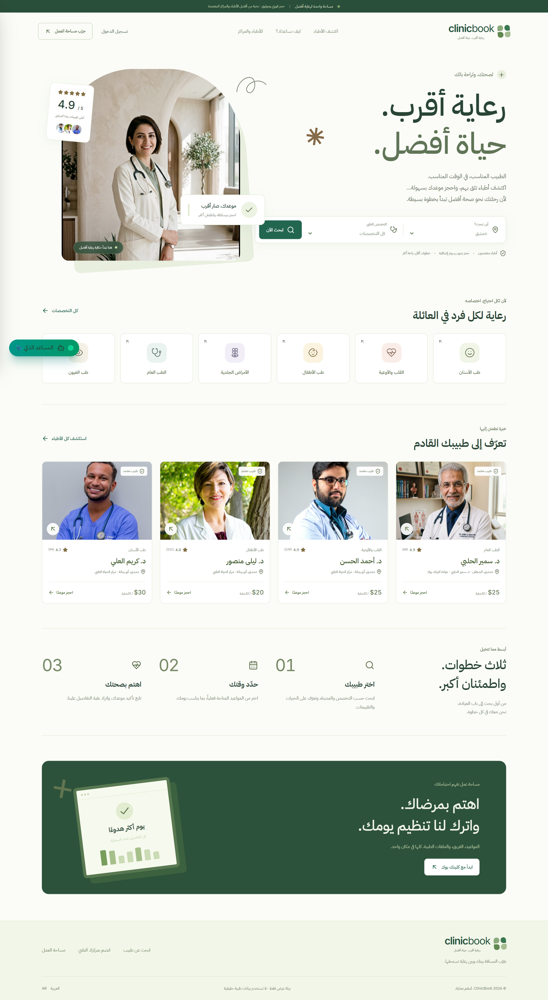
  </a>
</p>

<p align="center">
  <b>🌐 [English Documentation Available](README.en.md)</b>
</p>

</div>

---

## نظرة عامة

> **تنبيه النشر:** إصلاحات المستودع ليست موافقة على تشغيل بيانات
> مرضى حقيقية بعد. راجع [حالة التحقق وقيود النشر](docs/PRODUCTION_HARDENING.md)،
> واختبر الترحيلات والنسخ الاحتياطي والاستعادة على staging قبل النشر.
> أرقام التقارير واللقطات القديمة أدلة تاريخية، وليست نتائج تحقق الإصدار الحالي.

**ClinicBook** نموذج تعليمي لإدارة العيادات، بواجهة عربية للبحث عن الأطباء وحجز المواعيد، ومساحات عمل للاستقبال والطبيب وإدارة المركز. يدعم تسجيل الوصول والتحصيل النقدي وتوثيق الشكوى والتشخيص والأدوية. لا يتضمن المستودع دراسة ميدانية منشورة أو قياسًا لأثره على زمن الانتظار أو النتائج الصحية.

تدعم البنية تعدد المؤسسات (**Multi-Tenancy**) داخل مخطط PostgreSQL مشترك، مع سياسات RLS وحراس صلاحيات؛ ليست قاعدة بيانات مستقلة لكل مؤسسة. خطوط التطبيق وصوره التجريبية محلية، لكن وضع Supabase والتوليد النصي الاختياري يعتمدان على خدمات خارجية؛ لا يُدَّعى التشغيل دون اتصال.

> **نطاق التحقق:** بيانات demo وأسماء الأطباء وصورهم توضيحية، وليست دليل هوية أو ترخيص. الاختبارات المحلية وCI تغطي منطق التطبيق وقاعدة PostgreSQL 17 مع تجهيزات معزولة، لا نشرًا معتمدًا على Supabase حقيقي. راجع [مصفوفة تتبع الادعاءات](docs/TRACEABILITY.md) و[مصادر الأصول](docs/ASSETS.md).

---

## الميزات والواجهات الفعلية

اللقطات التالية توضح بيئة العرض التجريبية السابقة. لا تثبت وحدها نجاح اختبار أو تطابق الواجهة مع آخر إصدار؛ الدليل البرمجي لكل ميزة في [مصفوفة التتبع](docs/TRACEABILITY.md).

### 1. محرك الحجز وجدولة المواعيد الذرية

يعتمد محرك الحجز على الفترات نصف المفتوحة `[start, end)`، ويحوّل أوقات الدوام المحلية إلى UTC وفق `Asia/Damascus`. في demo تُسلسل الكتابة بمعاملة SQLite `IMMEDIATE`، وفي PostgreSQL يمنع قيد `appointment_no_overlap` تقاطع مواعيد الطبيب النشطة. اختبار PostgreSQL يتنافس فيه 50 طلبًا على الفترة نفسها؛ ليس هذا قياسًا للسعة الإنتاجية.

<p align="center">
  <a href="docs/screenshots/showcase/03-doctor-profile-slots.png">
    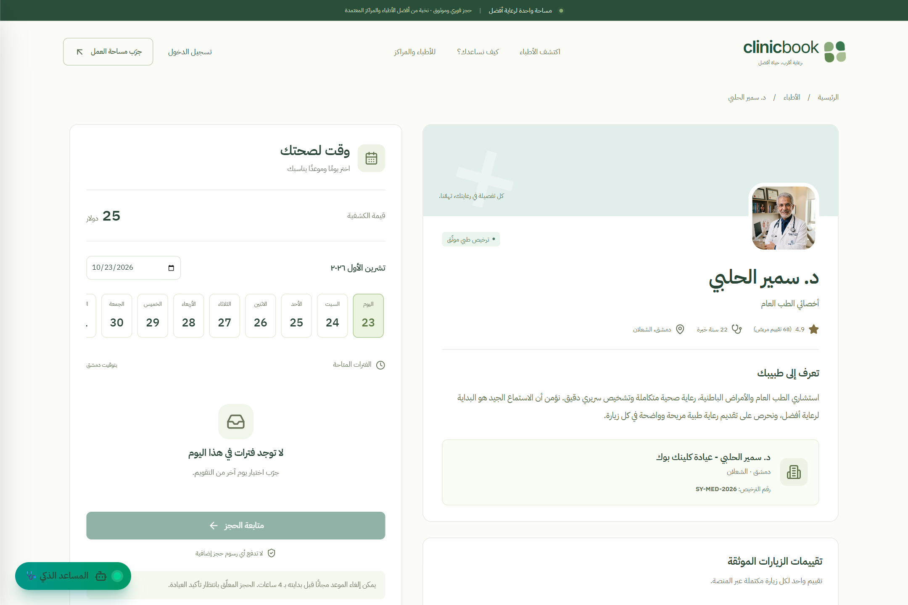
  </a>
</p>

- **إدارة الفترات:** تقسيم الدوام وفق المدة المضبوطة (10، 15، 20، 30، 45 أو 60 دقيقة).
- **الاستثناءات:** استبعاد الإجازات المسجلة والفجوات بين الورديات؛ لا يوجد تقويم عطل رسمية تلقائي.
- **التعارض والانتهاء:** رفض تعارض المواعيد النشطة، وتحويل الحجوزات المعلقة المنتهية إلى `expired` دون حذفها.

---

### 2. دليل الأطباء والبحث المتقدم والفلترة متعددة الأبعاد

محرك بحث طبي فوري يتيح للمرضى استكشاف الكادر الطبي والعيادات وفق معايير متعددة.

<p align="center">
  <a href="docs/screenshots/showcase/02-search-and-filters.png">
    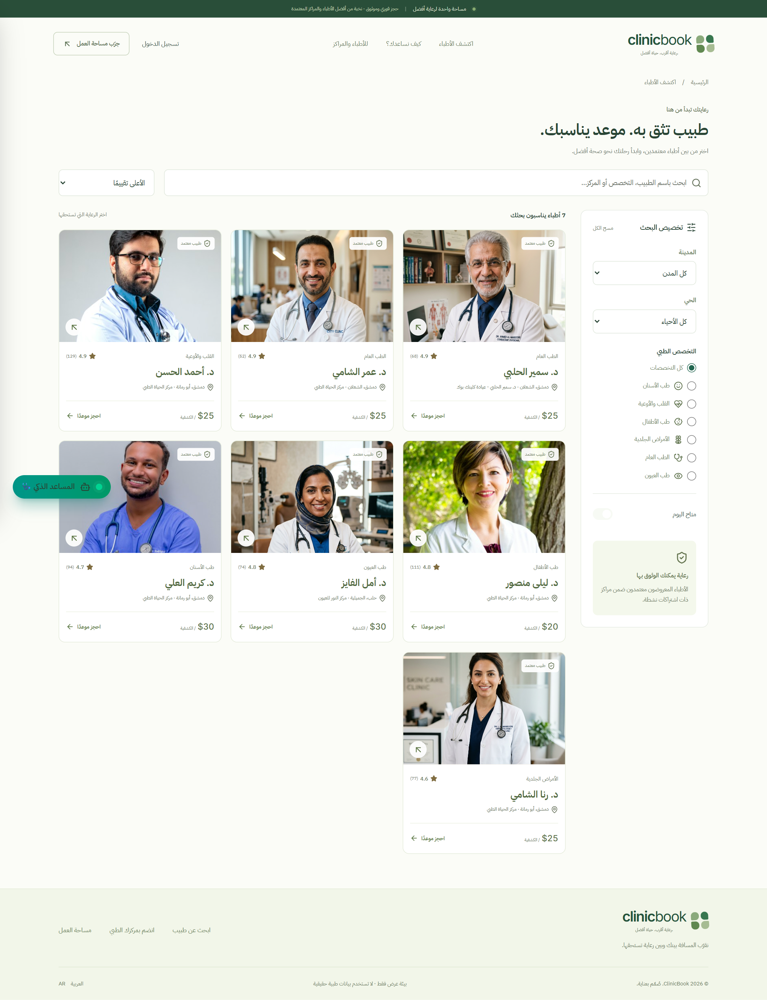
  </a>
</p>

- **الفلاتر الحالية:** الاسم/التخصص/المركز، المدينة، الحي، التخصص و«متاح اليوم».
- **الفرز الحالي:** التقييم أو الكشفية الأقل؛ لا توجد فلترة بنطاق سعر أو سنوات خبرة، ولا فرز عام حسب أقرب موعد.
- **بطاقات الأطباء التفاعلية:** استعراض تفاصيل العيادة، أوقات العمل، ورابط مباشر لجدول الفترات المتاحة.

---

### 3. لوحة تحكم إدارة المركز الطبي والتحليلات التشغيلية

تعرض بيانات المواعيد المسموح بها للدور ومؤشرات مشتقة منها؛ لا تدّعي تحديثًا لحظيًا مضمونًا أو تحليلات سريرية.

<p align="center">
  <a href="docs/screenshots/showcase/07-clinic-owner-dashboard.png">
    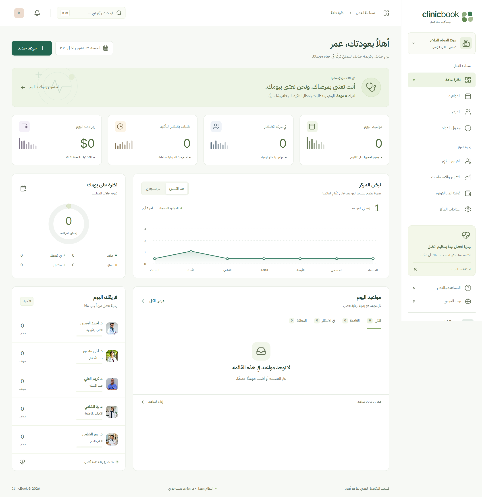
  </a>
</p>

- **مؤشرات تشغيلية:** أعداد المواعيد وحالاتها ومجاميع الرسوم؛ لا تعادل هذه الأرقام قائمة مالية مدققة أو قياسًا ميدانيًا للإشغال.
- **إدارة الكادر والفروع:** إضافة وتعيين الأطباء وموظفي الاستقبال وتحديد الفروع وأسقف الحجوزات وفق الباقة.
- **تصدير CSV:** يقتبس الخلايا ويستبدل الرمز الأول إذا كان `=`, `@`, `+`, `-` بعلامة اقتباس مفردة. هذه معالجة محددة في `DownloadCSV`، وليست ضمانًا ضد كل صيغ حقن جداول البيانات.

---

### 4. العيادة السريرية الرقمية والوصفة الإلكترونية (EMR & e-Prescription)

مساحة عمل للطبيب المعالج، مع فحوص صلاحيات للسجل الطبي وسياسة إظهاره للمريض.

<p align="center">
  <a href="docs/screenshots/showcase/09-doctor-clinical-emr.png">
    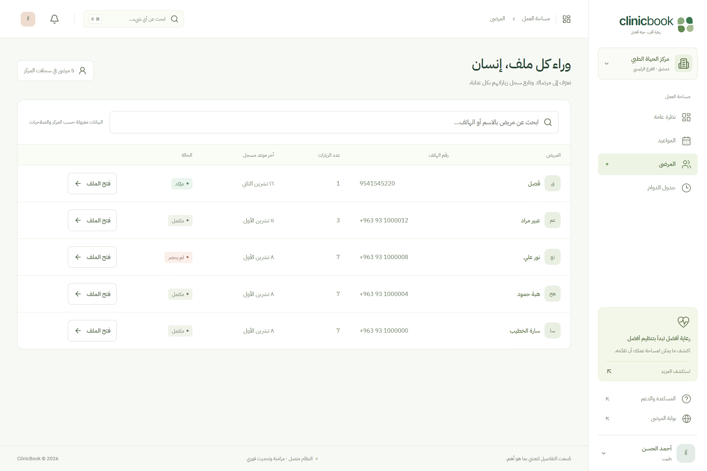
  </a>
</p>

- **السجل المبسط:** الشكوى والتشخيص وملاحظات الطبيب وتاريخ المراجعة؛ ليس نموذج SOAP كاملًا ولا ملف حساسية/سوابق منظّمًا.
- **الأدوية:** الاسم والجرعة والتكرار والمدة، دون فحص تداخلات دوائية آلي.
- **الطباعة:** قالب متصفح يتيح الطباعة أو الحفظ PDF؛ لا يوجد باركود أو رمز تحقق أو توقيع رقمي، ولا اعتماد FHIR/HL7.
- **الحد السريري:** يُحجب التشخيص عن الاستقبال والمالك ومدير المنصة؛ المريض يرى سجله عندما تكون سياسة الظهور مفعّلة. لا تعادل هذه الضوابط اعتمادًا قانونيًا لحماية البيانات الصحية.

---

### 5. إدارة جدول دوام الطبيب والورديات والاستثناءات

أداة مرنة تتيح لكل طبيب ضبط أوقات تواجده في العيادة بدقة متناهية.

<p align="center">
  <a href="docs/screenshots/showcase/10-doctor-schedule.png">
    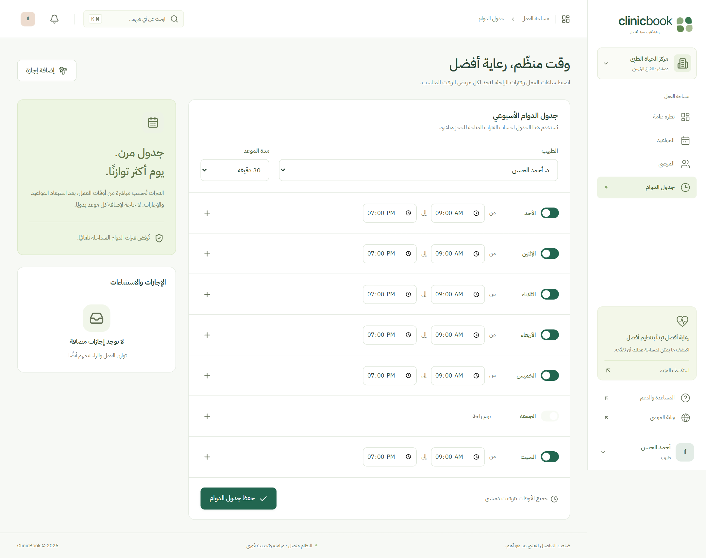
  </a>
</p>

- **تحديد الورديات الأسبوعية:** تحديد أوقات البدء والانتهاء لكل يوم من أيام الأسبوع وتخصيص مدة الفحص.
- **فترات الاستراحة اليومية:** إدراج أوقات الراحة المجدولة لمنع حجز المواعيد خلالها تلقائياً.
- **الإجازات:** تسجيل استثناء وعرض عدد المواعيد المتأثرة؛ المواعيد القائمة لا تُلغى ولا تُعاد جدولتها تلقائيًا.

---

### 6. شاشة الاستقبال وإدارة طابور المراجعين

واجهة مخصصة لموظفي مكتب الاستقبال لتسجيل الوصول الفوري والتحصيل المالي في العيادة.

<p align="center">
  <a href="docs/screenshots/showcase/08-reception-appointments.png">
    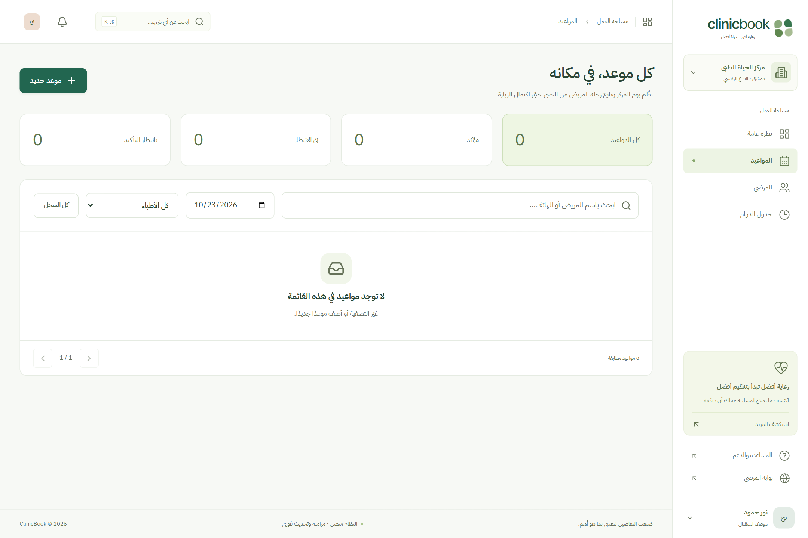
  </a>
</p>

- **تسجيل الوصول:** تحويل الموعد إلى `checked_in` ليظهر في قائمة الزيارات المسموح بها للطبيب.
- **التحصيل النقدي:** تغيير حالة الدفع إلى `paid_cash`؛ ليس نظام فواتير ضريبية أو إيصالات موقّعة.
- **الحجز المباشر:** تسجيل مراجع بالاسم والهاتف في فترة شاغرة ضمن صلاحيات الطبيب أو موظف استقبال الفرع؛ ليس مسار فرز إسعافي.

---

### 7. مساعد الحجز والإرشاد العام (Eve)

محرك توجيه قائم على قواعد لغوية، مع توليد نصي اختياري عند تهيئة مزود LLM. الاسم Eve لا يعني وجود إطار وكيل دائم مثبت في التطبيق.

<p align="center">
  <a href="docs/screenshots/showcase/04-ai-assistant-eve.png">
    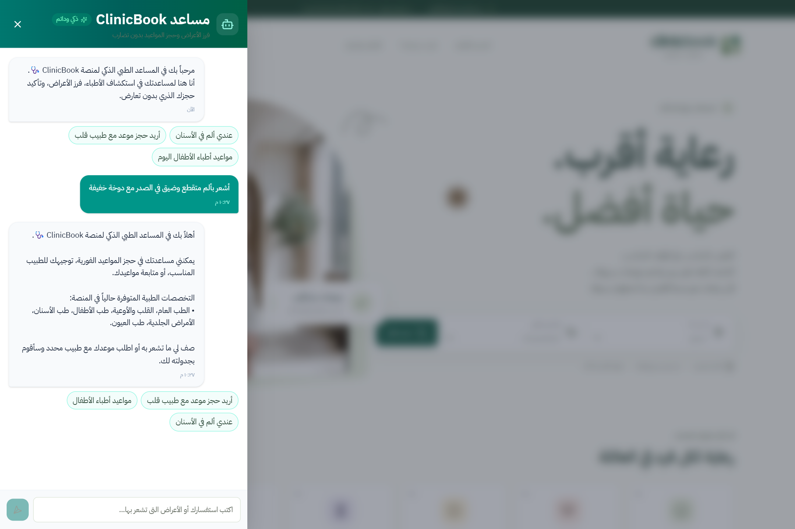
  </a>
</p>

- **تنبيه احترازي:** مطابقة كلمات وعبارات للطوارئ تسبق البحث والكتابة وطلب LLM؛ ليست تشخيصًا أو فرزًا سريريًا معتمدًا.
- **البحث والحجز:** ربط كلمات بتخصصات وأطباء، عرض فترات شاغرة وتنفيذ الحجز بعد تأكيد المستخدم والمصادقة.
- **التوليد النصي:** اختياري؛ الردود المحلية تعمل دون مفتاح AI. لا يوجد تنفيذ أدوات يقرره LLM أو حفظ سير عمل دائم.
- **حدود السلامة:** غياب التنبيه لا يعني أن الأعراض آمنة. تُقاس القواعد على أمثلة اصطناعية، مع إنذارات كاذبة موثّقة في [AGENT_TRIAGE.md](docs/AGENT_TRIAGE.md).

---

### 8. بوابة المريض وحساباته وسجل المواعيد

لوحة للمريض لإدارة مواعيده وعرض السجلات والوصفات المسموح بإظهارها؛ لا تتابع الحالة الصحية تلقائيًا.

<p align="center">
  <a href="docs/screenshots/showcase/06-patient-appointments.png">
    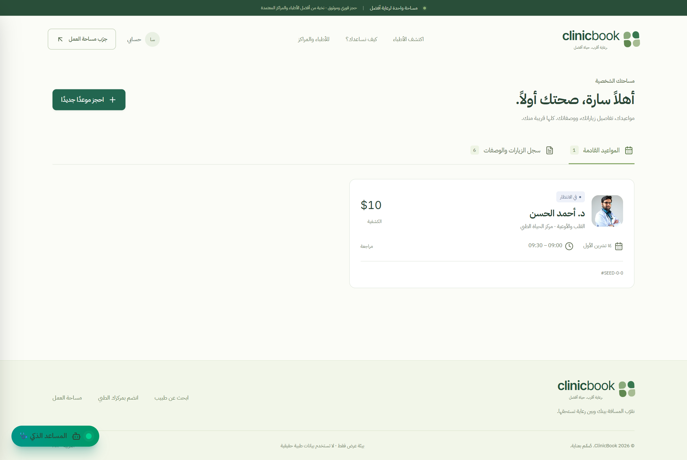
  </a>
</p>

- **المواعيد القادمة:** تفاصيل الطبيب والعيادة ومرجع نصي مختصر للموعد، وعد تنازلي لانتهاء الحجز المعلّق؛ لا يوجد باركود.
- **الإلغاء:** المعلّق قابل للإلغاء؛ المؤكد يخضع لنافذة العيادة (ساعتان افتراضيًا)، وليس قاعدة ثابتة لكل المنشآت.
- **الزيارات السابقة:** عرض المواعيد والسجلات المتاحة، وتقييم واحد لكل زيارة مكتملة والطباعة عبر المتصفح.

---

### 9. بوابة المصادقة وتجربة الأدوار التفاعلية (5 أدوار)

صفحة دخول وتسجيل، مع أزرار تجربة الأدوار في وضع demo المحلي فقط، وليس في تشغيل الإنتاج.

<p align="center">
  <a href="docs/screenshots/showcase/05-multi-role-login.png">
    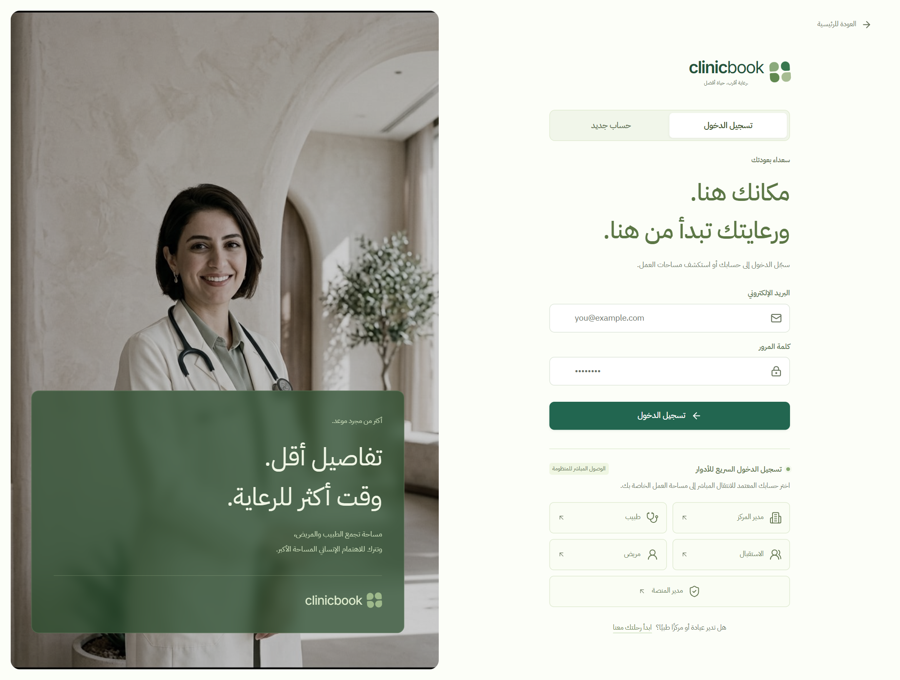
  </a>
</p>

- **محاكاة الأدوار:** `clinic_owner`, `doctor`, `receptionist`, `patient`, `super_admin`، محصورة في demo.
- **مصادقة demo:** تجزئة كلمات المرور بـ `scrypt` ورمز جلسة عشوائي تُحفظ تجزئته SHA-256؛ الكوكي `HttpOnly` والرمز ليس بيانات جلسة مشفرة.
- **مصادقة Supabase:** الدخول وكلمات المرور والجلسات تُدار عبر Supabase Auth، ويُشتق الدور من ملف قاعدة البيانات النشط؛ خوارزمية demo ليست وصفًا لتخزين كلمات مرور Supabase.
- **بوابة تسجيل المستخدم الجديد:** نماذج تسجيل واضحة للمرضى وأصحاب العيادات مع التحقق الصارم من الحقول.

---

### 10. معالج تسجيل واعتماد المنشآت الطبية (Clinic Onboarding)

معالج تفاعلي متعدد الخطوات لانضمام العيادات والمراكز الطبية إلى المنصة.

<p align="center">
  <a href="docs/screenshots/showcase/11-clinic-registration-wizard.png">
    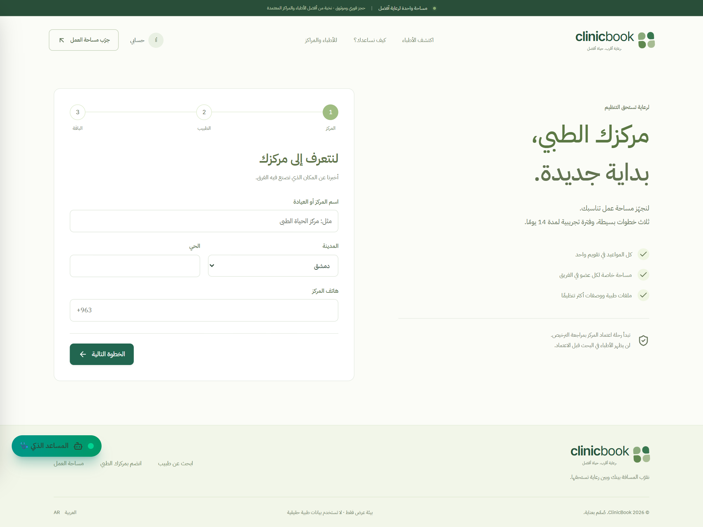
  </a>
</p>

- **التراخيص:** إدخال رقم ترخيص ومراجعة إدارية؛ لا يوجد اتصال بسجل حكومي للتحقق من صحته.
- **الاشتراك:** في الإنتاج يبدأ الانضمام بتجربة Starter لمدة 14 يومًا لطبيب وفرع واحد؛ الترقية تتطلب طلبًا وتفعيلًا إداريًا. محاكاة demo ليست سياسة الإنتاج.
- **قفل الأمان المؤقت:** بقاء المركز في حالة انتظار الاعتماد حتى مراجعته وتفعيله من قبل إدارة المنصة.

---

### 11. لوحة تحكم مدير المنصة وسجل التدقيق الأمني (Super Admin & Audit)

واجهة حوكمة لإدارة الاعتماد والاشتراكات والمراجع، دون صلاحية قراءة المواعيد والسجلات الطبية للمستأجرين.

<p align="center">
  <a href="docs/screenshots/showcase/12-super-admin-console.png">
    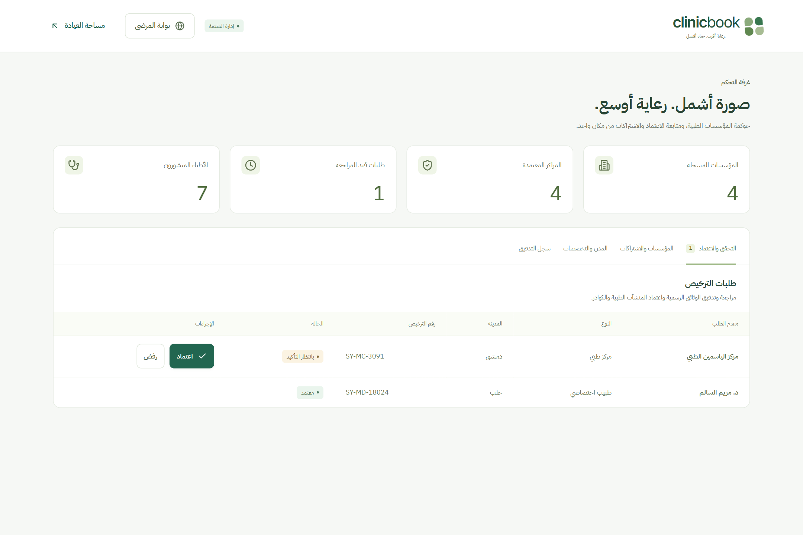
  </a>
</p>

- **اعتماد المنشآت:** مراجعة البيانات المدخلة وتغيير حالة الاعتماد مع سبب الرفض؛ ليست خدمة KYC حكومية.
- **سجل التدقيق:** triggers تسجل تغييرات ملتزمة دون نسخ القيم السريرية؛ عملاء التطبيق لا يكتبونه أو يعدلونه. ليس حماية ضد مالك قاعدة البيانات أو تسرب مفتاح إداري، والصفوف القديمة ليست دليل اعتماد أو دفع.
- **إدارة المراجع:** تحديث قائمة التخصصات والمدن؛ الأحياء معروضة ضمن بيانات الفروع وليست سجل اعتماد حكومي.

---

### 12. المهام التشغيلية المجدولة (Retention Cron)

توفر المنصة نقطة نهاية `GET/POST /api/cron/retention`. وجودها وملف الجدولة لا يثبت تشغيلها على منصة منشورة أو انخفاض التخلف عن الحضور:

- **الإنتاج:** RPC ذرية للانتهاء، التخلف بشروط، إشعار داخلي للمواعيد المؤكدة خلال 24 ساعة، انتهاء الاشتراك وأرشفة السجلات المؤهلة؛ لا إرسال SMS أو WhatsApp ولا متابعة علاجية ذاتية.
- **المصادقة:** سر صريح `CRON_SECRET` ومقارنة `timingSafeEqual`؛ النتائج أعداد فقط، والتكرار لا يضاعف التذكيرات.
- **التشغيل:** `vercel.json` يطلب التنفيذ كل ساعة؛ يجب التحقق من إعداد الأسرار ودعم خطة الاستضافة. demo يحاكي الفحص والانتهاء، وليس جميع وظائف SQL.

---

### 13. التخطيط المتجاوب (Mobile Responsive)

توجد قواعد CSS متجاوبة واختبارات منتقاة لواجهات الجوال، منها قياس نصوص الرئيسية عند 360px و390px وصور الأطباء على desktop/mobile. لم تُختبر كل صفحة وكل حالة عبر جميع القياسات أو قارئات الشاشة.

<p align="center">
  <a href="docs/screenshots/showcase/mobile-01-home.png">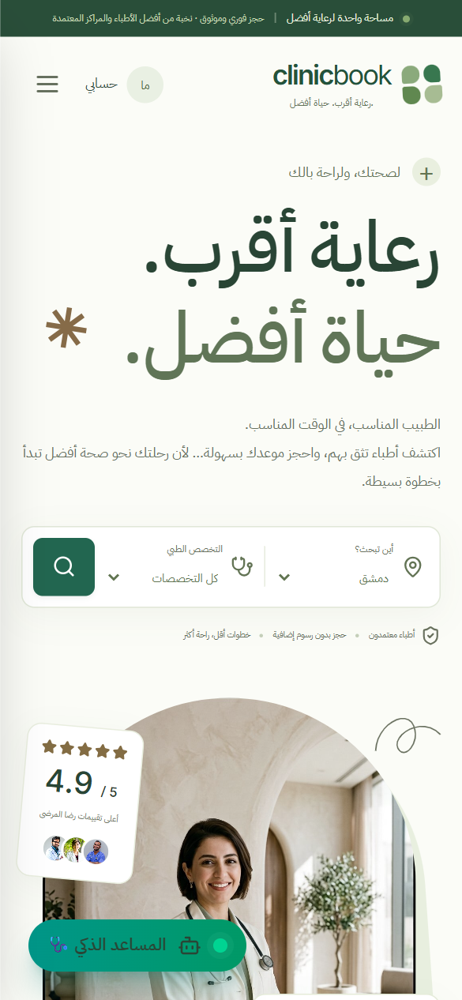</a> &nbsp;
  <a href="docs/screenshots/showcase/mobile-02-search.png">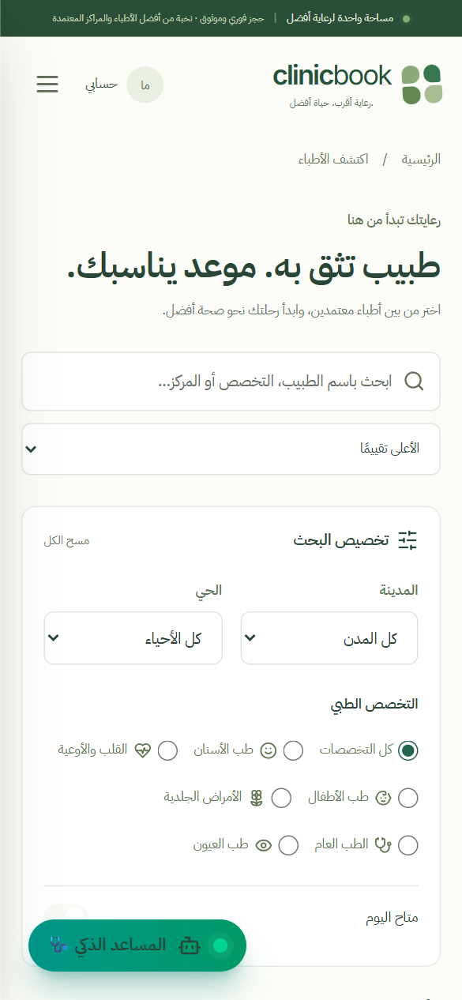</a> &nbsp;
  <a href="docs/screenshots/showcase/mobile-03-dashboard.png">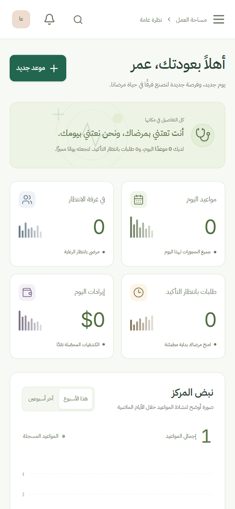</a>
</p>

---

## البنية المعمارية للنظام

يعتمد ClinicBook بنية طبقية محكمة تفصل بين واجهات العرض، ومنطق الأعمال الصارم، وطبقة البيانات المعزولة:

```text
┌────────────────────────────────────────────────────────────────────────┐
│                   واجهات المستخدم وتجربة المريض والكادر                 │
│      Next.js 15 App Router • React 19 • Tailwind 4 • Motion • Radix     │
│             (RTL Arabic • Self-hosted Fonts and Demo Images)            │
└───────────────────────────────────┬────────────────────────────────────┘
                                    │
                                    ▼
┌────────────────────────────────────────────────────────────────────────┐
│                 طبقة منطق الأعمال والتحقق وقواعد الأمان                │
│       • محرك الفترات (Slots Engine): Asia/Damascus → UTC Intervals     │
│       • آلة حالات الموعد (Lifecycle Machine): Pending → Confirmed → …  │
│       • حراسة الصلاحيات (RBAC Guards): فصل السجل الطبي عن الإدارة      │
│       • التحقق الصارم للمدخلات: Zod Schemas + Excel Injection Defense   │
└──────────────────┬──────────────────────────────────┬──────────────────┘
                   │                                  │
         (وضع العرض والتطوير)                 (الإنتاج السحابي)
                   ▼                                  ▼
┌──────────────────────────────────────┐  ┌──────────────────────────────┐
│       محرك SQLite المحلي السريع      │  │    PostgreSQL 17 + Supabase  │
│   • Better-SQLite3 (WAL Mode)        │  │  • Row-Level Security (RLS)  │
│   • معاملات فورية حصرية (IMMEDIATE)  │  │  • دوال RPC الذرية           │
│   • تحقق تعارض ضمن معاملة الحجز      │  │  • سجل تدقيق لتغييرات البيانات │
└──────────────────────────────────────┘  └──────────────────────────────┘
```

---

## مصفوفة الصلاحيات

يطبق النظام مبدأ الامتيازات الأقل (**Principle of Least Privilege**) لضمان سرية السجلات الصحية وعزل مهام الكادر:

| الدور              |   رمز الدور    |                صلاحيات المواعيد                |     السجل الطبي والتشخيص      |  إدارة الكادر والفروع   |          المالية والاشتراكات           |
| :----------------- | :------------: | :--------------------------------------------: | :---------------------------: | :---------------------: | :------------------------------------: |
| **مدير المركز**    | `clinic_owner` | عرض مواعيد المركز وتأكيد/رفض/إلغاء وفق السياسة |           🚫 محظور            |  إدارة الكادر والفروع   | طلب ترقية الاشتراك؛ التحصيل ضمن النطاق |
| **الطبيب المعالج** |    `doctor`    |             عرض وجدولة مواعيده فقط             | ✅ إنشاء وتعديل الوصفة والسجل |        🚫 محظور         |     الاطلاع على إيرادات عيادته فقط     |
| **موظف الاستقبال** | `receptionist` |      الحجز، التأكيد وتسجيل الوصول في فرعه      |           🚫 محظور            |        🚫 محظور         |          تحصيل نقدي ضمن فرعه           |
| **المريض**         |   `patient`    |   حجز مواعيده ومتابعتها وإلغاؤها وفق السياسة   |     عرض السجل المسموح له      |        🚫 محظور         |       عرض رسوم وحالة دفع الموعد        |
| **مدير المنصة**    | `super_admin`  |          🚫 مواعيد المستأجرين محظورة           |           🚫 محظور            | اعتماد المنشآت والأطباء |        تفعيل الاشتراكات إداريًا        |

هذه حدود التطبيق وحسابات `authenticated`، لا قيود على مالك قاعدة البيانات. رؤية المريض لسجله مشروطة بسياسة الظهور. مصدرها `canAccess` و`canTransition` وسياسات SQL المشار إليها في [مصفوفة التتبع](docs/TRACEABILITY.md).

---

## التشغيل والإعداد المحلي

### المتطلبات الأساسية

- **Node.js**: الإصدار 22.12.0 أو أحدث ضمن سلسلة 22 (`^22.12.0` في `package.json`).
- **npm**: الإصدار 10 أو أحدث.

> ⚠️ **قيود النشر والإنتاج (Deployment Constraints)**:
>
> - **الإنتاج (`CLINICBOOK_MODE=production`)**: يستخدم Supabase Auth/PostgreSQL وRedis مشتركًا. اختبارات build/start تستخدم خدمات معزولة؛ توافق النشر الفعلي يحتاج staging. CI يفحص PostgreSQL 17، بينما `supabase/config.toml` ما زال يحدد 16؛ المطابقة والتحقق على بيئة الهدف بند متبقٍ.
> - **demo (`CLINICBOOK_MODE=demo`)**: للتطوير والعرض المحلي عبر `npm run dev` بقرص قابل للكتابة. الكود يرفضه عند `NODE_ENV=production` حتى على استضافة ذات قرص؛ لا تستخدم `npm run build` / `npm start` لتشغيل demo.

### خطوات التثبيت والتشغيل السريع

```bash
# 1. تثبيت حزم الاعتماديات بدقة
npm ci

```

أنشئ `.env.local` محليًا بالقيم التالية للعرض فقط (لا تكتب فوق ملف أسرار موجود). `.env.example` افتراضيًا للإنتاج، فلا تنسخه كما هو لتجربة demo:

```dotenv
CLINICBOOK_MODE=demo
NEXT_PUBLIC_APP_URL=http://localhost:3000
COOKIE_SECURE=false
```

ثم:

```bash
npm run db:seed
npm run dev
```

افتح `http://localhost:3000`. البيانات تُنشأ محليًا ولا تأتي قاعدة SQLite من Git. مزود AI اختياري للإرشاد النصي، وليس شرطًا للبحث والحجز التجريبي.

### تجربة الأدوار التفاعلية الجاهزة

في demo المحلي يمكنك تجربة الأدوار الخمسة من `/login` دون إنشاء حساب؛ هذه الأزرار لا تمنح صلاحيات في الإنتاج:

1. **مدير المركز:** استكشف لوحة التحكم، إدارة الفروع، وإعدادات المركز.
2. **الطبيب:** افتح مواعيد اليوم واكتب تشخيصاً ووصفة دوائية قابلة للطباعة.
3. **موظف الاستقبال:** جرّب تسجيل وصول مراجع وتحصيل الكشفية نقدياً.
4. **المريض:** احجز موعدًا وتابع مهلة انتهاء الحجز المعلّق وسياسة الإلغاء.
5. **مدير المنصة:** راجع طلبات المراكز الجديدة وسجل التدقيق الأمني الشامل.

---

## منظومة الاختبارات والتحقق الهندسي

يحتوي المستودع اختبارات وحدة وتكامل ومتصفح وقاعدة بيانات. وجود الاختبارات أو أسماء TDD لا يثبت أن جميع الميزات طُورت اختبارًا أولًا، ولا يضمن خلو النظام من العيوب:

```bash
# 1. التحقق من سلامة الأنواع البرمجية (TypeScript Strict)
npm run typecheck

# 2. قواعد ESLint واختبارات الوحدة/التكامل مع حدود التغطية
npm run lint
npm run test:coverage

# 3. تجربة HTTP منفصلة؛ ليست قياس سعة، وقد ترفض الطلبات بسبب حد المعدل
# يتطلب خادم demo محليًا يعمل في طرفية أخرى
npm run test:concurrency

# 4. اختبارات المتصفح الشاملة وإمكانية الوصول (Playwright)
npm run test:e2e

# 5. فحوص axe المنتقاة، وليست شهادة امتثال شاملة
npx playwright test tests/e2e/accessibility.spec.ts

# 6. بناء وتشغيل production مع تجهيزات Supabase/Redis معزولة
npm run test:production
```

### سجل التحقق والنتائج المؤكدة:

النتائج التالية تخص مراجعة `1c84859` بتاريخ 2026-11-13، وليست أرقامًا دائمة لكل إصدار. نطاقها موضح في [QUALITY_GATES.md](docs/QUALITY_GATES.md):

- **269/269 وحدة وتكامل** عبر 21 ملفًا؛ تغطية 78.43% تعليمات، 60.84% فروع، 82.51% دوال، 80.01% أسطر ضمن ملفات المكتبات وAPI وagent، لا كامل شيفرة الواجهة.
- **38/38 متصفح demo**، منها 11 اختبار axe تغطي 10 مسارات وحالة درج المساعد؛ الدخول يفحص تبويب التسجيل أيضًا. النجاح لا يعني امتثال WCAG شاملًا.
- **16/16 بناء/متصفح إنتاج** مع تجهيزات بروتوكول محلية، لا مصادقة Supabase أو Upstash حقيقيين.
- **PostgreSQL 17:** `tests/postgres/verify.ts` يفحص RLS/RPC و50 محاولة حجز متنافسة (ناجح واحد والباقي `23P01`). هذا منفصل عن HTTP وحد المعدل ذي سعة 10 طلبات وإعادة تعبئة خلال دقيقة.
- **قيود متبقية:** اختبارات الترقية والاستعادة، التكامل الحقيقي، ومراجعة وصول يدوية على مزيد من الحالات. إعداد قاعدة اختبار PostgreSQL موضح في [POSTGRES_TESTING.md](docs/POSTGRES_TESTING.md)؛ لا تشغّل bootstrap على قاعدة حقيقية.

---

## الهيكلية البرمجية للمشروع

```text
clinicbook/
├── docs/                       # التوثيق الأكاديمي، التقارير، ولقطات الشاشة
│   ├── ACADEMIC_REPORT.md      # التقرير الأكاديمي الموسع للمشروع (ASPU)
│   ├── COMPREHENSIVE_PROPOSAL.md # المقترح المتكامل وخطة العمل
│   ├── ACCESSIBILITY_AUDIT_REPORT.md # نطاق فحوص الوصولية المنتقاة
│   ├── AI_AGENT_EVE_BLUEPRINT.md     # التنفيذ الحالي مقابل أفكار الوكيل المستقبلية
│   ├── TRACEABILITY.md         # المتطلبات والادعاءات مقابل الشيفرة والاختبارات
│   └── screenshots/showcase/   # لقطات توضيحية سابقة لبيئة demo
├── public/                     # الأصول الثابتة والصور والخطوط المحلية
│   ├── fonts/                  # خطوط IBM Plex Sans Arabic وInter المحلية
│   └── images/                 # صور توضيحية تجريبية والهوية البصرية
├── src/
│   ├── app/                    # مسارات Next.js App Router وواجهات API
│   ├── components/             # مكونات الواجهة مقسمة وظيفياً
│   │   ├── clinical-pages.tsx  # السجل الطبي، العيادة الرقمية، بوابة المريض
│   │   ├── management-pages.tsx # إدارة المركز، الفريق، والتقارير
│   │   ├── public-pages.tsx    # الرئيسية، محرك البحث، وملف الطبيب
│   │   └── shared.tsx          # عناصر واجهة المستخدم المشتركة (Radix/Tailwind)
│   └── lib/
│       ├── auth/               # إدارة الجلسات وصلاحيات الأدوار (RBAC)
│       ├── services/           # محرك الفترات وآلة حالات الموعد
│       ├── demo-db.ts          # محرك بيانات SQLite للبيئة المحلية
│       └── supabase/           # عملاء ومحولات Supabase وقواعد البيانات
├── supabase/migrations/        # مخططات SQL وسياسات الأمان RLS ودوال RPC
└── tests/                      # حزم اختبارات Vitest وPlaywright وPostgreSQL
```

---

## التوثيق الأكاديمي والمراجع

يمثل هذا المشروع تطبيقاً هندسياً عملياً أُعدّ كمشروع فصلي ضمن متطلبات كلية هندسة الحاسوب:

- **الجهة الأكاديمية:** جامعة أنطاكية السورية الخاصة (**ASPU**) — كلية هندسة الحاسوب.
- **إعداد المهندسين:** عمرو إبراهيم ليلا • سامر غصن.
- **إشراف:** د. لينا عرار.

### المراجع والتقارير المتوفرة في المستودع:

- 📄 **التقرير الأكاديمي الكامل:** [`docs/ACADEMIC_REPORT.md`](docs/ACADEMIC_REPORT.md) — [نسخة HTML منسقة للطباعة](docs/ACADEMIC_REPORT.html)
- 📑 **المقترح التقني المتكامل:** [`docs/COMPREHENSIVE_PROPOSAL.md`](docs/COMPREHENSIVE_PROPOSAL.md) — [نسخة HTML](docs/COMPREHENSIVE_PROPOSAL.html)
- 🤖 **المخطط الهندسي للمساعد الذكي Eve:** [`docs/AI_AGENT_EVE_BLUEPRINT.md`](docs/AI_AGENT_EVE_BLUEPRINT.md)
- ♿ **تقرير تدقيق إمكانية الوصول (WCAG 2.1 AA):** [`docs/ACCESSIBILITY_AUDIT_REPORT.md`](docs/ACCESSIBILITY_AUDIT_REPORT.md)
- 🖼️ **معرض لقطات الشاشة الكامل:** [`docs/screenshots/README.md`](docs/screenshots/README.md)
- 🔒 **دليل اختبارات PostgreSQL RLS المعزولة:** [`docs/POSTGRES_TESTING.md`](docs/POSTGRES_TESTING.md)
- 🔎 **مصفوفة تتبع المتطلبات والادعاءات:** [`docs/TRACEABILITY.md`](docs/TRACEABILITY.md)
- 📘 **مصطلحات المؤسسة والفرع والموعد:** [`GLOSSARY.md`](GLOSSARY.md)

---

## خارطة الطريق والجاهزية الإنتاجية

يوضح الجدول ما يوجد في الشيفرة وما لم يُنفذ أو يُتحقق منه بعد؛ كلمة «مختبر» تخص السيناريوهات المذكورة، لا جاهزية الاستخدام السريري:

| المكون                     |     الحالة الحالية     | المتطلب للإنتاج السحابي الكامل                                                |
| :------------------------- | :--------------------: | :---------------------------------------------------------------------------- |
| **محرك الفترات والحجز**    | تنفيذ واختبارات معزولة | ترقية staging وتزامن وحمل ممثلان لبيئة الهدف.                                 |
| **السجل الطبي والوصفة**    | سجل مبسط وطباعة متصفح  | مراجعة سريرية وقانونية؛ لا توقيع أو رمز تحقق أو FHIR/HL7.                     |
| **عزل الصلاحيات (RBAC)**   |   حراس وRLS مختبران    | Supabase Auth والدعوات وإلغاء الوصول وRealtime حقيقية.                        |
| **بوابة الدفع الإلكتروني** |  ⚠️ تسوية نقدية محلية  | تكامل مع مزود دفع سحابي (Stripe / بوابات محلية عبر Webhooks).                 |
| **الإشعارات والتذكير**     |   ⚠️ تنبيهات داخلية    | ربط بوابات SMS وWhatsApp الرسمية ورسائل البريد التلقائية.                     |
| **المرفقات الطبية**        |       غير منفذة        | تصميم التخزين وسياسات الوصول؛ لا يوجد رفع ملفات محلي أو سحابي في هذا الإصدار. |

---

<div align="center">
  <sub>مشروع فصلي تعليمي • بيانات العرض اصطناعية • ClinicBook © 2026</sub>
</div>
