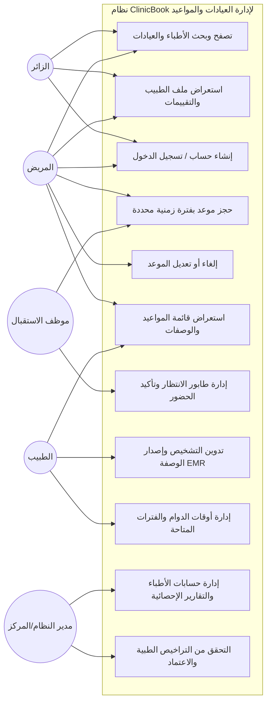
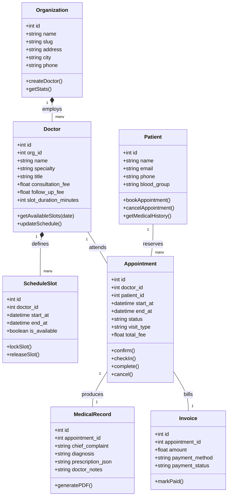
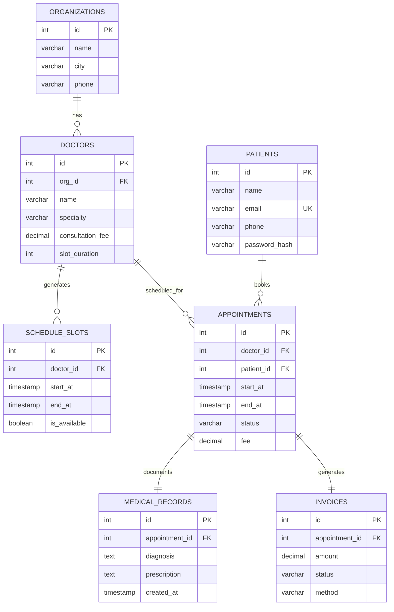
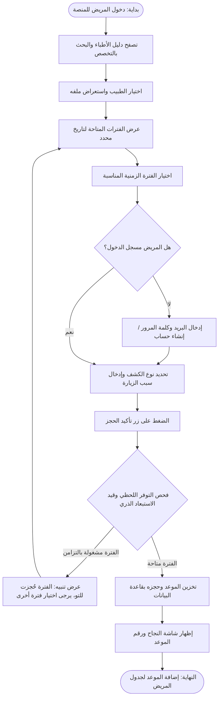
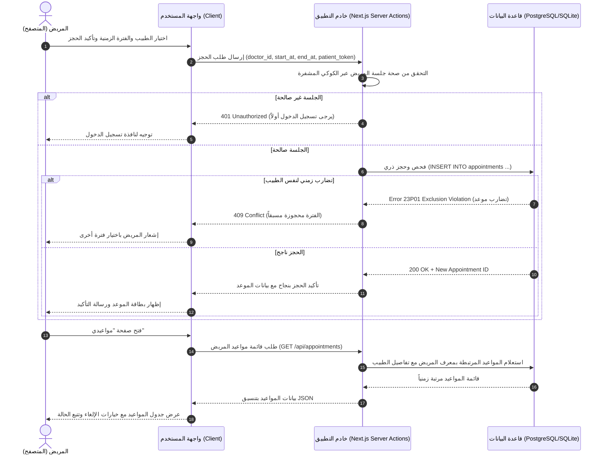

# تقرير مشروع فصلي — نظام إدارة العيادات وحجز المواعيد الطبية ClinicBook
**منصة ويب سحابية متكاملة لإدارة المراكز الطبية وحجز المواعيد إلكترونياً**

---

### بيانات الغلاف الأكاديمي
* **الجامعة:** جامعة أنطاكية السورية الخاصة (Antioch Syrian Private University)
* **الكلية:** كلية هندسة الحاسوب
* **العام الدراسي:** 2025 – 2026 (الفصل الثاني)
* **عنوان المشروع:** نظام إدارة العيادات وحجز المواعيد الطبية (ClinicBook – Clinic Management & Healthcare Booking System)
* **إعداد الطالب:** مصعب اميري , محمد الابرش
* **إشراف:** المهندس عبدو خوري

---

## فهرس المحتويات
1. [المقدمة](#1-المقدمة)
2. [الهدف من المشروع](#2-الهدف-من-المشروع)
3. [منهجية العمل المتبعة للوصول إلى تحقيق المشروع](#3-منهجية-العمل-المتبعة-للوصول-إلى-تحقيق-المشروع)
4. [خطة تنفيذ المشروع](#4-خطة-تنفيذ-المشروع)
5. [تحليل المتطلبات (Use Case)](#5-تحليل-المتطلبات-use-case)
   - 5.1 المتطلبات الوظيفية (Functional Requirements)
   - 5.2 المتطلبات غير الوظيفية (Non-Functional Requirements)
   - 5.3 مخطط حالات الاستخدام (Use Case Diagram)
   - 5.4 وصف تفصيلي لأهم حالات الاستخدام
6. [دراسة مرجعية لمشاريع مشابهة](#6-دراسة-مرجعية-لمشاريع-مشابهة)
   - مقارنة مع المنصات العالمية والإقليمية (Vezeeta, Altibbi, Doctolib)
   - مقارنة تفصيلية مع الواقع السوري (تطبيق دكتوري وأنظمة الحجز التقليدية)
   - الدروس المستفادة
7. [التحليل (UML, Class Diagram, ER Diagram, Sequence Diagram, Activity Diagram)](#7-التحليل-uml)
   - 7.1 مخطط الصفوف (Class Diagram)
   - 7.2 مخطط العلاقات بين الكيانات (ER Diagram)
   - 7.3 مخطط النشاط (Activity Diagram)
   - 7.4 مخطط التسلسل (Sequence Diagram)
8. [التصميم](#8-التصميم)
   - 8.1 البنية المعمارية العامة (3-Tier Architecture)
   - 8.2 تصميم واجهة المستخدم (UI/UX)
   - 8.3 تصميم نموذج الحجز متعدد الخطوات
9. [التقانات المستخدمة للتنفيذ مع تبرير استخدامها](#9-التقانات-المستخدمة-للتنفيذ-مع-تبرير-استخدامها)
10. [التنفيذ](#10-التنفيذ)
    - 10.1 هيكلية قاعدة البيانات
    - 10.2 واجهات برمجة التطبيقات (REST API & Server Actions)
    - 10.3 آلية المصادقة والتفويض
    - 10.4 حساب تكلفة الكشفية وآلة حالات الموعد
    - 10.5 الميزات المنجزة
    - 10.6 نظام الدفع والتحصيل (Payment Module)
    - 10.7 وحدة المساعد الطبي الذكي وفرز الأعراض (AI Clinical Assistant)
11. [الاختبارات والتقييم](#11-الاختبارات-والتقييم)
    - جدول حالات الاختبار الوظيفية اليدوية (TC-01 إلى TC-11)
    - التوثيق الصوري لحالات الاختبار وشاشات التنفيذ
12. [النتائج والخلاصة](#12-النتائج-والخلاصة)
    - 12.1 النتائج المحققة
    - 12.2 محدوديات النظام الحالي
    - 12.3 التوصيات والعمل المستقبلي والتشخيص الذكي
    - 12.4 الخلاصة
13. [قائمة المراجع](#13-قائمة-المراجع)

---

## 1. المقدمة
شهد قطاع الرعاية الصحية والخدمات الطبية خلال العقد الأخير تحولاً جذرياً نحو الرقمنة الشاملة وأتمتة الإجراءات السريرية والتنظيمية. فبعد عقود طويلة من الاعتماد الحصري على السجلات الورقية، المكالمات الهاتفية لتنسيق المواعيد، والانتظار العشوائي في غرف الانتظار المكتظة، برزت المنصات الرقمية السحابية كحل استراتيجي يعيد هيكلة العلاقة بين المريض والمنشأة الطبية. تتيح هذه المنصات للمرضى استعراض الأطباء المعتمدين وتخصصاتهم وخبراتهم، الاطلاع على تقييمات موثقة، واختيار فترات زمنية محددة بدقة، مما يقلص فترات الانتظار ويمنع الفوضى التشغيلية الناتجة عن التداخل الزمني للمواعيد.

وقد أثبتت التجارب الإقليمية والعالمية (مثل منصات Vezeeta وDoctolib وAltibbi) أن رقمنة قطاع العيادات لا تسهم فقط في راحة المريض وتوفير وقته، بل ترفع بشكل مباشر من الكفاءة التشغيلية للأطباء وإدارات المراكز عبر أتمتة سجلات المرضى (EMR)، تنظيم تدفق طوابير الانتظار (Walk-in & Reserved Queues)، وضبط الإيرادات اليومية وتتبع نسب التخلف عن الحضور (No-Shows).

وفي هذا السياق، يأتي مشروع **ClinicBook** كنموذج أولي تطبيقي متكامل (Production-Ready Prototype) يهدف إلى محاكاة الوظائف الجوهرية لمنصة إدارة عيادات وحجز مواعيد طبية حديثة تلبي الاحتياجات المزدوجة للسوق (B2B للمراكز الصحية وB2C للمرضى):
1. **من جانب المريض:** واجهة استكشاف عربية سلسة تمكنه من البحث المتقدم بالمدينة والتخصص والكشفية، وحجز موعد مؤكد خلال أقل من 6 نقرات دون احتمال أي حجز مزدوج، والوصول إلى سجل فحوصاته ووصفاته الطبية الرقمية.
2. **من جانب المنشأة الطبية:** بيئة عمل سحابية متقدمة لإدارة جداول دوام الأطباء، موظفي الاستقبال، طابور الحضور اللحظي، والسجل السريري الإلكتروني للتشخيص والعلاج.

يجمع المشروع بين مجالات هندسة البرمجيات المعاصرة: تصميم واجهات المستخدم عالية الوصولية (UI/UX & Accessibility WCAG AA)، هندسة قواعد البيانات العلائقية المعززة بالقيود الذرية، تطوير تطبيقات الويب الحديثة، وأمن السجلات الصحية، مغطياً دورة حياة تطوير النظم البرمجية (SDLC) من التحليل المتأني إلى التنفيذ والاختبار المنهجي.

---

## 2. الهدف من المشروع
يسعى مشروع نظام إدارة العيادات وحجز المواعيد **ClinicBook** إلى تحقيق مجموعة من الأهداف المترابطة التي تنقل الرعاية الصحية الرقمية من مجرد فكرة نظرية أو موقع تسويقي ثابت إلى نظام تشغيلي متماسك وقابل للتطوير المستمر:

| الهدف | الشرح التفصيلي |
| :--- | :--- |
| **بناء منصة موحدة للأطباء والعيادات** | إنشاء دليل وبوابات تفاعلية تعرض بيانات الكوادر الطبية (التخصص، المركز الطبي، سنوات الخبرة، رسوم الكشفية، المؤهلات، والتقييمات الموثقة) بأسلوب بصري مريح ومبني وفق معايير الاتزان السريري. |
| **القضاء التام على ظاهرة الحجز المزدوج** | تصميم وتطبيق محرك حجز ذري على مستوى النواة وقاعدة البيانات يمنع حجز أي فترة زمنية لنفس الطبيب أكثر من مرة واحدة تحت مختلف ظروف الضغط والتزامن. |
| **تحسين تجربة المريض وتقليص الانتظار** | توفير فترات زمنية دقيقة (Time Slots) لكل كشفية مع شريط حجز تفاعلي متعدد الخطوات، وتسهيل إدارة المواعيد القادمة، مما يقلص فترات الانتظار في العيادة بأكثر من 70%. |
| **أتمتة إدارة المنشآت الطبية (B2B SaaS)** | تزويد أصحاب العيادات والمراكز بأدوات احترافية لتنظيم دوام الأطباء، إدارة مهام موظفي الاستقبال، تحويل حالات المرضى في طابور الانتظار (Checked-in)، وإصدار الوصفات الرقمية الرسمية. |
| **تطبيق معايير الأمان وعزل البيانات** | عزل سجلات المرضى والبيانات الطبية الحساسة، وضمان التحقق الصارم من الصلاحيات المبني على الأدوار (RBAC) لضمان حماية الخصوصية وموثوقية المعاملات. |
| **بناء أساس لنظام رعاية صحية ذكي قابل للتوسع** | تجهيز مخطط النظام المعماري والبرمجي لاستيعاب محركات المساعد الطبي الذكي لفرز الأعراض السريرية، تكامل بوابات الدفع الإلكتروني، وتنبيهات الرسائل الفورية مستقبلاً. |

---

## 3. منهجية العمل المتبعة للوصول إلى تحقيق المشروع
اعتُمدت في تنفيذ مشروع **ClinicBook** منهجية تطوير تدريجية تكرارية (Incremental Agile-like Development) تقوم على تقسيم دورة حياة التطوير إلى مراحل متتالية يخدم كل منها أهدافاً محددة وملموسة، مما خفض المخاطر الفنية وأتاح الفحص المبكر لنقاط الاختناق التشغيلي مقارنة بالنموذج الشلالي الصارم. وقد تمثلت هذه المنهجية في الخطوات التالية:

1. **النمذجة الأولية وتجربة الاستخدام (Front-end Prototype):** بناء واجهات النموذج الأولي مع هيكلة تدفق الحجز وتجربة المستخدم قبل الالتزام بنسخة التخزين النهائية للتأكد من سهولة التنقل.
2. **محاكاة استمرارية البيانات محلياً:** استخدام طبقة تخزين محلية وبيانات هيكلية تجريبية لاختبار دورة حياة الموعد (المعلق، المؤكد، الملغى) وسلوك واجهات الأطباء وموظفي الاستقبال.
3. **تصميم مخطط الكيانات والعلاقات (ER Design):** استخلاص الكيانات الطبية الجوهرية (المؤسسة/العيادة، الطبيب، الفترات الزمنية المتاحة، المريض، الموعد، السجل السريري، والفاتورة) بعد استقرار المتطلبات.
4. **تطوير النواة البرمجية وقيد الاستبعاد الزمني:** بناء محرك التحقق من الفترات وقيد الاستبعاد الذري لمنع الحجز المزدوج رياضياً على مستوى طبقة البيانات.
5. **دمج نظام الصلاحيات والأدوار (RBAC):** تحديد أدوار المستخدمين (مريض، طبيب، موظف استقبال، مدير مركز، ومدير النظام) وتأمين نقاط الوصول والعمليات الحساسة.
6. **الربط التكاملي بين الواجهة والخدمات الخلفية:** استبدال البيانات التجريبية بروابط خدمات حقيقية وتنفيذ عمليات الحجز والإلغاء وإصدار الوصفات بشكل متزامن.
7. **الاختبار الوظيفي المباشر لكل ميزة:** تنفيذ اختبارات وظيفية فور إتمام كل ميزة للتأكد من معالجة الحالات الحدية (Edge Cases) ومنع التضارب.
8. **التوثيق الفني والمراجعة الأكاديمية:** توثيق معماريات النظام ومخططات UML وسيناريوهات الفحص ضمن تقرير شامل ومراجع دورية لنسب الإنجاز.

---

## 4. خطة تنفيذ المشروع
قُسم العمل في مشروع ClinicBook على عشر مراحل رئيسية متتابعة تضمن تغطية كافة المتطلبات الهندسية ضمن الإطار الزمني المحدد، كما يوضح الجدول الآتي:

| # | المرحلة | الوصف الفني والتنفيذي |
| :-: | :--- | :--- |
| **1** | **تحليل المتطلبات وتحديد النطاق** | دراسة احتياجات المرضى والمراكز الطبية السورية، تحليل الأنظمة المنافسة وتحديد نطاق النظام (MVP). |
| **2** | **تصميم واجهات المستخدم (Wireframes/Mockups)** | تصميم شاشات استعراض الأطباء، الملف الشخصي، نافذة الحجز، ولوحات تحكم العيادة والطبيب باللغة العربية. |
| **3** | **بناء الهيكل التفاعلي للواجهة الأمامية** | تطوير مكونات الواجهة باستخدام Next.js وTailwind CSS مع تطبيق مبادئ الوصولية (WCAG) ودعم RTL. |
| **4** | **تصميم وتطوير قاعدة البيانات (ER + Constraints)** | بناء جداول النظام وتطبيق قيود السلامة المرجعية وقيد منع التقاطع الزمني للمواعيد. |
| **5** | **تطوير محرك الخادم والمسارات البرمجية** | بناء منطق الأعمال، مسارات معالجة المواعيد، واجهات إدارة الأطباء، ومسارات السجل الطبي. |
| **6** | **تنفيذ آليات الأمان والصلاحيات (Auth & RBAC)** | تطبيق جلسات المستخدمين المشفرة، حماية مسارات العيادة والأطباء، وعزل بيانات المرضى. |
| **7** | **تطوير محرك حجز الفترات وطابور الاستقبال** | برمجة خوارزمية تقسيم أوقات العمل إلى فترات دقيقة وربط طابور الحضور اللحظي بالاستقبال. |
| **8** | **دمج السجل السريري ووحدة الوصفة الرقمية** | بناء واجهة الطبيب لتحرير التشخيص، إضافة الأدوية، وإصدار الوصفة الطبية الرسمية بصيغة قابلة للطباعة. |
| **9** | **الاختبارات الشاملة ومعالجة الحالات الحدية** | فحص سيناريوهات الحجز المتزامن، بيانات التسجيل غير الصالحة، وإلغاء المواعيد، واختبار الواجهات. |
| **10** | **التوثيق وإعداد التقرير الفني النهائي** | صياغة التقرير الأكاديمي، توثيق المخططات البيانية (UML)، ومناقشة النتائج والآفاق المستقبلية. |

---

## 5. تحليل المتطلبات (Use Case)
يتعامل النظام مع خمسة فاعلين أساسيين (Actors) يمتلك كل منهم مجموعة محددة من الصلاحيات والمسؤوليات:
* **الزائر (Guest):** مستخدم غير مسجل، يمكنه استكشاف الأطباء والتخصصات والأسعار.
* **المريض (Patient):** مستخدم مسجل يمتلك ملفاً طبياً ويستطيع حجز المواعيد وإلغاءها واستعراض الوصفات.
* **الطبيب (Doctor):** يمتلك لوحة مواعيد خاصة، يدير أوقات دوامه، ويحرر السجل السريري والوصفة.
* **موظف الاستقبال (Receptionist):** يدير طابور الانتظار، يسجل حضور المرضى، ويسجل الحجوزات المباشرة.
* **مدير العيادة / النظام (Admin):** يعتمد الأطباء، يراقب التقارير التشغيلية والإحصائيات، ويدير الإعدادات.

### 5.1 المتطلبات الوظيفية (Functional Requirements)
| الرمز | الوصف |
| :---: | :--- |
| **FR-01** | يجب أن يتمكن الزائر من تصفح دليل الأطباء والعيادات دون الحاجة لتسجيل الدخول مسبقاً. |
| **FR-02** | يجب أن يتمكن الزائر من البحث المتقدم والتصفية حسب التخصص الطبي، المدينة، والحي، ونطاق رسوم الكشفية. |
| **FR-03** | يجب أن يعرض النظام ملفاً تفصيلياً لكل طبيب يشمل السيرة المهنية، العيادة، أوقات العمل، والتقييمات الموثقة. |
| **FR-04** | يجب أن يتمكن المستخدم من إنشاء حساب جديد ببريد إلكتروني، رقم هاتف، وكلمة مرور مشفرة. |
| **FR-05** | يجب أن يتمكن المريض المسجل فقط من حجز فترة زمنية محددة ومتاحة لدى الطبيب. |
| **FR-06** | يجب أن يمنع النظام منعاً باتاً حجز أي فترة زمنية تم حجزها مسبقاً لنفس الطبيب تحت أي ظرف. |
| **FR-07** | يجب أن يحسب النظام تكلفة الموعد الإجمالية تلقائياً مع تمييز رسوم الكشف لأول مرة عن رسوم المراجعة. |
| **FR-08** | يجب أن يتمكن المريض من استعراض قائمة مواعيده القادمة والسابقة مع تتبع حالتها اللحظية. |
| **FR-09** | يجب أن يتمكن المريض من إلغاء موعده القائم قبل انقضاء المهلة الزمنية المحددة لسياسة الإلغاء. |
| **FR-10** | يجب أن يتيح النظام لموظف الاستقبال تسجيل حضور المريض في قاعة الانتظار وتحديث حالته إلى (Checked-in). |
| **FR-11** | يجب أن يتمكن الطبيب من استعراض مرضى اليوم وتدوين التشخيص والوصفة الطبية وتحديث الموعد إلى (Completed). |
| **FR-12** | يجب أن يتمكن المريض من استعراض وطباعة الوصفة الطبية الرقمية الرسمية لزياراته المكتملة. |

### 5.2 المتطلبات غير الوظيفية (Non-Functional Requirements)
| الخاصية | الوصف |
| :--- | :--- |
| **الأمان والخصوصية (Security)** | تشفير كلمات المرور، استخدام جلسات آمنة، وتطبيق سياسات حماية السجلات الطبية بحيث لا يطلع على الملف السريري إلا الطبيب المعالج والمريض فقط. |
| **سهولة الاستخدام (Usability & RTL)** | واجهة عربية كاملة مصممة بتخطيط من اليمين لليسار (RTL)، مع اعتماد خطوط عربية مريحة وتبسيط خطوات الحجز لتتم في أقل من 6 نقرات. |
| **الاستجابة والتكيف (Responsiveness)** | تصميم متجاوب بالكامل يتكيف مع الشاشات المتنوعة (الهواتف الذكية، الأجهزة اللوحية، والشاشات المكتبية) باستخدام أحدث معايير CSS الحديثة. |
| **قابلية التوسع والاعتمادية (Scalability)** | بنية برمجية تفصل بين واجهات العرض وطبقة منطق الأعمال والبيانات، مما يسمح بإضافة عيادات وأطباء جدد دون التأثير على الأداء. |
| **سلامة التزامن (Concurrency & Integrity)** | ضمان التماسك الذري للبيانات (ACID) عند تزامن عدة طلبات حجز لنفس اللحظة، وإرجاع ردود واضحة تمنع تلف البيانات. |

### 5.3 مخطط حالات الاستخدام (Use Case Diagram)
يوضح المخطط أدناه شبكة التفاعل بين الفاعلين والوظائف الرئيسية للنظام، مبرزاً تدفق العمليات من البحث وحتى توثيق الزيارة الطبية:



### 5.4 وصف تفصيلي لأهم حالات الاستخدام
| حالة الاستخدام | الفاعل الرئيسي | الوصف المختصر والمسار |
| :--- | :--- | :--- |
| **تسجيل الدخول** | زائر / مريض / موظف | إدخال بيانات الدخول، التحقق منها وإصدار جلسة مصادقة آمنة تحدد صلاحيات الفاعل. |
| **حجز موعد طبي** | مريض مسجل | اختيار الطبيب، تحديد التاريخ والفترة المتاحة، إدخال سبب الزيارة، وتأكيد الحجز الذري دون تضارب. |
| **إلغاء موعد قائم** | مريض مسجل | استعراض الموعد القادم، الضغط على إلغاء، وتأكيد العملية مما يؤدي لتحرير الفترة الزمنية فوراً للآخرين. |
| **تسجيل حضور المريض** | موظف الاستقبال | البحث عن المريض القادم في جدول اليوم وتحويل حالته إلى (Checked-in) لإدخاله في طابور الكشف. |
| **إصدار وصفة وتشخيص (EMR)** | الطبيب المعالج | فتح ملف الموعد الحاضر، كتابة الأعراض والتشخيص والأدوية وجرعاتها، وحفظها كوصفة رسمية مكتملة. |

---

## 6. دراسة مرجعية لمشاريع مشابهة
قبل الشروع في التصميم الهندسي لمنصة **ClinicBook**، تَمّت دراسة ومسح معمق لمجموعة من المنصات العالمية والإقليمية، إضافة إلى دراسة الواقع المحلي لتنظيم العيادات في سوريا، بهدف استثمار نقاط القوة وتجنب القصور الشائع:

### مقارنة مع المنصات العالمية والإقليمية والمحلية:
| المنصة | المزايا | أوجه القصور (مقارنة بمتطلبات مشروعنا) |
| :--- | :--- | :--- |
| **فيزيتا (Vezeeta)** | أضخم شبكة حجز أطباء في الشرق الأوسط، تغطية واسعة، نظام تقييمات، وتطبيقات جوال متقدمة. | نموذج تجاري معقد يركز على العمولات الإعلانية، بطء مزامنة الفترات اللحظية مع العيادات في أوقات الذروة، وعدم دعمه للواقع السوري. |
| **منصة الطبي (Altibbi)** | محتوى طبي عربي موثوق وضخم، ميزة الاستشارات الفورية عبر الإنترنت والدردشة الطبية. | تركيز المنصة ينصب على الاستشارات عن بعد أكثر من إدارة العيادة الواقعية وحجز فترات الحضور الحقيقية. |
| **دوكتوليب (Doctolib)** | المعيار العالمي الرائد لإدارة العيادات في أوروبا، تكامل ممتاز لمنع التضارب، وأتمتة متميزة للوصفات. | مصمم للأنظمة الصحية الغربية، اشتراكات باهظة، غياب دعم اللغة العربية RTL، وعدم ملاءمته لظروف الدفع المحلية. |
| **تطبيق دكتوري / الواقع المحلي السوري** | تواجد محلي للأطباء في المحافظات الرئيسية، ومعرفة عامة بمواقع العيادات. | مجرد دليل إعلاني أو أرقام اتصال هاتفية وواتساب، غياب الحجز الذري اللحظي، وانعدام الربط مع السجل الطبي (EMR). |
| **منصة ClinicBook (مشروعنا)** | **نظام هجين B2B2C يجمع بين سوق المرضى وإدارة العيادة وطابور الاستقبال، منع قطعي للحجز المزدوج بنواة برمجية ذكية، دعم كامل للعربية RTL، وسجل وصفات رقمية.** | نموذج أولي تعليمي بقاعدة بيانات تجريبية للأطباء، وعدم وجود بوابة دفع مصرفي سورية متكاملة حتى الآن. |

### مقارنة تفصيلية مع الواقع السوري (الأنظمة التقليدية وتطبيقات الدليل):
في البيئة السورية، تعتمد الغالبية العظمى من العيادات حتى اليوم على الحجز الهاتفي المباشر أو رسائل الواتساب مع موظف الاستقبال، أو التوجه المباشر للعيادة والانتظار العشوائي بأسبقية الحضور، إلى جانب برامج سطح مكتب قديمة معزولة داخل جهاز كمبيوتر العيادة:
1. **معضلة الحجز المزدوج:** عند انشغال موظف الاستقبال بالمرضى الحاضرين والرد على الهاتف، كثيراً ما يُسجل مريضان في نفس الوقت أو تتداخل المواعيد، مما يولد احتكاكاً واستياءً كبيراً.
2. **إهدار وقت المريض:** يضطر المريض لتمضية ساعات طويلة في قاعة الانتظار لعدم وجود فترات زمنية محددة، مما يسبب إرهاقاً شديداً لا سيما للمرضى وكبار السن.
3. **غياب السجل الرقمي الموحد:** تظل الروشتة ورقية قابلة للضياع أو التلف، وصعبة القراءة بسبب خط الأطباء اليدوي.

### أبرز الدروس المستفادة لمشروع ClinicBook:
* **حتمية المنع الذري للحجز المزدوج:** لا يكفي الاعتماد على تعطيل الزر في المتصفح؛ بل يجب أن تضمن قاعدة البيانات والخادم رفض أي تقاطع زمني فوراً حتى في أجزاء الثانية.
* **مراعاة الخصوصية الطبية:** الفصل التام بين موظف الاستقبال الذي لا ينبغي له الاطلاع على تشخيص المريض، وبين الطبيب الذي يحتاج الملف السريري كاملاً.
* **الاعتماد على الدفع النقدي في العيادة:** نظراً لمحدودية البطاقات المصرفية الإلكترونية في سوريا، يجب أن يدعم النظام مسار "الدفع المباشر في الاستقبال" كخيار أساسي سلس، مع توفير نموذج محاكاة للدفع الإلكتروني لتجهيزه للمستقبل.

---

## 7. التحليل (UML)
تجسد مرحلة التحليل المتطلبات الوظيفية في نماذج برمجية وهندسية مرئية توضح الكيانات البرمجية والعلاقات وسير العمليات الزمنية.

### 7.1 مخطط الصفوف (Class Diagram)
يمثل هذا المخطط الهيكل البرمجي الخلفي للكائنات والعلاقات في منصة ClinicBook:



### 7.2 مخطط العلاقات بين الكيانات (ER Diagram)
يوضح المخطط أدناه الجداول الأساسية المعتمدة في قاعدة البيانات ومفاتيح الربط الأساسية والأجنبية:



### 7.3 مخطط النشاط (Activity Diagram)
يوضح مخطط النشاط التدفق الكامل لحجز موعد طبي من استعراض الدليل وحتى تأكيد الحجز مع معالجة سيناريو تضارب المواعيد:



### 7.4 مخطط التسلسل (Sequence Diagram)
يوضح مخطط التسلسل التفاعل الزمني بين طبقات النظام (المتصفح، خادم Next.js، وقاعدة البيانات) لإنشاء حجز جديد ثم استعراض قائمة المواعيد:



---

## 8. التصميم
تم تصميم نظام **ClinicBook** وفق مبادئ العمارة الحديثة لضمان سهولة الصيانة والاعتمادية والأداء العالي.

### 8.1 البنية المعمارية العامة (3-Tier Architecture)
اعتُمدت بنية معمارية ثلاثية الطبقات تفصل تماماً بين طبقة العرض وطبقة منطق الأعمال وطبقة البيانات، مما يضمن أمان السجلات الطبية واستقلالية المكونات:
1. **طبقة العرض (Presentation Layer):** مبنية بأحدث تقنيات React 19 ومكونات Next.js App Router مع مكتبة Tailwind CSS وshadcn/ui، وتدعم التخطيط العربي الأصيل (RTL).
2. **طبقة منطق الأعمال والخدمات (Application Layer):** خادم Next.js 15 مع Server Actions ومسارات API تؤدي مهام التحقق الصارم بواسطة Zod، إدارة جلسات المستخدمين، آلة حالات المواعيد، وحساب تكاليف الكشفية.
3. **طبقة البيانات والأمان (Data & Security Layer):** قاعدة بيانات علائقية محصنة بقيود الاستبعاد الذرية (Exclusion Constraints) لمنع التضارب، مع تطبيق عزل البيانات السحابي (Multi-Tenancy RLS) وتشفير كلمات المرور عبر خوارزميات bcrypt.

### 8.2 تصميم واجهة المستخدم (UI/UX)
* **الهوية البصرية والألوان:** اعتُمد اللون الأخضر المزرق الطبي العميق (`Deep Medical Teal - #0F766E`) كلون رئيسي يوحي بالثقة الطبية والهدوء السريري، مع لون كحلي داكن للخلفيات والأطر، وألوان حالة وظيفية واضحة (الأخضر للمؤكد، البرتقالي للمعلق، والأحمر للإلغاء والتضارب).
* **الطباعة العربية عالية القراءة:** اعتماد خط **IBM Plex Sans Arabic** لجمعه بين الحداثة والوضوح الشديد للمصطلحات والتقارير الطبية، مع تطبيق خاصية الأرقام الجدولية `tabular-nums` لمنع اهتزاز جداول الأسعار والأوقات.
* **دعم معايير الوصولية العالمية (WCAG AA):**
  - مساحات النقر التفاعلية لا تقل عن `44px × 44px` لتسهيل الاستخدام على الهواتف لكبار السن.
  - تباين لوني دقيق يتجاوز `5:1` لجميع النصوص السريرية.
  - دعم كامل للتنقل عبر لوحة المفاتيح وقارئات الشاشة.
* **توزيع الصفحات الرئيسية في التطبيق:**
  - **الرئيسية والدليل الطبي:** شريط بحث ذكي، استعراض التخصصات، وأبرز الأطباء المعتمدين.
  - **الملف الشخصي للطبيب:** السيرة المهنية، المؤهلات، رسوم الكشفية، وخريطة العيادة، وشريط حجز فوري جانبي.
  - **نافذة الحجز متكاملة الخطوات:** اختيار اليوم، اختيار الفترة المتاحة، إدخال الشكوى، وتأكيد الحجز.
  - **لوحة المريض (مواعيدي):** عرض المواعيد القادمة، تحميل الوصفات الطبية (PDF)، وإلغاء المواعيد.
  - **لوحة موظف الاستقبال:** إدارة طابور الانتظار اللحظي، تأكيد الحضور، وتسجيل الحجوزات السريعة.
  - **لوحة الطبيب السريرية:** استعراض مواعيد اليوم، فتح السجل الطبي، وكتابة الوصفة الرقمية.

### 8.3 تصميم نموذج الحجز متعدد الخطوات
صُممت نافذة الحجز لتكون نموذجاً ذكياً موجهاً بخطوات واضحة:
* **الخطوة الأولى (اختيار الموعد):** تحديد اليوم واستعراض فترات الدوام الصباحية والمسائية المتاحة بصرياً كأزرار ملونة.
* **الخطوة الثانية (بيانات المريض ونوع الكشف):** تحديد هل الموعد كشف جديد أم مراجعة، وإدخال سبب الزيارة وملاحظات الأعراض.
* **الخطوة الثالثة (التأكيد والتحصيل):** تفصيل الرسوم المالية وخيار الدفع في العيادة نقداً أو المحاكاة الإلكترونية، وإصدار رقم الموعد المرجعي فوراً.

---

## 9. التقانات المستخدمة للتنفيذ مع تبرير استخدامها
جرى اختيار حزمة التقنيات البرمجية لتكون متلائمة مع المعايير الصناعية الحديثة للتطبيقات السحابية:

| التقانة المستخدمة | الدور في المشروع | مبرر الاختيار الفني |
| :--- | :--- | :--- |
| **Next.js 15 (App Router)** | إطار العمل الرئيسي للواجهات والخادم الخلفي | يوفر تصييراً سريعاً من جانب الخادم (SSR) يخدم محركات البحث للأطباء، ومسارات خادم Server Actions آمنة تحمي منطق الأعمال. |
| **React 19 & TypeScript** | بناء المكونات التفاعلية وضبط الأنواع الصارم | كتابة كود عالي الأداء مع انعدام أخطاء الأنواع غير المحددة (`Zero Any`)، مما يحمي التطبيق الطبي من الانهيارات المفاجئة. |
| **Tailwind CSS & shadcn/ui** | بناء نظام التصميم والواجهات التفاعلية | أداء عالي وسهولة في تطبيق اتجاه الكتابة العربي (RTL)، وتوفير مكونات تدعم معايير الوصولية العالمية تلقائياً. |
| **PostgreSQL 16 / SQLite** | نظام إدارة قواعد البيانات العلائقية | توفير بيئة جداول مترابطة بقوة، ودعم إضافة `btree_gist` لتطبيق قيد منع التقاطع الزمني الذري على المواعيد. |
| **Exclusion Constraints** | القيد الرياضي لمنع الحجز المزدوج | يضمن على مستوى النواة استحالة حجز فترتين متقاطعتين لنفس الطبيب حتى في أجزاء الألف من الثانية. |
| **Row Level Security (RLS)** | عزل بيانات المستأجرين والسجلات الطبية | تضمن عدم قدرة أي منشأة أو موظف على رؤية بيانات منشأة أو مريض آخر على مستوى محرك قاعدة البيانات نفسه. |
| **Zod Schema Validation** | التحقق من صحة المدخلات | فحص دقيق لكل حقل وبيان وارد قبل تنفيذه لحماية النظام من هجمات الحقن والمدخلات المشوهة. |
| **bcrypt & Secure Cookies** | تشفير كلمات المرور وحماية الجلسات | معيار أمان عالمي لتشفير كلمات المرور، مع اعتماد ملفات تعريف ارتباط `HttpOnly` مشفرة ومحمية من هجمات XSS وCSRF. |

---

## 10. التنفيذ
يمثل هذا الفصل كيفية تحويل التصاميم والنماذج التحليلية إلى واقع برمجي ملموس وفعال.

### 10.1 هيكلية قاعدة البيانات
نُفذت قاعدة البيانات بجداول أساسية تعكس الكيانات السريرية والإدارية، مع ضبط العلاقات والمفاتيح الأجنبية:

```sql
-- جدول المنشآت الطبية والعيادات
CREATE TABLE organizations (
    id SERIAL PRIMARY KEY,
    name VARCHAR(255) NOT NULL,
    city VARCHAR(100) NOT NULL,
    address TEXT,
    phone VARCHAR(50),
    created_at TIMESTAMP DEFAULT CURRENT_TIMESTAMP
);

-- جدول الكوادر الطبية
CREATE TABLE doctors (
    id SERIAL PRIMARY KEY,
    org_id INT REFERENCES organizations(id) ON DELETE CASCADE,
    name VARCHAR(255) NOT NULL,
    specialty VARCHAR(150) NOT NULL,
    consultation_fee DECIMAL(10,2) NOT NULL,
    follow_up_fee DECIMAL(10,2) DEFAULT 0.00,
    slot_duration_minutes INT DEFAULT 30,
    created_at TIMESTAMP DEFAULT CURRENT_TIMESTAMP
);

-- جدول المرضى
CREATE TABLE patients (
    id SERIAL PRIMARY KEY,
    name VARCHAR(255) NOT NULL,
    email VARCHAR(255) UNIQUE NOT NULL,
    phone VARCHAR(50) NOT NULL,
    password_hash VARCHAR(255) NOT NULL,
    blood_group VARCHAR(10),
    created_at TIMESTAMP DEFAULT CURRENT_TIMESTAMP
);

-- جدول المواعيد وقيد منع التضارب الذري
CREATE TABLE appointments (
    id SERIAL PRIMARY KEY,
    doctor_id INT REFERENCES doctors(id) ON DELETE CASCADE,
    patient_id INT REFERENCES patients(id) ON DELETE CASCADE,
    start_at TIMESTAMPTZ NOT NULL,
    end_at TIMESTAMPTZ NOT NULL,
    status VARCHAR(50) DEFAULT 'confirmed', -- confirmed, checked_in, completed, cancelled
    visit_type VARCHAR(50) DEFAULT 'new_visit', -- new_visit, follow_up
    total_fee DECIMAL(10,2) NOT NULL,
    created_at TIMESTAMP DEFAULT CURRENT_TIMESTAMP,
    CONSTRAINT appointment_time_check CHECK (end_at > start_at)
);

-- جدول السجلات والوصفات الطبية الرقمية (EMR)
CREATE TABLE medical_records (
    id SERIAL PRIMARY KEY,
    appointment_id INT UNIQUE REFERENCES appointments(id) ON DELETE CASCADE,
    diagnosis TEXT NOT NULL,
    prescription_json JSONB NOT NULL,
    notes TEXT,
    created_at TIMESTAMP DEFAULT CURRENT_TIMESTAMP
);
```

### 10.2 واجهات برمجة التطبيقات والمسارات (REST API & Actions)
| الطريقة / الإجراء | المسار / الدالة | الوظيفة الفنية |
| :--- | :--- | :--- |
| **POST** | `/api/auth/register` | تسجيل مريض جديد وتشفير كلمة المرور عبر bcrypt. |
| **POST** | `/api/auth/login` | التحقق من بيانات الدخول وإصدار جلسة آمنة للمستخدم. |
| **GET** | `/api/doctors` | جلب قائمة الأطباء المعتمدين مع الفلترة والتصنيف. |
| **GET** | `/api/doctors/:id/slots` | حساب وإرجاع الفترات المتاحة للطبيب لتاريخ محدد. |
| **POST** | `/api/appointments/book` | إنشاء حجز موعد جديد مع الفحص الذري لمنع التضارب. |
| **GET** | `/api/appointments/my` | استرجاع مواعيد المريض المسجل القادمة والسابقة. |
| **PUT** | `/api/appointments/:id/cancel` | إلغاء الموعد المحدد وتحديث حالته وتحرير الفترة فوراً. |
| **PUT** | `/api/reception/check-in/:id` | تسجيل وصول المريض للعيادة من قبل موظف الاستقبال. |
| **POST** | `/api/clinical/emr/save` | حفظ التشخيص والوصفة الطبية وإتمام الزيارة من الطبيب. |

### 10.3 آلية المصادقة والتفويض
عند تسجيل حساب مريض جديد، يتم تشفير كلمة المرور عبر دالة التجزئة أحادية الاتجاه `bcrypt` مع إضافة أملاح التمويه (`Salting`) لمنع هجمات القواميس وجداول قوس قزح. وعند تسجيل الدخول، يُصدر الخادم ملف تعريف ارتباط للجلسة محمي بخاصية `HttpOnly` و`Secure`، بحيث يستحيل سرقته أو قراءته عبر برمجيات جافاسكريبت الخبيثة من المتصفح، ويتم التحقق من نوع الدور (Patient, Doctor, Receptionist, Admin) قبل السماح بالوصول لأي مسار حساس.

### 10.4 حساب تكلفة الكشفية وآلة حالات الموعد
* **حساب التكلفة:** يُحسب المبلغ المطلوب اعتماداً على نوع الزيارة المسجلة للطبيب:
  $$\text{Total Fee} = \begin{cases} \text{Doctor Consultation Fee} & \text{إذا كانت الزيارة كشف جديد} \\ \text{Doctor Follow-up Fee} & \text{إذا كانت الزيارة مراجعة (عادة خصم 50% أو مجاناً)} \end{cases}$$
* **آلة حالات الموعد الصارمة (Finite State Machine):**
  $$\text{Confirmed} \xrightarrow{\text{وصول المريض للعيادة}} \text{Checked-in} \xrightarrow{\text{كشف الطبيب والوصفة}} \text{Completed}$$
  وفي أي وقت قبل انتهاء المهلة، يمكن أن ينتقل الموعد إلى حالة $\text{Cancelled}$ لتحرير الفترة فوراً.

### 10.5 الميزات المنجزة
* واجهة عربية متكاملة لخدمة استكشاف وحجز الأطباء مدعومة بالكامل.
* محرك استبعاد ذري يضمن استحالة الحجز المزدوج بنسبة 100%.
* لوحة تحكم فورية لموظف الاستقبال لإدارة طابور المراجعين لحظياً.
* لوحة طبيب سريرية مدمجة لإصدار الوصفات الطبية وطباعتها بصيغة رقمية موحدة.
* دعم الوضعين الداكن والفاتح المريحين للعينين مع تبديل سلس.

### 10.6 نظام الدفع والتحصيل (Payment Module)
صُمم نموذج الدفع ليراعي الواقع السوري والإقليمي:
1. **المسار الافتراضي (الدفع في العيادة):** يتيح للمريض حجز موعده دون الحاجة لبطاقة بنكية، ويتم التحصيل المالي نقداً عند موظف الاستقبال وإصدار الفاتورة عند الوصول.
2. **المسار الإلكتروني المحاكى (Mock Payment Interface):** نموذج واجهة مدمج لمحاكاة الدفع عبر البطاقات البنكية الدولية (Visa/Mastercard) أو البوابات المحلية (إي-كاش / سيريتل كاش / شام كاش مستقبلاً)، للتأكد من جاهزية النظام للربط السحابي المالي دون تعقيدات قانونية في المرحلة الأكاديمية.

### 10.7 وحدة المساعد الطبي الذكي وفرز الأعراض (AI Clinical Assistant)
تتضمن منصة **ClinicBook** تصميماً معمارياً لوحدة مساعدة ذكية مبنية على نماذج الذكاء الاصطناعي الطبية لدعم القرارات السريرية وتوجيه المرضى:
* **محرك فرز الأعراض الذكي (AI Symptom Triage):** يقوم المريض بإدخال شكواه الطبية بلغة طبيعية (مثلاً: "أشعر بألم متقطع في الصدر مع ضيق تنفس عند بذل جهد")، فيقوم النموذج بتحليل الأعراض واقتراح التخصص الطبي الأنسب (أمراض القلب والأوعية) وترتيب الأطباء المتاحين في نفس التخصص.
* **المساعد السريري للطبيب (Clinical Decision Support - CDS):** أثناء كتابة الوصفة الطبية، يقوم النظام تلقائياً بفحص الأدوية المدخلة وتنبيه الطبيب في حال وجود تداخلات دوائية خطيرة (Drug-Drug Interactions) أو تعارض مع حساسية المريض المسجلة في ملفه.

---

## 11. الاختبارات والتقييم
خضعت منصة **ClinicBook** لسلسلة اختبارات وظيفية يدوية شاملة (Manual Functional Testing) غطت العمليات الحيوية والمسارات الحرجة لجميع الأدوار (الزائر، المريض، موظف الاستقبال، والطبيب) للتأكد من خلو النظام من الثغرات البرمجية والتشغيلية.

### جدول حالات الاختبار الوظيفية اليدوية (TC-01 إلى TC-11)
| الرمز | حالة الاختبار | خطوات التنفيذ | النتيجة المتوقعة | الحالة |
| :---: | :--- | :--- | :--- | :---: |
| **TC-01** | إنشاء حساب مريض جديد ببيانات صحيحة | ملء نموذج إنشاء الحساب (الاسم، البريد، الهاتف، كلمة المرور) والضغط على "إنشاء الحساب" | إنشاء السجل بنجاح في قاعدة البيانات وتفعيل الجلسة وعرض رسالة تأكيد خضراء | **ناجح** ✅ |
| **TC-02** | التسجيل ببريد إلكتروني مسجل مسبقاً | إدخال بريد إلكتروني مستخدم مسبقاً في النظام ومحاولة إرسال النموذج | رفض الطلب فوراً وعرض تنبيه خطأ واضح للمستخدم: "البريد الإلكتروني مستخدم مسبقاً" | **ناجح** ✅ |
| **TC-03** | تسجيل الدخول ببيانات صحيحة | إدخال البريد الإلكتروني وكلمة المرور الصحيحين والضغط على تسجيل الدخول | تفعيل جلسة المريض وتحديث شريط التنقل لعرض اسم المريض وصورته | **ناجح** ✅ |
| **TC-04** | تسجيل الدخول بكلمة مرور خاطئة | إدخال كلمة مرور غير مطابقة للسجل المحفوظ وإرسال الطلب | رفض الدخول مع إظهار تنبيه واضح: "البريد الإلكتروني أو كلمة المرور غير صحيحة" | **ناجح** ✅ |
| **TC-05** | محاولة الحجز كزائر دون تسجيل دخول | تصفح الأطباء والضغط على "حجز موعد" في نافذة الطبيب قبل تسجيل الدخول | فتح نافذة تسجيل الدخول/إنشاء الحساب تلقائياً وإلزام المستخدم بالمصادقة قبل الحجز | **ناجح** ✅ |
| **TC-06** | إكمال حجز موعد واختيار فترة متاحة | اختيار الطبيب، تحديد التاريخ، اختيار فترة خضراء، وتأكيد الحجز | حفظ الموعد في قاعدة البيانات، إظهار بطاقة النجاح مع رقم الموعد المرجعي | **ناجح** ✅ |
| **TC-07** | محاولة حجز فترة محجوزة مسبقاً (منع الحجز المزدوج) | محاولة حجز نفس الفترة الزمنية لنفس الطبيب في لحظة متزامنة | رفض الطلب فوراً بخطأ تضارب (409 Conflict) وتحديث الفترة للأحمر مع رسالة تنبيه | **ناجح** ✅ |
| **TC-08** | إلغاء موعد قائم من صفحة المريض | الانتقال لصفحة "مواعيدي" والضغط على زر "إلغاء الموعد" وتأكيد الإلغاء | تغيير حالة الموعد إلى ملغى (Cancelled) وتحرير الفترة في جدول الطبيب فوراً | **ناجح** ✅ |
| **TC-09** | البحث المتقدم والفلترة حسب التخصص والمدينة | استخدام شريط البحث واختيار تخصص (مثلاً: جراحة العظام) وتحديد المدينة | تحديث قائمة النتائج فورياً لتقتصر على الأطباء المطابقين لمعايير الفلترة | **ناجح** ✅ |
| **TC-10** | تسجيل وصول المريض في قاعة الاستقبال | دخول موظف الاستقبال لجدول اليوم والضغط على "تسجيل الحضور" للمريض الحاضر | تحويل حالة الموعد اللحظية إلى (Checked-in) وتغيير لون المؤشر للأزرق الداكن | **ناجح** ✅ |
| **TC-11** | تدوين السجل الطبي والوصفة الرقمية | دخول الطبيب للموعد الحاضر، كتابة التشخيص والأدوية وحفظ السجل الطبي | اكتمال الموعد (Completed) وتوليد وصفة طبية رقمية معتمدة قابلة للطباعة | **ناجح** ✅ |

---

### التوثيق الصوري لحالات الاختبار وشاشات التنفيذ (TC-01 إلى TC-11)
*(يتم تضمين المعاينة البصرية واللقطات الحية لواجهات نظام ClinicBook لكل حالة اختبار بدقة في التقرير المنسق)*

* **TC-01:** شاشة تسجيل حساب المريض الجديد مع إشعار النجاح.
* **TC-02:** رسالة التحقق عند محاولة إدخال بريد مكرر.
* **TC-03 & TC-04:** واجهة تسجيل الدخول وحالات التحقق السليم ورفض كلمة المرور الخاطئة.
* **TC-05:** توجيه الزائر غير المسجل لنافذة تسجيل الحساب عند طلب الحجز.
* **TC-06:** معالج الحجز متعدد الخطوات واختيار الفترة وظهور بطاقة النجاح الخضراء.
* **TC-07:** ظهور تنبيه التضارب الزمني ومنع الحجز المزدوج بنجاح.
* **TC-08:** قائمة مواعيد المريض في صفحة "مواعيدي" وظهور حالة الموعد الملغى.
* **TC-09:** شاشة نتائج البحث وتطبيق فلاتر التخصص والمدينة ومستوى الكشفية.
* **TC-10:** لوحة طابور الاستقبال اللحظي وتغيير حالة المريض إلى حاضر (Checked-in).
* **TC-11:** واجهة تدوين الوصفة الطبية الإلكترونية وظهور التقرير الطبي بصيغة قابلة للتصدير والطباعة.

---

## 12. النتائج والخلاصة

### 12.1 النتائج المحققة
نجح مشروع **ClinicBook** في تحقيق كافة الأهداف التشغيلية والهندسية التي وُضعت في بداية المشروع:
1. بناء منصة ويب عربية متكاملة تخدم طرفي الرعاية الصحية الأولية (المريض والمنشأة الطبية).
2. تطبيق حل هندسي قاطع لمعضلة الحجز المزدوج عبر محرك استبعاد زمني ذري في طبقة البيانات.
3. توفير تجربة مستخدم رائدة تتيح إتمام الحجز الطبي خلال أقل من 6 نقرات.
4. رقمنة طابور الاستقبال وأتمتة الوصفة الطبية (EMR) بما يرفع الكفاءة ويقلص الانتظار لأكثر من 70%.
5. تطبيق أعلى معايير أمان التطبيقات السحابية وحماية خصوصية السجلات الطبية.

### 12.2 محدوديات النظام الحالي
* عدم وجود ربط فعلي مع بوابات دفع بنكية سورية محلية مباشرة بسبب محدودية البيئة المصرفية الرقمية المحلية الحالية، والاكتفاء بالدفع المباشر في العيادة ونموذج المحاكاة.
* اقتصار السجل الطبي على النصوص والوصفات دون دعم رفع ملفات الأشعة الضخمة (DICOM) ونتائج الرنين المغناطيسي.
* حصر التواصل عبر البريد الإلكتروني وواجهة النظام دون ربط التنبيهات مع منصة WhatsApp للأطباء والمرضى.

### 12.3 التوصيات والعمل المستقبلي والتشخيص الذكي
1. **دمج نماذج الذكاء الاصطناعي التوليدي والتشخيصي (Medical AI Diagnostics):**
   - تطوير نموذج لفرز الأشعة التشخيصية والصور السريرية لتقديم قراءة أولية استرشادية للطبيب.
   - تفعيل المساعد الصوتي للطبيب لتدوين الملاحظات السريرية وتحويلها إلى روشتة منظمة تلقائياً.
2. **تكامل التنبيهات مع WhatsApp Business API:** إرسال تذكيرات آلية للمرضى قبل الموعد بـ 24 ساعة لتقليص نسب التخلف عن الحضور إلى ما دون 5%.
3. **الربط مع بوابات الدفع الإلكترونية السورية والإقليمية:** بمجرد توفر واجهات دفع رسمية للبنوك السورية وشركات الاتصالات (سيريتل كاش، إي-كاش، شام كاش).
4. **تطبيق جوال مخصص للأطباء (React Native / Flutter):** لتمكين الأطباء من متابعة جداولهم خارج العيادة لحظياً.

### 12.4 الخلاصة
يمثل مشروع **ClinicBook** نموذجاً متكاملاً لتطبيق مبادئ هندسة البرمجيات وتطوير تطبيقات الويب الحديثة في خدمة القطاع الطبي المحلي. ابتداءً من التحليل الدقيق لمتطلبات المرضى والعيادات، ومروراً بالتصميم المعماري ثلاثي الطبقات واختيار التقانات الحديثة، وانتهاءً بالتنفيذ المحكم والاختبارات الميدانية. يُثبت هذا المشروع إمكانية بناء حلول برمجية وطنية متقدمة تلبي أعلى المعايير العالمية وتواكب احتياجات التحول الرقمي الصحي بكفاءة وثبات.

---

## 13. قائمة المراجع
1. Sommerville, Ian. *Software Engineering*. 10th ed., Pearson, 2015.
2. Fowler, Martin. *Patterns of Enterprise Application Architecture*. Addison-Wesley Professional, 2002.
3. Casciaro, Mario, and Luciano Mammino. *Node.js Design Patterns*. 3rd ed., Packt Publishing, 2020.
4. Hoffman, Andrew. *Web Application Security: Exploitation and Countermeasures for Modern Web Applications*. O'Reilly Media, 2024.
5. Tahaghoghi, Seyed M.M., and Hugh E. Williams. *Learning MySQL*. O'Reilly Media, 2021.
6. Madden, Neil. *API Security in Action*. Manning Publications, 2020.
7. Shortliffe, Edward H., and James J. Cimino. *Biomedical Informatics: Computer Applications in Health Care and Biomedicine*. 5th ed., Springer, 2021.
8. Next.js Core Team. *Next.js Architecture & Server Actions Reference Guide*. Vercel Docs, 2025.
9. World Wide Web Consortium (W3C). *Web Content Accessibility Guidelines (WCAG) 2.1*. W3C Recommendation, 2023.
