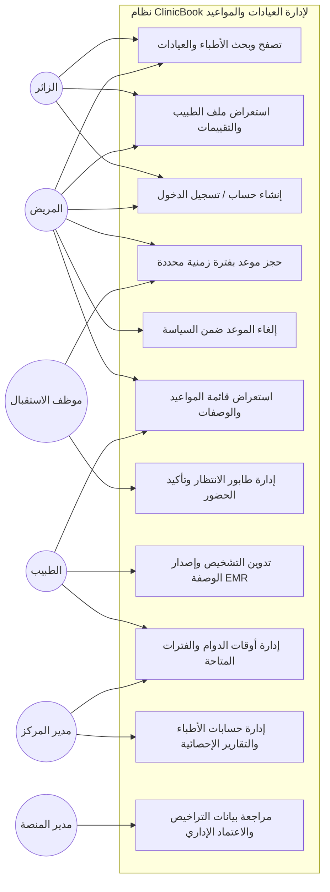
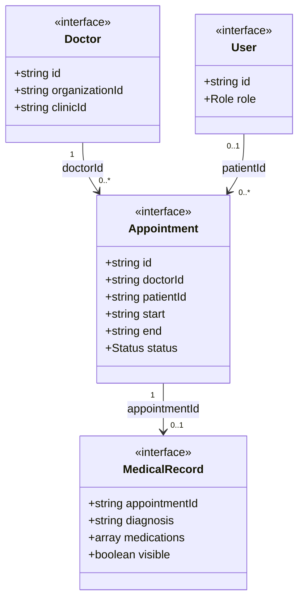
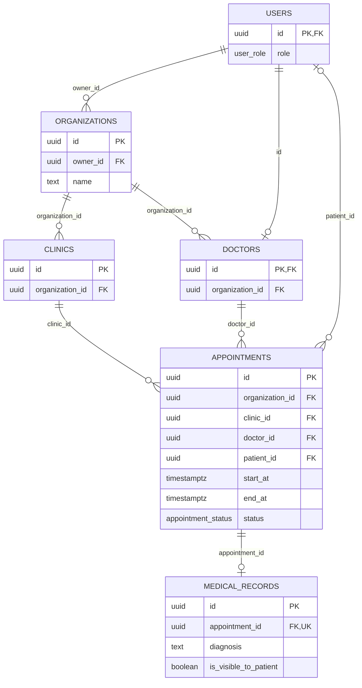
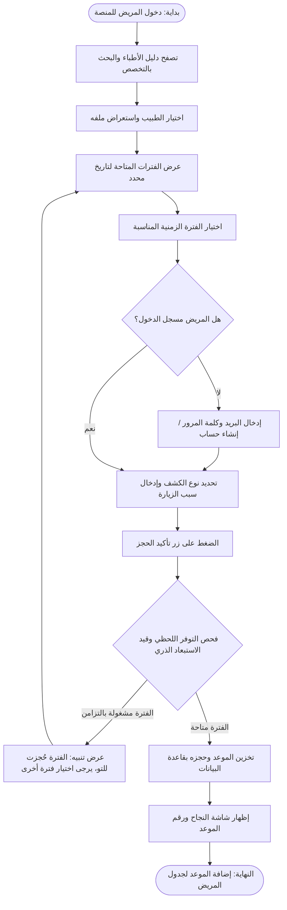
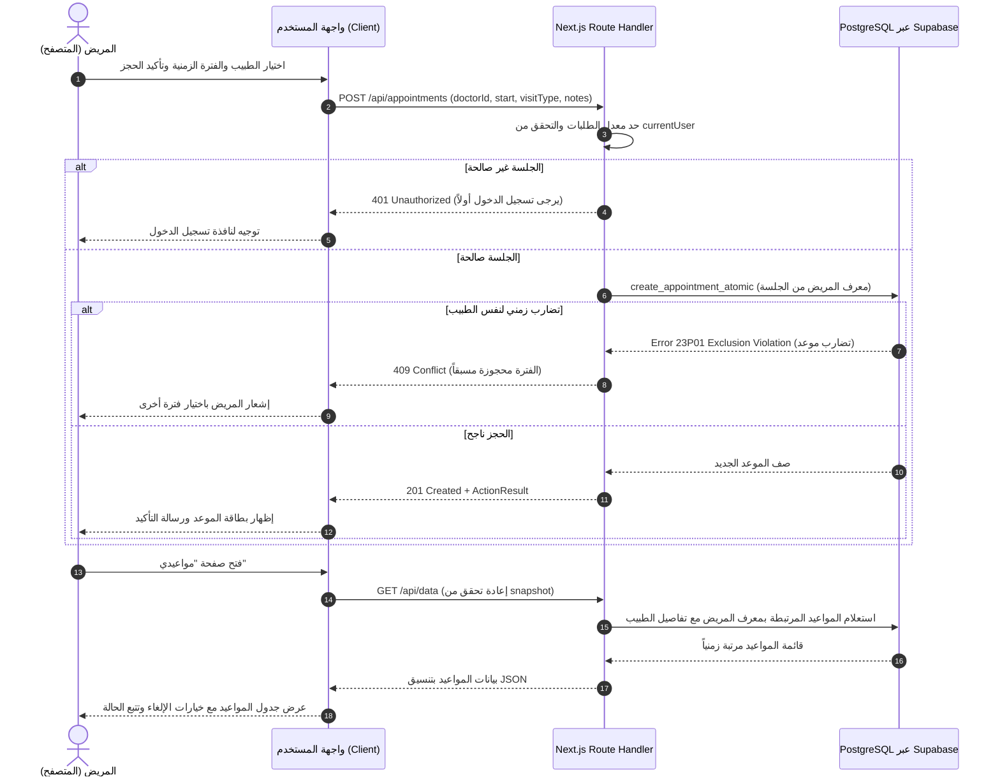

# تقرير مشروع فصلي — نظام إدارة العيادات وحجز المواعيد الطبية ClinicBook

**نموذج تعليمي لإدارة العيادات والحجز والسجل الطبي المبسط**

> **نطاق التقرير — مراجعة 2026-11-13:** يصف هذا التقرير الشيفرة عند
> `1c84859d8093e41ee2ac1d78e2b7c4fc1f09660e`، مع فصل التنفيذ عن المقترحات.
> بيانات العرض اصطناعية، والاختبارات المعزولة ليست اعتمادًا لاستخدام بيانات مرضى
> حقيقية. كل متطلب تنفيذي مرتبط بمصدره في [مصفوفة التتبع](TRACEABILITY.md).
> الأهداف المتعلقة بزمن الانتظار، سهولة الاستخدام والنتائج الصحية لم تُقَس ميدانيًا.

---

### بيانات الغلاف الأكاديمي

- **الجامعة:** جامعة أنطاكية السورية الخاصة (Antioch Syrian Private University)
- **الكلية:** كلية هندسة الحاسوب
- **العام الدراسي:** 2025 – 2026 (الفصل الثاني)
- **عنوان المشروع:** نظام إدارة العيادات وحجز المواعيد الطبية (ClinicBook – Clinic Management & Healthcare Booking System)
- **إعداد الطلاب:** عمرو إبراهيم ليلا ، سامر غصن
- **إشراف:** د. لينا عرار

---

## فهرس المحتويات

1. [المقدمة](#1-المقدمة)
2. [الهدف من المشروع](#2-الهدف-من-المشروع)
3. [منهجية العمل المتبعة للوصول إلى تحقيق المشروع](#3-منهجية-العمل-المتبعة-للوصول-إلى-تحقيق-المشروع)
4. [خطة تنفيذ المشروع](#4-خطة-تنفيذ-المشروع)
5. [تحليل المتطلبات (Use Case)](#5-تحليل-المتطلبات-use-case)
   - 5.1 المتطلبات الوظيفية (Functional Requirements)
   - 5.2 المتطلبات غير الوظيفية (Non-Functional Requirements)
   - 5.3 مخطط حالات الاستخدام (Use Case Diagram)
   - 5.4 وصف تفصيلي لأهم حالات الاستخدام
6. [دراسة مرجعية لمشاريع مشابهة](#6-دراسة-مرجعية-لمشاريع-مشابهة)
   - نطاق المقارنة وقيود الأدلة الخارجية
   - مقارنة بدائل التصميم، لا ترتيب المنتجات التجارية
7. [التحليل (UML, Class Diagram, ER Diagram, Sequence Diagram, Activity Diagram)](#7-التحليل-uml)
   - 7.1 مخطط الصفوف (Class Diagram)
   - 7.2 مخطط العلاقات بين الكيانات (ER Diagram)
   - 7.3 مخطط النشاط (Activity Diagram)
   - 7.4 مخطط التسلسل (Sequence Diagram)
8. [التصميم](#8-التصميم)
   - 8.1 البنية المعمارية العامة (3-Tier Architecture)
   - 8.2 تصميم واجهة المستخدم (UI/UX)
   - 8.3 تصميم نموذج الحجز متعدد الخطوات
9. [التقانات المستخدمة للتنفيذ مع تبرير استخدامها](#9-التقانات-المستخدمة-للتنفيذ-مع-تبرير-استخدامها)
10. [التنفيذ](#10-التنفيذ)
    - 10.1 هيكلية قاعدة البيانات
    - 10.2 واجهات HTTP الفعلية (Route Handlers)
    - 10.3 آلية المصادقة والتفويض
    - 10.4 حساب تكلفة الكشفية وآلة حالات الموعد
    - 10.5 الميزات المنجزة
    - 10.6 نظام الدفع والتحصيل (Payment Module)
    - 10.7 مساعد الحجز والإرشاد العام (Eve)
11. [الاختبارات والتقييم](#11-الاختبارات-والتقييم)
    - سيناريوهات العرض ومصادر اختبارها (TC-01 إلى TC-11)
    - التوثيق الصوري لحالات الاختبار وشاشات التنفيذ
12. [النتائج والخلاصة](#12-النتائج-والخلاصة)
    - 12.1 النتائج المحققة
    - 12.2 محدوديات النظام الحالي
    - 12.3 التوصيات والعمل المستقبلي
    - 12.4 الخلاصة
13. [قائمة المراجع](#13-قائمة-المراجع)

---

## 1. المقدمة

يتناول **ClinicBook** مشكلة برمجية محددة: عرض فترات طبيب متاحة، حجزها من حساب
مريض أو موظف مخوّل، ثم متابعة الحالة وتوثيق الزيارة. الهدف التعليمي هو تطبيق
التحقق من المدخلات، معاملات قاعدة البيانات، صلاحيات الأدوار وواجهات عربية قابلة
للتجربة، لا إثبات تحسن صحي أو تشغيلي في عيادات حقيقية.

1. **المريض:** البحث بالاسم/المركز والتخصص والمدينة والحي، فرز بالتقييم أو الكشفية،
   فحص التوفر اليومي، الحجز وإلغاء الموعد ضمن السياسة وعرض الوصفة المتاحة له.
2. **طاقم العيادة:** ضبط الورديات والاستثناءات، تسجيل الوصول والتحصيل النقدي،
   وكتابة الشكوى والتشخيص والأدوية في سجل مبسط.
3. **إدارة المنصة:** مراجعة بيانات الاعتماد والاشتراكات والمراجع دون صلاحية قراءة
   مواعيد المستأجرين أو سجلاتهم الطبية.

التنفيذ المحلي يستخدم SQLite للعرض. المسار السحابي يستخدم Supabase Auth ومخطط
PostgreSQL مشتركًا وسياسات RLS؛ الاختبارات المتاحة لا تغني عن تجربة نشر حقيقية.

---

## 2. الهدف من المشروع

الأهداف التالية توجه التصميم. النتيجة المحققة وحدودها موضحتان في الفصل 12؛ لا
تُحوَّل الأهداف إلى نسب نجاح أو ضمانات دون قياس:

| الهدف                    | الشرح التفصيلي                                                                                            |
| :----------------------- | :-------------------------------------------------------------------------------------------------------- |
| **دليل وحجز موحدان**     | عرض بيانات الأطباء التجريبية وربطها بالمواعيد والحسابات؛ حالة «معتمد» في demo ليست ترخيصًا حقيقيًا.       |
| **سلامة الحجز المتزامن** | منع تقاطع الفترات النشطة لنفس الطبيب بقيود ومعاملات، مع اختبارات تنافس محددة، لا ضمان سعة تحت كل الأحمال. |
| **تبسيط تجربة المريض**   | تنظيم اختيار الطبيب واليوم والفترة ومتابعة الحجز؛ لا يوجد قياس موثق لعدد النقرات أو خفض الانتظار.         |
| **إدارة العيادة**        | الورديات والفروع والكادر وتسجيل الوصول والتحصيل النقدي وسجل طبي مبسط.                                     |
| **عزل الصلاحيات**        | حراس تطبيق وRLS واختبارات أدوار تمنع العمليات غير المخوّلة ضمن النطاق المختبر؛ ليست شهادة امتثال صحي.     |
| **توسعات مستقبلية**      | الدفع الإلكتروني وقنوات التذكير والمرفقات ومساعد الطبيب أفكار مستقبلية تحتاج تنفيذًا وتقييمًا منفصلين.    |

---

## 3. منهجية العمل المتبعة للوصول إلى تحقيق المشروع

يمكن تنظيم العمل الظاهر في المستودع إلى واجهات، منطق أعمال، تخزين، تقوية صلاحيات
واختبارات انحدار. هذا وصف للمخرجات، وليس إثباتًا لاعتماد منهجية Agile رسمية أو
أن كل ميزة اتبعت TDD أو أن المخاطر انخفضت بنسبة مقاسة:

1. **النمذجة الأولية وتجربة الاستخدام (Front-end Prototype):** بناء واجهات النموذج الأولي مع هيكلة تدفق الحجز وتجربة المستخدم قبل الالتزام بنسخة التخزين النهائية للتأكد من سهولة التنقل.
2. **محاكاة استمرارية البيانات محلياً:** استخدام طبقة تخزين محلية وبيانات هيكلية تجريبية لاختبار دورة حياة الموعد (المعلق، المؤكد، الملغى) وسلوك واجهات الأطباء وموظفي الاستقبال.
3. **نموذج الكيانات:** فصل المؤسسة عن الفرع، والمستخدم عن ملف الطبيب، والدوام الأسبوعي عن الفترة المتاحة المحسوبة؛ تفاصيل النموذج في الفصل 7 و[المصطلحات](../GLOSSARY.md).
4. **تطوير النواة البرمجية وقيد الاستبعاد الزمني:** بناء محرك التحقق من الفترات وقيد الاستبعاد الذري لمنع الحجز المزدوج رياضياً على مستوى طبقة البيانات.
5. **دمج نظام الصلاحيات والأدوار (RBAC):** تحديد أدوار المستخدمين (مريض، طبيب، موظف استقبال، مدير مركز، ومدير النظام) وتأمين نقاط الوصول والعمليات الحساسة.
6. **الربط بين الواجهة والخدمات:** مسارا SQLite وSupabase منفصلان؛ وجود المحول السحابي لا يثبت اختبار خدمة Supabase فعلية.
7. **اختبارات الانحدار:** سيناريوهات وحدة وHTTP ومتصفح وقاعدة بيانات، مع بيان ما تستخدمه من تجهيزات معزولة.
8. **التوثيق الفني والمراجعة الأكاديمية:** توثيق معماريات النظام ومخططات UML وسيناريوهات الفحص ضمن تقرير شامل ومراجع دورية لنسب الإنجاز.

---

## 4. خطة تنفيذ المشروع

يعرض الجدول تقسيمًا فنيًا للعمل، لا سجلًا زمنيًا موقعًا أو دليل اكتمال كل متطلب:

|   #    | المرحلة                                            | الوصف الفني والتنفيذي                                                                               |
| :----: | :------------------------------------------------- | :-------------------------------------------------------------------------------------------------- |
| **1**  | **تحديد النطاق**                                   | صياغة سيناريوهات الحجز والعيادة التعليمية؛ لا يتضمن المستودع مسحًا ميدانيًا موثقًا.                 |
| **2**  | **تصميم واجهات المستخدم (Wireframes/Mockups)**     | تصميم شاشات استعراض الأطباء، الملف الشخصي، نافذة الحجز، ولوحات تحكم العيادة والطبيب باللغة العربية. |
| **3**  | **بناء الهيكل التفاعلي للواجهة الأمامية**          | تطوير مكونات الواجهة باستخدام Next.js وTailwind CSS مع تطبيق مبادئ الوصولية (WCAG) ودعم RTL.        |
| **4**  | **تصميم وتطوير قاعدة البيانات (ER + Constraints)** | بناء جداول النظام وتطبيق قيود السلامة المرجعية وقيد منع التقاطع الزمني للمواعيد.                    |
| **5**  | **تطوير محرك الخادم والمسارات البرمجية**           | بناء منطق الأعمال، مسارات معالجة المواعيد، واجهات إدارة الأطباء، ومسارات السجل الطبي.               |
| **6**  | **المصادقة والصلاحيات**                            | جلسات demo ذات رموز عشوائية، Supabase Auth للمسار السحابي، وحراس الأدوار وسياسات RLS.               |
| **7**  | **تطوير محرك حجز الفترات وطابور الاستقبال**        | برمجة خوارزمية تقسيم أوقات العمل إلى فترات دقيقة وربط طابور الحضور اللحظي بالاستقبال.               |
| **8**  | **دمج السجل ووحدة الوصفة**                         | واجهة لتوثيق التشخيص والأدوية وقالب متصفح قابل للطباعة دون توقيع أو اعتماد.                         |
| **9**  | **الاختبارات ومعالجة الحالات الحدية**              | سيناريوهات محددة للحجز المتزامن والتسجيل والإلغاء والواجهات، وليست تغطية شاملة.                     |
| **10** | **التوثيق وإعداد التقرير الفني النهائي**           | صياغة التقرير الأكاديمي، توثيق المخططات البيانية (UML)، ومناقشة النتائج والآفاق المستقبلية.         |

---

## 5. تحليل المتطلبات (Use Case)

يوجد زائر غير مسجل وخمسة أدوار حسابات مستقلة في `src/lib/types.ts`:

- **الزائر (Guest):** مستخدم غير مسجل، يمكنه استكشاف الأطباء والتخصصات والأسعار.
- **المريض (Patient):** مستخدم مسجل يمتلك ملفاً طبياً ويستطيع حجز المواعيد وإلغاءها واستعراض الوصفات.
- **الطبيب (Doctor):** يمتلك لوحة مواعيد خاصة، يدير أوقات دوامه، ويحرر السجل السريري والوصفة.
- **موظف الاستقبال (Receptionist):** يدير طابور الانتظار، يسجل حضور المرضى، ويسجل الحجوزات المباشرة.
- **مدير المركز (`clinic_owner`):** يدير مؤسسته وفروعها وكادرها وسياسات الحجز ويطلب ترقية الاشتراك؛ لا يقرأ التشخيص.
- **مدير المنصة (`super_admin`):** يراجع الاعتماد ويفعّل الاشتراكات ويدير المراجع؛ لا يدير مواعيد المستأجرين أو سجلاتهم الطبية.

### 5.1 المتطلبات الوظيفية (Functional Requirements)

|   الرمز   | الوصف                                                                                                                                        |
| :-------: | :------------------------------------------------------------------------------------------------------------------------------------------- |
| **FR-01** | يجب أن يتمكن الزائر من تصفح دليل الأطباء والعيادات دون الحاجة لتسجيل الدخول مسبقاً.                                                          |
| **FR-02** | البحث بالاسم/المركز والتخصص، والتصفية بالمدينة والحي والتخصص والتوفر اليومي؛ الفرز بالتقييم أو الكشفية. نطاق السعر وسنوات الخبرة غير منفذين. |
| **FR-03** | عرض نبذة الطبيب والعيادة والخبرة والرسوم والفترات والتقييمات؛ بيانات demo توضيحية.                                                           |
| **FR-04** | إنشاء حساب والدخول بالبريد وكلمة المرور مع التحقق من المدخلات؛ scrypt في demo وSupabase Auth في المسار السحابي، والهاتف حقل اختياري في API.  |
| **FR-05** | حجز المريض المسجل لنفسه، أو الحجز المباشر بواسطة الطبيب/استقبال الفرع المخوّلين.                                                             |
| **FR-06** | رفض تقاطع المواعيد النشطة (`pending`, `confirmed`, `checked_in`) لنفس الطبيب، والسماح بالفترات المتجاورة.                                    |
| **FR-07** | يجب أن يحسب النظام تكلفة الموعد الإجمالية تلقائياً مع تمييز رسوم الكشف لأول مرة عن رسوم المراجعة.                                            |
| **FR-08** | عرض المريض لمواعيده القادمة والسابقة؛ إعادة تحقق من البيانات بعد الإجراءات وأحداث محددة، لا تحديث لحظي مضمون.                                |
| **FR-09** | يجب أن يتمكن المريض من إلغاء موعده القائم قبل انقضاء المهلة الزمنية المحددة لسياسة الإلغاء.                                                  |
| **FR-10** | يجب أن يتيح النظام لموظف الاستقبال تسجيل حضور المريض في قاعة الانتظار وتحديث حالته إلى (Checked-in).                                         |
| **FR-11** | حفظ الطبيب المعالج لسجل الشكوى والتشخيص والأدوية وإتمام الزيارة ذرّيًا، بعد وقت بدايتها وفي حالة مسموحة.                                     |
| **FR-12** | عرض السجل المسموح للمريض وطباعة الوصفة أو حفظ PDF عبر المتصفح، دون باركود أو توقيع رقمي.                                                     |

تحتفظ [TRACEABILITY.md](TRACEABILITY.md) بهذه الرموز نفسها وتربطها بالدوال والاختبارات وحدود التحقق.

### 5.2 المتطلبات غير الوظيفية (Non-Functional Requirements)

| الخاصية                  | الوصف                                                                                                 |
| :----------------------- | :---------------------------------------------------------------------------------------------------- |
| **الأمان والخصوصية**     | تجزئة كلمات مرور demo، تحقق جلسة ودور، RLS وحجب التشخيص عن غير المخوّلين؛ لا اعتماد أمني/قانوني شامل. |
| **سهولة الاستخدام وRTL** | واجهة عربية وخطوط محلية؛ سهولة الاستخدام وعدد النقرات يحتاجان دراسة مستخدمين.                         |
| **التجاوب والوصولية**    | CSS متجاوب وفحوص axe وkeyboard/contrast منتقاة؛ لا إثبات لكل صفحة وحالة وقياس شاشة.                   |
| **قابلية التوسع**        | فصل العرض والخدمات والتخزين يساعد الصيانة؛ السعة وزمن الاستجابة على حجم واقعي غير مقاسين.             |
| **سلامة التزامن**        | معاملات SQLite/RPC وقيد PostgreSQL مع اختبارات تنافس؛ ليست ضمانًا ضد جميع أخطاء التطبيق أو التشغيل.   |

### 5.3 مخطط حالات الاستخدام (Use Case Diagram)

يوضح المخطط أدناه شبكة التفاعل بين الفاعلين والوظائف الرئيسية للنظام، مبرزاً تدفق العمليات من البحث وحتى توثيق الزيارة الطبية:



### 5.4 وصف تفصيلي لأهم حالات الاستخدام

| حالة الاستخدام        | الفاعل الرئيسي     | الوصف المختصر والمسار                                                                                                      |
| :-------------------- | :----------------- | :------------------------------------------------------------------------------------------------------------------------- |
| **تسجيل الدخول**      | زائر / مريض / موظف | إدخال بيانات الدخول، التحقق منها وإصدار جلسة مصادقة آمنة تحدد صلاحيات الفاعل.                                              |
| **حجز موعد طبي**      | مريض مسجل          | اختيار الطبيب، تحديد التاريخ والفترة المتاحة، إدخال سبب الزيارة، وتأكيد الحجز الذري دون تضارب.                             |
| **إلغاء موعد قائم**   | مريض مسجل          | استعراض الموعد القادم، الضغط على إلغاء، وتأكيد العملية مما يؤدي لتحرير الفترة الزمنية فوراً للآخرين.                       |
| **تسجيل حضور المريض** | موظف الاستقبال     | البحث عن المريض القادم في جدول اليوم وتحويل حالته إلى (Checked-in) لإدخاله في طابور الكشف.                                 |
| **السجل والوصفة**     | الطبيب المعالج     | فتح الموعد المسموح، كتابة الشكوى والتشخيص والأدوية، وحفظ السجل مع إتمام الزيارة؛ القالب قابل للطباعة وليس توقيعًا معتمدًا. |

---

## 6. دراسة مرجعية لمشاريع مشابهة

ذكرت المسودة أسماء Vezeeta وAltibbi وDoctolib وتطبيق دكتوري، لكن المستودع لا
يحتوي مصادر مؤرخة أو بروتوكول مقارنة أو نتائج قياس لهذه المنتجات. لذلك لا
ينسب التقرير إليها ضعف التزامن أو غياب ميزات أو أسعارًا محددة، ولا يدّعي تفوق
ClinicBook التجاري عليها. يلزم بحث خارجي منفصل لتقديم مقارنة سوق موثقة.

يمكن مقارنة **بدائل التصميم** دون الحكم على منتجات بعينها:

| البديل              | ما يوفره منطقيًا                                  | ما يحتاجه لتلبية نطاق هذا المشروع                                           |
| :------------------ | :------------------------------------------------ | :-------------------------------------------------------------------------- |
| تنسيق الحجز هاتفيًا | تسجيل القرار بواسطة موظف                          | وسيلة لحفظ الوقت والحالة وصلاحيات الوصول.                                   |
| دليل أطباء فقط      | عرض معلومات وتواصل                                | تنفيذ معاملات حجز وسجل حالة، إن أُريد الحجز المباشر.                        |
| تطبيق إدارة عيادة   | تنظيم عمل الطاقم                                  | بوابة مريض وربط التوفر بالحجز مع فحص الصلاحيات.                             |
| ClinicBook التعليمي | هذه السيناريوهات في واجهة واحدة مع اختبارات محددة | تكامل حقيقي، دراسة مستخدمين، ترقية واستعادة وقياس حمل قبل الاستخدام الفعلي. |

الدروس التصميمية هي أن تعطيل زر الواجهة لا يكفي لمنع السباق، وأن بيانات التشخيص
تحتاج حد صلاحيات مستقلًا عن إدارة الموعد. دليل هذين القرارين في قيود SQL وحراس
الأدوار واختبارات التزامن والعزل، لا في ادعاء دراسة ميدانية غير منشورة.

---

## 7. التحليل (UML)

تجسد مرحلة التحليل المتطلبات الوظيفية في نماذج برمجية وهندسية مرئية توضح الكيانات البرمجية والعلاقات وسير العمليات الزمنية.

### 7.1 مخطط الصفوف (Class Diagram)

يوضح المخطط إسقاطًا مختصرًا لأنواع الزيارة في `src/lib/types.ts`. هذه
interfaces/types وليست كلاسات OOP ذات دوال عضو. أسماء الحقول هنا من واجهة
التطبيق، وبعضها اختياري؛ مخطط SQL في القسم التالي، وليس كل الحقول معروضة في الرسم.



الأنواع المرتبطة بتنظيم الوقت والمركز:

| النوع          | حقول مختارة                                                           | المصدر                                                  |
| -------------- | --------------------------------------------------------------------- | ------------------------------------------------------- |
| `Organization` | `id`, `name`, `tier`, `subscriptionStatus`, `cancelHours`, `timezone` | `booking-service.ts`، إسقاط بيانات للمؤسسة والسياسات.   |
| `Shift`        | `day`, `start`, `end`, `duration`, `active`                           | `types.ts`؛ وردية أسبوعية، لا حجز.                      |
| `Slot`         | `start`, `end`                                                        | `slots-engine.ts`؛ فترة UTC محسوبة، لا صف ثابت في جدول. |

### 7.2 مخطط العلاقات بين الكيانات (ER Diagram)

هذا مخطط مختصر لمسار المؤسسة والطبيب والموعد والسجل، مشتق من الترحيل الأول،
لا مخطط شامل لكل الجداول والحقول أو سياسات RLS. المفاتيح UUID؛ المريض حساب في `public.users`، والفترات
الشاغرة محسوبة من `availability` لا محفوظة في جدول `schedule_slots`. لا يوجد
جدول `patients` أو `invoices` في المخطط الحالي. جدول `billing_requests` يخص
اشتراك المؤسسة، وليس فاتورة موعد. قائمة الجداول الكاملة في 10.1.



### 7.3 مخطط النشاط (Activity Diagram)

يوضح مخطط النشاط التدفق الكامل لحجز موعد طبي من استعراض الدليل وحتى تأكيد الحجز مع معالجة سيناريو تضارب المواعيد:



### 7.4 مخطط التسلسل (Sequence Diagram)

يوضح مخطط التسلسل التفاعل الزمني بين طبقات النظام (المتصفح، خادم Next.js، وقاعدة البيانات) لإنشاء حجز جديد ثم استعراض قائمة المواعيد:



---

## 8. التصميم

ينظم التصميم مسؤوليات العرض والخدمات والتخزين؛ مصادر الآليات في الأقسام التالية،
ولا يُستنتج الأداء أو الاعتمادية من الرسم المعماري وحده.

### 8.1 البنية المعمارية العامة (3-Tier Architecture)

تنظم البنية المسؤوليات في العرض والخدمات والتخزين؛ الفصل يساعد الصيانة لكنه
لا يضمن الأمان بمفرده:

1. **طبقة العرض (Presentation Layer):** مبنية بأحدث تقنيات React 19 ومكونات Next.js App Router مع مكتبة Tailwind CSS وshadcn/ui، وتدعم التخطيط العربي الأصيل (RTL).
2. **الخدمات:** Route Handlers في `src/app/api/**/route.ts`، وZod والجلسات وآلة
   الحالات ومحولات البيانات في `src/lib`. اسم `/api/actions` لا يعني Next.js
   Server Actions؛ لا توجد توجيهات `'use server'` في التنفيذ.
3. **التخزين:** SQLite محلي للعرض، وSupabase Auth/PostgreSQL للمسار السحابي، مع
   RLS وRPC وقيد استبعاد زمني. `scrypt` يخص كلمات مرور demo؛ كلمات مرور السحابة
   تُدار بواسطة Supabase Auth. الإنتاج يحتاج Redis مشتركًا لحدود الطلبات.

### 8.2 تصميم واجهة المستخدم (UI/UX)

- **الهوية البصرية والألوان:** اعتُمد اللون الأخضر المزرق الطبي العميق (`Deep Medical Teal - #0F766E`) كلون رئيسي يوحي بالثقة الطبية والهدوء السريري، مع لون كحلي داكن للخلفيات والأطر، وألوان حالة وظيفية واضحة (الأخضر للمؤكد، البرتقالي للمعلق، والأحمر للإلغاء والتضارب).
- **الطباعة العربية عالية القراءة:** اعتماد خط **IBM Plex Sans Arabic** لجمعه بين الحداثة والوضوح الشديد للمصطلحات والتقارير الطبية، مع تطبيق خاصية الأرقام الجدولية `tabular-nums` لمنع اهتزاز جداول الأسعار والأوقات.
- **الوصولية:** تسميات حقول وحالات اختيار وتركيز ونوافذ Radix مع اختبارات axe
  وفحوص contrast/keyboard منتقاة. لا يوجد قياس يثبت حجم `44×44px` لكل زر أو
  تباينًا واحدًا لكل النصوص أو توافقًا شاملًا مع قارئات الشاشة. تفاصيل العينة
  في [تقرير الوصولية](ACCESSIBILITY_AUDIT_REPORT.md).
- **توزيع الصفحات الرئيسية في التطبيق:**
  - **الرئيسية والدليل الطبي:** شريط بحث ذكي، استعراض التخصصات، وأبرز الأطباء المعتمدين.
  - **ملف الطبيب:** النبذة والخبرة والرسوم واسم العيادة والمدينة والحي وشريط حجز؛ لا خريطة تفاعلية.
  - **نافذة الحجز متكاملة الخطوات:** اختيار اليوم، اختيار الفترة المتاحة، إدخال الشكوى، وتأكيد الحجز.
  - **مواعيدي:** عرض الموعد وإلغاؤه ضمن السياسة، والوصفة المتاحة للطباعة أو حفظ PDF من المتصفح.
  - **لوحة موظف الاستقبال:** إدارة طابور الانتظار اللحظي، تأكيد الحضور، وتسجيل الحجوزات السريعة.
  - **لوحة الطبيب السريرية:** استعراض مواعيد اليوم، فتح السجل الطبي، وكتابة الوصفة الرقمية.

### 8.3 تصميم نموذج الحجز متعدد الخطوات

تجمع صفحة `DoctorPage` ونافذة التأكيد اختيار اليوم والفترة ونوع الزيارة
والملاحظات وإرسال الحجز. هذه مراحل استخدام، لا قياس لعدد النقرات:

- **الخطوة الأولى (اختيار الموعد):** تحديد اليوم واستعراض فترات الدوام الصباحية والمسائية المتاحة بصرياً كأزرار ملونة.
- **الخطوة الثانية (بيانات المريض ونوع الكشف):** تحديد هل الموعد كشف جديد أم مراجعة، وإدخال سبب الزيارة وملاحظات الأعراض.
- **التأكيد:** يعرض السعر ويرسل الحجز؛ يبدأ الدفع `unpaid` ويسجل التحصيل لاحقًا.
  لا يوجد اختيار بطاقة مصرفية أو واجهة دفع إلكتروني محاكاة في الشيفرة الحالية.

---

## 9. التقانات المستخدمة للتنفيذ مع تبرير استخدامها

جرى اختيار حزمة التقنيات البرمجية لتكون متلائمة مع المعايير الصناعية الحديثة للتطبيقات السحابية:

| التقانة المستخدمة            | الدور في المشروع             | مبرر الاختيار الفني                                                                                                                    |
| :--------------------------- | :--------------------------- | :------------------------------------------------------------------------------------------------------------------------------------- |
| **Next.js 15 App Router**    | صفحات وRoute Handlers        | تصيير HTML وبيانات أولية على الخادم؛ جذر الوثيقة dynamic بسبب nonce وبيانات المستخدم. SSR ليس SSG أو ISR.                              |
| **React 19 وTypeScript**     | مكونات وأنواع                | `tsconfig.json` يستخدم strict، وESLint يقيد `any` في التطبيق مع سماح بالاختبارات؛ الأنواع لا تثبت خلو التنفيذ من الأخطاء.              |
| **Tailwind 4 وRadix/shadcn** | تخطيط ومكونات تفاعلية        | دعم RTL وإدارة حوار/تركيز؛ وصولية المكتبة لا تجعل كل استعمال لها مطابقًا للمعايير تلقائيًا.                                            |
| **PostgreSQL وSQLite**       | المسار السحابي والعرض المحلي | CI يفحص PostgreSQL 17؛ إعداد Supabase المحلي ما زال 16، والمطابقة والتحقق على الهدف متبقيان.                                           |
| **btree_gist / Exclusion**   | رفض التقاطع الزمني           | قيد `appointment_no_overlap` على الطبيب والفترة في الحالات النشطة فقط؛ القياس المتاح هو اختبار تنافس محدد.                             |
| **RLS وحراس الأدوار**        | حدود بيانات المستخدم/المؤسسة | سياسات للقراءة والكتابة ودوال RPC باشتراط الدور والملكية؛ الحسابات الإدارية ومالك القاعدة ليست ضمن نفس الحد.                           |
| **Zod**                      | تحقق API والخدمات            | تحقق من الأشكال والحدود والقيم قبل الإجراءات؛ ليس بديلًا عن الصلاحيات أو حماية ضد جميع أنواع الحقن.                                    |
| **scrypt وSupabase Auth**    | المصادقة                     | تجزئة demo بـ scrypt؛ Supabase يدير مصادقة السحابة. رموز demo عشوائية، تجزئتها محفوظة ومرسلة في HttpOnly cookie، لا كوكي بيانات مشفرة. |
| **Upstash Redis**            | حدود طلبات موزعة             | token bucket مشترك للمسار الإنتاجي، وفشل الخدمة يعيد 503؛ الاختبارات تستخدم بروتوكول REST محليًا.                                      |
| **Vitest وPlaywright وpg**   | التحقق الآلي                 | اختبارات وحدة/HTTP ومتصفح وPostgreSQL بأدوار وتجهيزات محددة، موثقة في الفصل 11.                                                        |

المتطلب الأدنى لـ Node هو `^22.12.0`، لا سلسلة 20. مصادر الإصدارات هي
`package.json` و`package-lock.json`، لا الشارات التاريخية.

---

## 10. التنفيذ

يمثل هذا الفصل كيفية تحويل التصاميم والنماذج التحليلية إلى واقع برمجي ملموس وفعال.

### 10.1 هيكلية قاعدة البيانات

المرجع التنفيذي هو [supabase/migrations](../supabase/migrations)، وليس مثال
`CREATE TABLE` في التقرير. يحتوي مخطط `public` على الجداول التالية:

| المجموعة         | الجداول الحالية                                                                | المصدر                                            |
| :--------------- | :----------------------------------------------------------------------------- | :------------------------------------------------ |
| الهوية والمراجع  | `users`, `cities`, `specialties`                                               | `20261013000001_initial_saas_schema.sql`          |
| المؤسسة والكادر  | `organizations`, `subscriptions`, `clinics`, `doctors`, `organization_members` | الترحيل الأول                                     |
| الدوام والحجز    | `availability`, `availability_exceptions`, `appointments`                      | الترحيل الأول وقيود/دوال الترحيلات التالية        |
| الزيارة والتواصل | `medical_records`, `reviews`, `notifications`, `audit_logs`                    | الترحيل الأول، ثم تقوية العزل والتدقيق والاستبقاء |
| ترقية الاشتراك   | `billing_requests`                                                             | `20261111000007_billing_requests_atomic.sql`      |

- المفاتيح `UUID`. `public.users.id` مرتبط بـ `auth.users.id`، والطبيب مرتبط
  بالمستخدم، والمريض يستخدم `users` بدور `patient`؛ لا جدول مرضى مستقل.
- الموعد يحتوي `organization_id`, `clinic_id`, `doctor_id`, `patient_id`,
  `start_at`, `end_at`, `fee_amount`, `payment_status`؛ المراجع المباشر قد لا
  يملك `patient_id` وتُحفظ بيانات الاسم والهاتف على الموعد.
- الدوام الأسبوعي يحفظ `day_of_week`, `start_time`, `end_time`,
  `slot_duration_minutes`. الفترة المتاحة نتيجة حساب، لا صف في `schedule_slots`.
- السجل يحفظ `chief_complaint`, `diagnosis`, `prescription_items` JSONB,
  `doctor_notes`, `follow_up_recommended_date`, `is_visible_to_patient`.
  الترحيلات اللاحقة تضيف `retention_until`, `legal_hold`, `archived_at`,
  `archived_by`, `archive_reason` وتمنع الحذف من حسابات التطبيق والخدمة.
- سياسة عشر سنوات والأرشفة موجودة في الشيفرة، لكنها ليست حكمًا قانونيًا صالحًا
  لكل بلد أو فئة عمرية؛ تفاصيل الحدود في [PRODUCTION_HARDENING.md](PRODUCTION_HARDENING.md).

مقتطف القيد التالي من الترحيل الأول **للتوضيح فقط، وليس أمر تهيئة أو إعادة تطبيق**:

```sql
ALTER TABLE public.appointments
ADD CONSTRAINT appointment_no_overlap
EXCLUDE USING gist (
  doctor_id WITH =,
  tstzrange(start_at, end_at, '[)') WITH &&
) WHERE (status IN ('pending', 'confirmed', 'checked_in'));
```

الترقية والاستعادة والتحقق من نسخة PostgreSQL المستهدفة بنود متبقية؛ لا تشغّل
bootstrap الاختبارات أو مقتطفات التقرير على قاعدة تحتوي بيانات حقيقية.

### 10.2 واجهات HTTP الفعلية (Route Handlers)

هذه طرق HTTP المصدّرة في ملفات `src/app/api/**/route.ts`:

| الطريقة       | المسار                                  | الوظيفة                                                               |
| :------------ | :-------------------------------------- | :-------------------------------------------------------------------- |
| **POST**      | `/api/session`                          | `mode: signin/signup` للدخول والتسجيل؛ معاينة `role` في demo فقط.     |
| **DELETE**    | `/api/session`                          | إنهاء الجلسة.                                                         |
| **GET**       | `/api/data`                             | snapshot حسب هوية المستخدم وصلاحياته، يشمل الدليل والمواعيد المسموحة. |
| **GET**       | `/api/slots?doctorId=…&date=YYYY-MM-DD` | الفترات المتاحة للطبيب والتاريخ.                                      |
| **POST**      | `/api/appointments`                     | الحجز؛ النجاح 201 والتعارض 409.                                       |
| **POST**      | `/api/actions`                          | غلاف `{ action, payload }` للإجراءات المذكورة أدناه.                  |
| **POST**      | `/api/agent/chat`                       | `action: chat` للإرشاد أو `book_slot` للحجز المصادق عليه.             |
| **GET**       | `/api/health`                           | فحص جاهزية قاعدة البيانات والمخطط؛ الفشل 503.                         |
| **GET, POST** | `/api/cron/retention`                   | مهام تشغيلية تتطلب سر Bearer صريحًا.                                  |

الإلغاء والتأكيد وتسجيل الوصول تستخدم `action: transition` في `/api/actions`،
والتحصيل `payment`، وحفظ السجل `medical`. الإجراءات الأخرى هي `onboard`,
`schedule`, `exception`, `team`, `branch`, `doctorFee`, `settings`, `review`,
`notification`, `billingRequest`, `verify`, `subscription`, `reference`، ولكل
منها تحقق وصلاحيات. ليس هناك `/api/auth/login` أو `/api/doctors` أو مسارات
الإلغاء/EMR المنفصلة التي ذكرتها المسودة. يوجد أيضًا `GET /auth/callback`
لعودة Supabase Auth؛ هو خارج مجلد `/api`.

### 10.3 آلية المصادقة والتفويض

1. **demo:** `src/lib/auth/password.ts` ينشئ تجزئة `scrypt` بملح عشوائي؛ هذه
   تجزئة لا تشفير قابل للفك. `createSession` يولد رمزًا عشوائيًا ويحفظ تجزئته
   SHA-256 وعمره في SQLite، ويرسل الرمز في `HttpOnly`, `SameSite=Lax` cookie.
   لا يُستخدم هذا المسار في تشغيل الإنتاج.
2. **Supabase:** `/api/session` يستدعي `signUp` و`signInWithPassword`،
   ويستخدم `currentUser` مستخدم Auth مع ملف `public.users` نشط. الدور والعضوية
   من قاعدة البيانات، لا من `user_metadata` أو طلب المتصفح.
3. **الصلاحيات:** `canAccess` وRLS يقيدان القراءة والكتابة بالمريض/الطبيب/الفرع
   والمؤسسة. مدير المركز ومدير المنصة ليسا طبيبًا معالجًا لمجرد دورهما.
4. **HTTP:** middleware يفحص أصل الطلب وبعض حدود الجسم ويضيف CSP nonce؛ وحدود
   الطلبات الإنتاجية تستخدم Redis وتتوقف بـ503 عند فشله. `HttpOnly` يقيّد
   قراءة الكوكي من JavaScript لكنه لا يضمن منع كل أثر XSS أو CSRF أو سرقة جلسة.

قبول دعوات الكادر، تأكيد البريد وتجديد/إنهاء جلسات Supabase يحتاجان اختبارًا
حقيقيًا على staging؛ الاختبارات المحلية ليست خدمة GoTrue أو SMTP كاملة.

### 10.4 حساب تكلفة الكشفية وآلة حالات الموعد

الرسوم مشتقة من إعداد الطبيب في الخادم/قاعدة البيانات: `follow_up_fee` عند
`follow_up`، وإلا `consultation_fee`. لا توجد نسبة خصم ثابتة أو تحصيل بطاقة
مصرفية أو فاتورة زيارة مستقلة.

الحالات في `Status` و`appointment_status` هي `pending`, `confirmed`,
`checked_in`, `completed`, `cancelled`, `rejected`, `expired`, `no_show`.
الانتقال ليس مجرد تغيير لون؛ تفحص `canTransition` ودالة SQL الدور والوقت والحالة:

- `pending → confirmed`: موظف مخوّل قبل بداية الموعد وانتهاء مهلة التأكيد؛
  `pending → rejected` يتطلب سببًا، والانتهاء إلى `expired` مهمة نظامية.
- المريض يلغي `pending`، ويلغي `confirmed` قبل نافذة العيادة (ساعتان
  افتراضيًا). إلغاء الموظف المخوّل يتطلب سببًا.
- الطبيب أو الاستقبال يسجل الوصول `confirmed → checked_in`؛ مالك المركز
  لا يملك صلاحية إتمام الزيارة أو تسجيل الوصول بحكم الإدارة.
- الطبيب المعالج فقط يُتم الزيارة المسموحة بعد بدايتها. RPC
  `save_medical_record_and_complete` يحفظ السجل والاكتمال في معاملة واحدة؛
  تعديل سجل مكتمل قبل الأرشفة لا يعيد فتح الموعد.
- المهام النظامية تحدد `no_show` بشروط؛ لا تعني أن الزيارة اكتملت سريريًا.

### 10.5 الميزات المنجزة

| الميزة                 | التنفيذ الحالي وحدوده                                                                            |
| :--------------------- | :----------------------------------------------------------------------------------------------- |
| الدليل والحجز          | `SearchPage`, `DoctorPage` ومسارات البيانات والفترات والحجز؛ بيانات العرض ليست هوية أطباء موثقة. |
| الفروع والكادر والدوام | إجراءات وصلاحيات فرع/مؤسسة؛ الإجازة لا تلغي المواعيد القائمة تلقائيًا.                           |
| السجل والوصفة          | شكوى وتشخيص وأدوية وملاحظات، طباعة متصفح، دون SOAP كامل أو تحقق دوائي أو توقيع.                  |
| إعادة تحقق البيانات    | بعد الإجراءات وأحداث focus/visibility وRealtime مصادق عليه ومصالحة دورية؛ لا ضمان تحديث فوري.    |
| التدقيق والاشتراك      | triggers لتغييرات ملتزمة و`billing_requests` لحالة طلب الترقية، لا استنتاج الدفع من نص audit.    |
| التذكير والاستبقاء     | RPC تشغيلية بمصادقة سر وتكرار آمن؛ إشعار داخل التطبيق، لا قنوات رسائل خارجية.                    |
| العرض الداكن وRTL      | قواعد ومكونات واختبارات منتقاة؛ لا قياس لراحة العين أو امتثال جميع الحالات.                      |

مصادر كل بند في [TRACEABILITY.md](TRACEABILITY.md).

### 10.6 نظام الدفع والتحصيل (Payment Module)

صُمم نموذج الدفع ليراعي الواقع السوري والإقليمي:

1. الحجز يبدأ بحالة `unpaid`، والإجراء `payment` يحوّل موعدًا مسموحًا إلى
   `paid_cash` بعد فحص الدور والحالة وعدم التحصيل السابق.
2. وجود قيم `paid_online` و`refunded` في enum أو حقول Stripe في المخطط لا يعني
   وجود تكامل دفع. لا يوجد مزود بطاقة أو webhook أو واجهة دفع محاكاة في التطبيق.
3. `billing_requests` طلب لترقية اشتراك المؤسسة وتفعيله إداريًا؛ لا يولّد
   فاتورة للمريض ولا يثبت دفعًا مصرفيًا.

### 10.7 مساعد الحجز والإرشاد العام (Eve)

`processAgentMessage` يطبّع النص العربي ويطابق قواعد للطوارئ وأسماء الأطباء
والتخصصات، ويستدعي خدمات الفترات/المواعيد وملخص العيادة في مسارات محددة.
`/api/agent/chat` يتيح `chat` أو `book_slot`؛ الحجز يحتاج حساب مريض وتأكيدًا
في واجهة المستخدم. لا يقرر LLM أي أدوات تُنفّذ.

تنبيه الطوارئ احترازي لغوي، يسبق طلب قاعدة البيانات وLLM، ولا يشخّص درجة
الاستعجال سريريًا. مثال ألم الصدر مع ضيق التنفس ينبغي أن ينتج تنبيهًا، لا حجز
عيادة بوصفه تقييمًا آمنًا. غياب التنبيه ليس دليل سلامة. اختبارات القواعد
اصطناعية، مع إنذارات كاذبة موثقة في [AGENT_TRIAGE.md](AGENT_TRIAGE.md).

عند تهيئة مفتاح مزود AI يمكن توليد نص عام عبر `callAgentRouter`؛ عند غيابه أو
فشله توجد ردود محلية. مجلد `agent/` يحتوي تعريفات وأدوات TypeScript محلية،
وليس دليلًا على تثبيت Eve SDK أو تنفيذ دائم مع استئناف وحفظ محادثات.

**غير منفذ:** كشف تداخلات الأدوية والحساسية، توصيات علاجية معتمدة، توليد وصفات
بالنيابة عن الطبيب، تحليل أشعة أو فرز سريري مصدَّق. مخطط الوكيل المستقبلي في
[AI_AGENT_EVE_BLUEPRINT.md](AI_AGENT_EVE_BLUEPRINT.md) مقترح، لا شهادة تنفيذ.

---

## 11. الاختبارات والتقييم

توجد أربع طبقات تحقق: Vitest للوحدات وHTTP بخدمات معزولة، Playwright لعرض demo،
Playwright لبناء/تشغيل production مع تجهيزات Supabase/Redis، و`pg` لاختبار SQL
وأدوار RLS على PostgreSQL 17. الأخيرة تستخدم نموذج `auth.uid()` ودور
`authenticated` في قاعدة مؤقتة؛ ليست اختبار GoTrue أو SMTP أو بث Realtime حي.

النتائج المسجلة لمراجعة الشيفرة `1c84859` بتاريخ 2026-11-13:

| الطبقة           | النتيجة والنطاق                                                                                                           |
| :--------------- | :------------------------------------------------------------------------------------------------------------------------ |
| Vitest           | 269/269 عبر 21 ملفًا؛ حدود التغطية مفعّلة، لا تغطية كاملة لكل مسار.                                                       |
| تغطية V8         | 78.43% تعليمات، 60.84% فروع، 82.51% دوال، 80.01% أسطر ضمن `src/lib`, `src/app/api`, `agent`؛ الواجهة ليست ضمن هذا القياس. |
| متصفح demo       | 38/38؛ منها 11 اختبار axe لعشر صفحات وحالة درج المساعد، مع فحص تبويب التسجيل أيضًا.                                       |
| بناء/متصفح إنتاج | 16/16 على `next build` و`next start` بتجهيزات بروتوكول محلية.                                                             |
| PostgreSQL       | اختبار 50 محاولة لنفس الفترة ينتج حجزًا واحدًا و49 رفضًا `23P01`، مع اختبارات أدوار وrollback وRPC؛ ليس benchmark للسعة.  |

تفصيل الأوامر والحدود في [QUALITY_GATES.md](QUALITY_GATES.md)، وإعداد القاعدة
المؤقتة في [POSTGRES_TESTING.md](POSTGRES_TESTING.md). لا يثبت نجاح هذه الفحوص
خلو التطبيق من الثغرات، ولا انخفاض الانتظار أو صحة الإرشاد الطبي. ربط الأدلة
التنفيذية والسجلات بإصدار التسليم النهائي عمل منفصل عن تصحيح هذا التقرير.

### سيناريوهات العرض ومصادر اختبارها (TC-01 إلى TC-11)

هذا الجدول لا يدّعي تنفيذ جلسة اختبار يدوي موقعة؛ يربط سيناريو العرض بما هو
مختبر برمجيًا، ولا يجعل لقطة الشاشة دليلًا على النتيجة:

|   الرمز   | السيناريو والسلوك المطلوب            | مصدر الاختبار                                                                                            | الحد                                                              |
| :-------: | :----------------------------------- | :------------------------------------------------------------------------------------------------------- | :---------------------------------------------------------------- |
| **TC-01** | تسجيل حساب جديد وتجزئة كلمة مروره    | `tests/integration/actions-api.test.ts` — `signs up user in demo mode...`                                | HTTP demo، لا بريد Supabase حي.                                   |
| **TC-02** | رفض البريد المكرر                    | الاختبار نفسه ضمن `actions-api.test.ts`                                                                  | بيانات SQLite اصطناعية.                                           |
| **TC-03** | الدخول بكلمة المرور الصحيحة          | `tests/e2e/auth.spec.ts` — `Rejects invalid credentials and succeeds...`                                 | متصفح demo.                                                       |
| **TC-04** | رفض بيانات الدخول الخاطئة            | `auth.spec.ts` والاختبارات المصادقة في `actions-api.test.ts`                                             | ليس اختبار اختراق شاملًا.                                         |
| **TC-05** | منع الحجز دون جلسة مريض              | `tests/unit/security-hardening.test.ts` — `returns 401 when book_slot...`، و`tests/e2e/flows.spec.ts`    | حد مصادقة HTTP، لا ضمان شكل/لون واحد للواجهة.                     |
| **TC-06** | الحجز من فترة ثم رؤية الحالة المخزنة | `tests/e2e/flows.spec.ts` — `Patient books real slot then cancels...`                                    | حفظ فعلي في قاعدة demo المعزولة، لا قاعدة مرضى.                   |
| **TC-07** | رفض تعارض الحجز المتزامن             | `tests/postgres/verify.ts`، و`tests/integration/demo-storage.test.ts`                                    | SQL 50 متنافسًا وقيد SQLite؛ حد HTTP قد يعيد 429 وليس 409 فقط.    |
| **TC-08** | الإلغاء ضمن السياسة                  | `flows.spec.ts` و`tests/unit/core.test.ts` — حدود ساعتين وحالة الموعد                                    | النافذة قابلة للضبط، لا كل موعد قابل للإلغاء.                     |
| **TC-09** | البحث بالمدينة والتخصص               | `flows.spec.ts` و`tests/e2e/rendering.spec.ts`                                                           | لا فلتر نطاق رسوم أو خبرة.                                        |
| **TC-10** | الحجز المباشر والوصول والتحصيل       | `flows.spec.ts` — `Reception direct booking, check-in and cash collection`                               | فرع محدد في demo؛ اختبارات SQL مستقلة للصلاحيات.                  |
| **TC-11** | حفظ السجل والاكتمال والطباعة         | `flows.spec.ts` — `Doctor writes clinical record and printable prescription` و`tests/postgres/verify.ts` | الطباعة قالب متصفح؛ rollback للسجل والموعد في SQL، لا توقيع رقمي. |

---

### التوثيق الصوري لحالات الاختبار وشاشات التنفيذ (TC-01 إلى TC-11)

اللقطات في `screenshots/showcase/` توضح عرضًا سابقًا، ولا يرافقها سجل مصادقة
يدوي لكل TC أو SHA لكل لقطة. قد تختلف عن الواجهة الحالية؛ تُستخدم للعرض لا
كإثبات اجتياز اختبار أو تحقق من هوية الأطباء.

- **TC-01 & TC-02:** شاشات التسجيل والتحقق من الحسابات: [`screenshots/showcase/05-multi-role-login.png`](screenshots/showcase/05-multi-role-login.png)
- **TC-03 & TC-04:** واجهة تسجيل الدخول متعددة الأدوار (5 أدوار للمستخدمين): [`screenshots/showcase/05-multi-role-login.png`](screenshots/showcase/05-multi-role-login.png)
- **TC-05 & TC-06 & TC-07:** اختيار فترات الطبيب وتأكيد الحجز ومنع التعارض الزمني: [`screenshots/showcase/03-doctor-profile-slots.png`](screenshots/showcase/03-doctor-profile-slots.png)
- **TC-08:** بوابة المريض وقائمة المواعيد والمرجع النصي والإلغاء: [`screenshots/showcase/06-patient-appointments.png`](screenshots/showcase/06-patient-appointments.png)
- **TC-09:** محرك البحث الطبي والفلترة المتقدمة حسب التخصص والمدينة: [`screenshots/showcase/02-search-and-filters.png`](screenshots/showcase/02-search-and-filters.png)
- **TC-10:** لوحة الاستقبال وإدارة طابور المراجعين وتسجيل الوصول اللحظي (Check-in): [`screenshots/showcase/08-reception-appointments.png`](screenshots/showcase/08-reception-appointments.png)
- **TC-11:** العيادة السريرية الرقمية والوصفة الطبية الإلكترونية وتصدير السجل: [`screenshots/showcase/09-doctor-clinical-emr.png`](screenshots/showcase/09-doctor-clinical-emr.png)
- **مساعد الحجز والإرشاد العام Eve:** معاينة للمحادثة لا إثبات فرز سريري: [`screenshots/showcase/04-ai-assistant-eve.png`](screenshots/showcase/04-ai-assistant-eve.png)
- **لوحة تحكم المركز الطبي (Clinic Owner Dashboard):** المؤشرات الحيوية والإحصائيات: [`screenshots/showcase/07-clinic-owner-dashboard.png`](screenshots/showcase/07-clinic-owner-dashboard.png)
- **دليل التوثيق الصوري الكامل:** متاح في المعرض المصور [`screenshots/README.md`](screenshots/README.md).

---

## 12. النتائج والخلاصة

### 12.1 النتائج المحققة

المخرجات المدعومة بالشيفرة والاختبارات هي:

1. واجهة عربية للدليل والحجز ومتابعة المواعيد ومساحات عمل للأدوار الخمسة.
2. رفض التقاطع الزمني للمواعيد النشطة بمعاملات وقيد PostgreSQL، ضمن سيناريوهات
   التنافس والحدود المختبرة، ومنها 50 محاولة لفترة واحدة.
3. سجل طبي مبسط وقالب وصفة للطباعة، مع حجب القراءة عن أدوار الإدارة والاستقبال.
4. إجراءات للدوام والكادر والفروع والتحصيل النقدي والاشتراكات والتدقيق، مع
   اختبارات صلاحيات وrollback، وليس دليل فعالية سريرية أو مالية.
5. تنبيهات لغوية احترازية وبحث عن مواعيد، مع توليد نصي اختياري وحدود سلامة معلنة.

لم يُقَس عدد نقرات الحجز أو زمن الانتظار أو نسبة التخلف أو النتائج الصحية.
لا توصف هذه المخرجات بأنها «معتمدة طبيًا» أو «جاهزة لبيانات مرضى حقيقية».

### 12.2 محدوديات النظام الحالي

- لا يوجد دفع إلكتروني أو webhook أو فاتورة معتمدة أو محاكاة بطاقة مدمجة.
- لا مرفقات/رفع ملفات طبيّة أو DICOM، ولا SOAP كامل أو فحص تداخلات أدوية أو حساسية.
- لا باركود أو رمز تحقق أو توقيع رقمي أو معيار FHIR/HL7 في الوصفة.
- التذكيرات داخل التطبيق فقط؛ بريد Supabase الخاص بالمصادقة/الدعوات ليس قناة
  تذكير مواعيد منفذة. لا إرسال SMS أو WhatsApp.
- المساعد لا يقوم بتشخيص أو فرز سريري معتمد ولا يعمل كوكيل دائم مستقل.
- الفحوص منتقاة؛ لا دراسة مستخدمين أو قياس سعة/انتظار أو اختبار أمان شامل.
- يلزم اختبار Supabase Auth والدعوات وRealtime وUpstash الحقيقيين، وترقية من
  قاعدة أقدم ونسخ احتياطي واستعادة ومراقبة على staging. إعداد Supabase المحلي
  يحدد PostgreSQL 16 بينما CI على 17؛ التحقق على الهدف متبقٍ.

### 12.3 التوصيات والعمل المستقبلي

1. التحقق من ترقية القاعدة والاستعادة والأسرار والمراقبة والتكاملات الحقيقية
   قبل نشر تجربة staging، مع بيانات اصطناعية.
2. دراسة مستخدمين تقيس زمن إتمام الحجز وعدد الخطوات، ثم دراسة تشغيلية منفصلة
   تقيس الانتظار والتخلف؛ لا يُفترض تحسن رقمي مسبقًا.
3. بحث تكامل دفع وتذكير ومرفقات بسياسات خصوصية وصلاحيات واختبارات خاصة بكل مزود.
4. أي مساعد للطبيب أو فرز/تحليل صور مستقبلي يحتاج نطاقًا سريريًا واضحًا ومراجعة
   متخصصين ودراسة تحقق وموافقة بشرية؛ ليس مجرد إضافة مفتاح LLM.

### 12.4 الخلاصة

يقدم **ClinicBook** مشروعًا فصليًا يمكن من خلاله دراسة الحجز المتزامن والصلاحيات
وتوثيق الزيارة وواجهات عربية. قيمته الأكاديمية في مطابقة المتطلبات للشيفرة
والاختبارات وشرح الحدود، لا في نسب تحسن غير مقاسة أو ادعاء اعتماد سريري.
التسليم التقني والتعليم الأكاديمي مرحلة مختلفة عن تشغيل بيانات مرضى حقيقية.

---

## 13. قائمة المراجع

### مصادر التنفيذ والتحقق

1. [package.json](../package.json)، [package-lock.json](../package-lock.json)،
   [tsconfig.json](../tsconfig.json): التقانات والإصدارات والأنواع.
2. [ترحيلات PostgreSQL](../supabase/migrations): الجداول والقيود والسياسات ودوال RPC؛
   الملف الأول مصدر المخطط الأساسي، والملفات اللاحقة مصدر تقويته.
3. [مسارات HTTP](../src/app/api) و[الخدمات](../src/lib/services): السلوك التنفيذي.
4. [الاختبارات](../tests) و[QUALITY_GATES.md](QUALITY_GATES.md): سيناريوهات التحقق
   وحدود القياس، لا شهادة سريرية.
5. [TRACEABILITY.md](TRACEABILITY.md): المتطلب والدالة والاختبار والحد لكل ادعاء.
6. [ASSETS.md](ASSETS.md): منشأ الصور والخطوط؛ الصور ليست إثبات هوية.

### مراجع المفاهيم

الروابط التالية مراجع لتعريف الآليات، وليست دليلًا على نتائج ClinicBook أو على
ميزات منتجات منافسة. لا تُنسب لها دراسة ميدانية أو تاريخ زيارة غير مسجل:

- [Next.js — Route Handlers](https://nextjs.org/docs/app/api-reference/file-conventions/route).
- [PostgreSQL — Range Types / Exclusion Constraints](https://www.postgresql.org/docs/17/rangetypes.html).
- [Node.js — crypto.scrypt](https://nodejs.org/docs/latest-v22.x/api/crypto.html#cryptoscryptpassword-salt-keylen-options-callback).
- [W3C — WCAG 2.1](https://www.w3.org/TR/WCAG21/).
