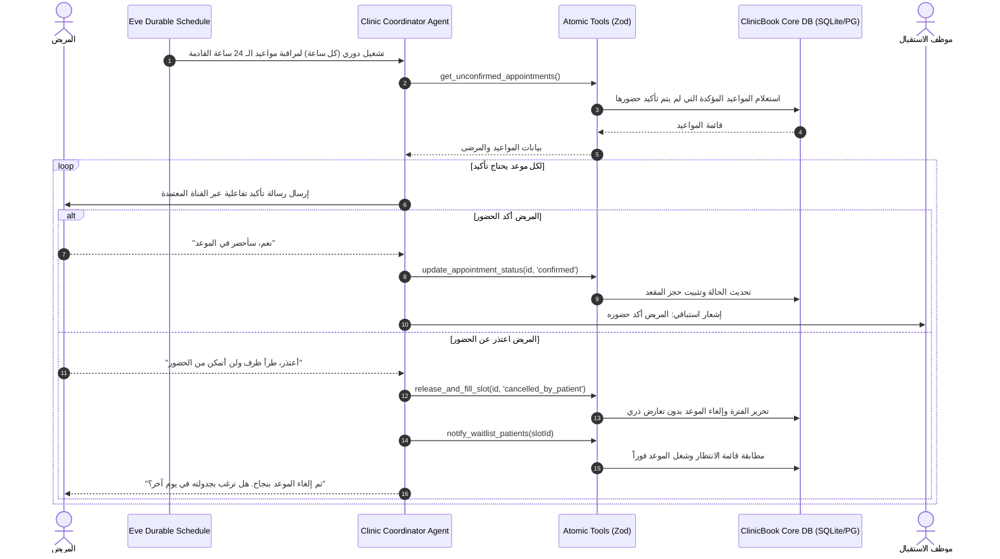

# 🩺 وثيقة التصميم المعماري والتنفيذي: دمج AI Agent في منصة ClinicBook باستخدام Eve

> **مرجع التقييم الاستراتيجي والتصميم الهندسي لوكلاء الذكاء الاصطناعي الدائمين (Durable AI Agents)**  
> **الإطار التقني:** Vercel Eve (`eve.dev`) • **المنصة:** ClinicBook HealthTech SaaS • **التاريخ:** أكتوبر 2026

---

## 1. التقييم الهندسي والجدوى الاستراتيجية (Executive Opinion)

### هل من المجدي إضافة AI Agent لمنصة ClinicBook؟
**الرأي القاطع: نعم وبقوة، ولكن بأسلوب "الوكيل التشغيلي الدائم المتصل بالأدوات" (Durable Tool-Calling Agent)، وليس مجرد "روبوت محادثة عام" (General Conversational Chatbot).**

### لماذا؟
1. **معضلة القطاع الصحي (HealthTech Dilemma):** 
   الأنظمة الطبية لا تتحمل الهلوسة (Hallucination) أو التخمين في التشخيص الطبي. تقديم تشخيصات طبية مستقلة عبر LLM يعرّض المنصة لمسؤوليات قانونية وطبية فادحة.
2. **القيمة الحقيقية للـ Agent في منصات SaaS الصحية:**
   تكمن القيمة في **أتمتة العمليات التشغيلية المعقدة متناهية الصغر (Micro-Operations)** التي تستهلك وقتاً بشرياً مكلفاً:
   - متابعة وتأكيد الحضور لمنع التخلف (No-Show Mitigation).
   - تحرير المواعيد الملغاة وإعادة شغلها فوراً من قائمة الانتظار (Instant Waitlist Dispatch).
   - مساعدة المريض في الوصول للعيادة المناسبة وحجز الموعد دون تخبط في الفلاتر.
   - تلخيص الزيارات السريرية ومساعدة الطبيب في إعداد الوصفة بنظام (Human-in-the-Loop).

### لماذا إطار عمل Eve (`eve.dev`) بالتحديد؟
* **بنية قائمة على نظام الملفات (File-System-First):** مطابقة لفلسفة Next.js، حيث يتم تحديد هوية الوكيل وأدواته من خلال المجلدات (`agent/instructions.md`, `agent/tools/*.ts`, `agent/schedules/*.ts`) دون تعقيد إعدادات الكلاسات التقليدية.
* **التنفيذ المتين وحفظ الحالة (Durable Workflows):** في إدارة المواعيد، تبدأ العملية قبل الموعد بـ 48 ساعة وتنتهي بعده بـ 48 ساعة. إطار Eve مصمم ليتحمل فترات الانتظار الطويلة واستئناف التنفيذ (Pause & Resume) دون فقدان الجلسة أو استهلاك موارد عبثية.
* **الاعتماد على Zod في التحقق:** تكامل تام مع TypeScript 5 ونماذج البيانات الصارمة في ClinicBook (`Appointment`, `Doctor`, `Shift`, `MedicalRecord`).

---

## 2. دراسة ومقارنة أفكار الوكلاء الأربعة (AI Agent Concepts)

| # | الفكرة | الفئة المستهدفة | القيمة التشغيلية والمالية | المخاطر الطبية | استغلال ميزات Eve |
|---|---|---|---|---|---|
| **1** | **وكيل الاستقبال والفرز والحجز الذكي** *(Smart Triage & Booking Concierge)* | المرضى (B2C Marketplace) | رفع معدل تحويل الزوار إلى حجوزات مؤكدة بنسبة تتجاوز 40%، وتسهيل الوصول للطبيب المناسب باللغة الطبيعية. | منخفضة (مع وجود حواجز التوجيه للطوارئ). | متوسط (يعتمد على الأدوات المباشرة `tools/`). |
| **2** | **المساعد السريري وتوليد الروشتات** *(Clinical EMR & Prescription Copilot)* | الأطباء (Doctor Workspace) | توفير ما بين 30-50% من وقت التوثيق الإداري على الطبيب، وتحويل الملاحظات الشفهية لصيغة SOAP. | متوسطة إلى مرتفعة (يتطلب إلزامية موافقة الطبيب البشرية). | متوسط (جلسات تفاعلية فورية). |
| **3** | **وكيل خفض التخلف والمتابعة الاستباقية** ⭐ *(Durable Retention & Care Coordinator)* | العيادات والمرضى (B2B SaaS Core) | **استعادة إيرادات ضائعة مباشرة تقدر بـ 15-25% من دخل العيادة** عن طريق خفض الـ No-Shows وملء المقاعد الشاغرة آلياً. | **شبه معدومة** (عمليات إدارية وجدولة بحتة). | **أعلى ما يمكن** (يعتمد جوهرياً على `schedules/` و `durable execution`). |
| **4** | **وكيل ذكاء العمليات وتخطيط العيادة** *(Clinic Ops & Capacity Intelligence)* | ملاك المراكز (Clinic Owners) | كشف اختناقات الاستقبال، تحسين فترات الدوام (Shifts)، ومقارنة نسب إشغال الأطباء دورياً. | معدومة (تحليل إحصائي خلفي). | منخفض إلى متوسط (يعتمد على الجداول التحليلية). |

---

## 3. التحليل المعمق للفكرة الأقوى: "وكيل تنسيق الرعاية وخفض التخلف الذاتي"

### لماذا تم اختيار هذه الفكرة كالأقوى بلا منازع؟
1. **حل معضلة الإيراد رقم 1 (The Financial Pain Point):** 
   العيادات والمراكز الطبية تخسر شهرياً آلاف الدولارات بسبب حجز المريض لموعد ثم عدم حضوره (No-Show). البرامج التقليدية ترسل رسالة SMS جامدة غالباً ما يتجاهلها المريض. هذا الوكيل يتفاعل بذكاء، يفهم اعتذار المريض، ويقوم في أجزاء من الثانية بتحرير الموعد وعرضه على مرضى الانتظار المسجلين.
2. **استثمار جوهر Eve المعماري:**
   المتابعة الطبية والتأكيد ليسا حدثاً لحظياً (Request-Response)، بل دورة حياة تمتد لأيام:
   - **T-48h**: فحص الموعد وتوقع مخاطر الغياب.
   - **T-24h**: محادثة تفاعلية لتأكيد الحضور أو التعديل.
   - **T-2h**: إرسال تذكرة الوصول وتنبيه موظف الاستقبال بتجهيز الملف.
   - **T+24h**: تذكير المريض بالالتزام بالجرعات الدوائية وحجز موعد المراجعة المجاني/المخفض.
3. **أمان قانوني وطبي 100%:** لا يقدم نصائح طبية حيوية مستقلة، بل ينسق الإجراءات ويضمن حقوق العيادة والمريض.

---

## 4. المخطط المعماري الكامل للوكيل في ClinicBook

---

## 5. ضوابط الأمان والامتثال الطبي (Medical & Operational Guardrails)

1. **الوقاية من التشخيص العشوائي (Strict Triage Boundary):**
   أي استفسار يمس أعراضاً حادة (ألم بالصدر، ضيق تنفس شديد، فقدان وعي، نزيف) يُقابل فوراً برد ثابت وموجه:
   > *"⚠️ هذه الأعراض قد تدل على حالة طارئة تستدعي التدخل الفوري. يرجى التوجه فوراً لأقرب قسم طوارئ أو الاتصال بالإسعاف (997/112)."*
2. **عزل المستأجرين (Multi-Tenancy Isolation):**
   كل أداة يستدعيها الوكيل تتطلب تمرير `clinicId` أو `organizationId` موثوق، لمنع أي تسريب لمعلومات المرضى بين العيادات المختلفة.
3. **معاملات ذرية غير قابلة للتضارب (Atomic Mutex):**
   عند حجز أو تحرير المواعيد، لا يقوم الوكيل بكتابة SQL عشوائية، بل يستدعي دوال المحرك الرسمية في المنصة:
   - `createAppointment()`
   - `cancelAppointment()`
   - `getAvailableSlots()`
   مما يضمن الحفاظ على قاعدة المنصة الأساسية: **Zero Double-Booking**.

---

## 6. خطة التنفيذ الميدانية (Action Plan)

1. **التهيئة الهيكلية:** إنشاء مجلد `agent/` يضم `agent.ts`, `instructions.md`, `tools/`, و `schedules/`.
2. **ربط الأدوات بالخدمات السحابية:** كتابة الأدوات بصيغة Zod لترتبط مباشرة بدوال `src/lib/services/booking-service.ts` و `src/lib/demo-db.ts`.
3. **الاختبارات الآلية:** كتابة اختبارات تكاملية للتحقق من أن استدعاءات الوكيل للأدوات تؤدي للنتائج المتوقعة دون كسر سلامة البيانات أو الأنواع البرمجية.
