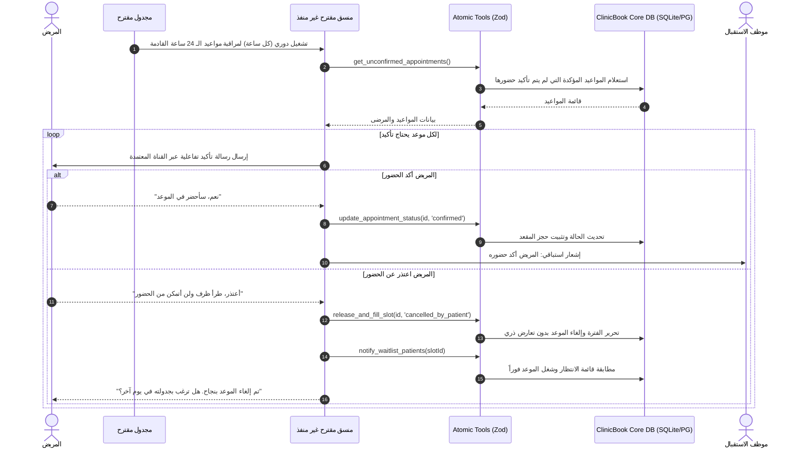

# Eve في ClinicBook — التنفيذ الحالي وتصميم مقترح للتوسع

> **مراجعة 2026-11-13 للشيفرة `1c84859`:** Eve اسم المساعد في الواجهة، وليس
> دليلًا على تثبيت إطار Vercel Eve أو تشغيل Durable Agent. تفصل هذه الوثيقة
> ما يُنفّذ الآن عن أفكار مستقبلية غير منفذة وغير مقاسة سريريًا أو ماليًا.

---

## 1. التنفيذ الموجود في المستودع

- [processAgentMessage](../src/lib/services/agent-service.ts) محرك توجيه لغوي
  بأسماء أطباء وكلمات تخصص وعبارات احترازية للطوارئ، ويستدعي خدمات محددة برمجيًا.
- [chat route](../src/app/api/agent/chat/route.ts) يدعم `chat` و`book_slot`؛
  الحجز يتطلب مصادقة مريض وتأكيدًا في الواجهة، ولا يختار LLM الأدوات.
- [callAgentRouter](../src/lib/services/agentrouter-client.ts) يولد نصًا اختياريًا
  عند إعداد مزود AI؛ ردود محلية عند الغياب/الفشل. وجود مفتاح ليس شرطًا للإرشاد
  المحلي أو البحث عن فترات demo.
- [agent/types.ts](../agent/types.ts) تعريفات TypeScript محلية، و`agent/agent.ts`
  ملف إعداد. لا يوجد SDK Eve أو runtime دائم لاستئناف العمل في `package.json`.
- [retention endpoint](../src/app/api/cron/retention/route.ts) يشغّل مهام SQL
  ذرية بمصادقة سر؛ ليس حلقة استنتاج LLM أو تنسيق رعاية ذاتي.

مصادر الاختبارات: [agent-service.test.ts](../tests/unit/agent-service.test.ts)،
[agent-triage-accuracy.test.ts](../tests/unit/agent-triage-accuracy.test.ts)،
[agent.spec.ts](../tests/e2e/agent.spec.ts) و[مصفوفة التتبع](TRACEABILITY.md).
هذه اختبارات برمجية وlabels اصطناعية، لا دراسة سلامة سريرية.

وجود `agent/tools` و`agent/schedules` لا يثبت تكاملًا مع إطار بعينه. اختيار
إطار دوام/استئناف يحتاج تحققًا من واجهاته ومصدرًا مؤرخًا وتصميم حفظ حالة؛ لم
تُحسم هذه القرارات في التنفيذ الحالي.

---

## 2. أفكار مستقبلية — ليست قياسات أو ميزات منجزة

| #     | الفكرة                   | الفئة المستهدفة | الهدف غير المقاس            | ما يلزم قبل التنفيذ                                                  |
| ----- | ------------------------ | --------------- | --------------------------- | -------------------------------------------------------------------- |
| **1** | مساعد حجز بلغة طبيعية    | المرضى          | تبسيط الوصول للطبيب والفترة | قياس مستخدمين؛ التوجيه الطبي يبقى خارج الادعاء الحالي.               |
| **2** | مساعد توثيق الطبيب       | الأطباء         | تنظيم ملاحظات الزيارة       | نموذج بيانات أوسع، مراجعة طبيب وتحقيق سريري؛ لا توليد وصفة مستقل.    |
| **3** | منسق تذكير وقائمة انتظار | العيادة والمرضى | تقليل المواعيد غير المستغلة | قنوات إرسال وموافقة واتصال وهوية وحفظ حالة وتكرار آمن، ثم دراسة أثر. |
| **4** | تحليل عمليات العيادة     | مدير المركز     | فهم مؤشرات وقت وكادر        | بيانات ذات جودة، تعريف مؤشرات، صلاحيات واختبار حجم ممثل.             |

---

## 3. سيناريو توسع مقترح: منسق التذكير وقائمة الانتظار

التنفيذ الحالي يضع إشعارًا داخليًا للمواعيد المؤكدة خلال 24 ساعة، ويُفحص
تكراره وصلاحياته في [cron.verify.ts](../tests/postgres/cron.verify.ts).
لا يوجد إرسال SMS/WhatsApp أو توقع غياب أو قائمة انتظار تعيد شغل الفترة.

التوسع المقترح قد يرسل تذكيرًا، ويتلقى اختيار المستخدم ثم يعرض فترة لقائمة
انتظار بموافقة صريحة. هذه أفكار لا تُنسب لها نسب تحويل أو توفير وقت أو دخل
ولا «صفر مخاطر». أي متابعة علاجية بعد الزيارة تحتاج تقييمًا سريريًا مستقلًا.

---

## 4. مخطط مقترح غير منفذ

الأسماء `release_and_fill_slot` و`notify_waitlist_patients` في الرسم وظائف
تصورية غير موجودة في الكود؛ لا يُعرض هذا الرسم بوصفه تدفق التشغيل الحالي.

---

## 5. ضوابط الأمان والامتثال الطبي (Medical & Operational Guardrails)

1. **الحد الطبي الحالي:** قواعد لفظية تعطي تنبيهًا احترازيًا قبل طلبات LLM
   والقاعدة. قد تخطئ أو تنذر دون طارئ؛ غياب التنبيه لا يعني سلامة الأعراض.
   [AGENT_TRIAGE.md](AGENT_TRIAGE.md) مصدر العبارات والحدود والقياسات الاصطناعية.
2. **عزل المستأجرين (Multi-Tenancy Isolation):**
   الهوية والصلاحيات من جلسة موثقة وحراس/RLS؛ تمرير `clinicId` وحده لا يثبت
   التخويل. أي أداة مستقبلية تحتاج فحص ملكية ودور واختبار تسريب بين المؤسسات.
3. **معاملات ذرية غير قابلة للتضارب (Atomic Mutex):**
   عند حجز أو تحرير المواعيد، لا يقوم الوكيل بكتابة SQL عشوائية، بل يستدعي دوال المحرك الرسمية في المنصة:
   - الموجود حاليًا `createBooking` / `createSupabaseBooking` وRPC الحجز.
   - الانتقالات عبر `canTransition` و`transition_appointment`.
   - الفترات عبر `getAvailableSlots` / `getSupabaseSlots`.
     استخدام هذه الخدمات مع اختبارات محددة ليس ضمانًا شاملًا ضد كل خطأ تشغيل.

---

## 6. خطة التنفيذ الميدانية (Action Plan)

1. تحديد نطاق غير سريري وموافقة المستخدم قبل كل إجراء، وعدم إسناد سلطة إلى نص LLM.
2. تقييم إطار حفظ حالة/استئناف وقنوات إرسال مع مصادر موثقة، دون افتراض أن مجلد
   `agent/` يحقق ذلك بالفعل.
3. اختبار الصلاحيات وإلغاء الوصول والتكرار الآمن وفقد الاستجابة والبيانات الخاصة
   على staging، دون سجلات مرضى حقيقية.
4. قياس الأثر على المستخدم والعمليات بدراسة واضحة بدل نسب نجاح أو مخاطر تقديرية.
