# دليل التوثيق الصوري لواجهات نظام ClinicBook
**لقطات الشاشة الرسمية للنظام — مخصصة لتقرير الأطروحة الجامعية والعرض التقديمي (Presentation)**

تم التقاط هذه اللقطات بدقة عالية (High-DPI Retina @1.5x) مباشرة من بيئة التشغيل الفعلية للنظام، وهي مرتبطة بحالات الاختبار الوظيفية (TC-01 إلى TC-11) الموثقة في الفصل 11 من التقرير الأكاديمي.

---

## 📊 جدول مطابقة الشاشات مع حالات الاختبار الأكاديمية وشرائح العرض

| رقم الشاشة | اسم الملف | الوصف الوظيفي | حالة الاختبار المرتبطة | الشريحة المقترحة بالعرض |
| :---: | :--- | :--- | :---: | :---: |
| **01** | `01-landing-page.png` | الصفحة الرئيسية واستكشاف التخصصات والأطباء والبحث السريع | **نظرة عامة / الغلاف** | شريحة 3: الواجهة الرئيسية للمنصة |
| **02** | `02-search-and-filters.png` | محرك البحث الطبي المتقدم والفلترة حسب المدينة والتخصص والتقييم | **TC-09** | شريحة 5: البحث والاستكشاف |
| **03** | `03-doctor-profile-slots.png` | الملف الشخصي للطبيب وشبكة الفترات الشاغرة وحجز الموعد | **TC-05, TC-06, TC-07** | شريحة 6: تفاصيل الطبيب وآلية الحجز |
| **04** | `04-ai-assistant-eve.png` | وحدة المساعد الطبي الذكي Eve وفرز الأعراض والمحادثة السريرية | **10.7 (AI Clinical Triage)** | شريحة 7: المساعد الطبي الذكي |
| **05** | `05-multi-role-login.png` | بوابة تسجيل الدخول متعددة الأدوار (5 أدوار للمستخدمين) | **TC-03, TC-04** | شريحة 4: هيكلية المصادقة والأدوار |
| **06** | `06-patient-appointments.png` | بوابة المريض وقائمة المواعيد مع الباركود وتفاصيل الإلغاء والطباعة | **TC-08** | شريحة 8: لوحة المريض وسجل المواعيد |
| **07** | `07-clinic-owner-dashboard.png` | لوحة تحكم إدارة المركز والمؤشرات الحيوية والمخططات البيانية | **إدارة المراكز الطبية** | شريحة 9: لوحة تحكم المنشأة الطبية |
| **08** | `08-reception-appointments.png` | لوحة الاستقبال وإدارة طابور المراجعين وتسجيل الوصول اللحظي | **TC-10 (Check-in)** | شريحة 10: شاشة موظف الاستقبال |
| **09** | `09-doctor-clinical-emr.png` | العيادة السريرية الرقمية وكتابة التشخيص والوصفة الطبية (EMR) | **TC-11 (Prescription)** | شريحة 11: لوحة الطبيب والوصفة الرقمية |
| **10** | `10-doctor-schedule.png` | إدارة جدول دوام الطبيب وفترات الراحة وأيام العمل | **إدارة الجداول والورديات** | شريحة 12: إدارة أوقات الدوام |
| **11** | `11-clinic-registration-wizard.png` | معالج تسجيل وانضمام المراكز الطبية متعدد المراحل | **اعتماد المراكز** | شريحة 13: تسجيل المنشآت الطبية |
| **12** | `12-super-admin-console.png` | لوحة تحكم مدير المنصة الشامل وسجل التدقيق الأمني (Audit Logs) | **الحوكمة والأمان** | شريحة 14: إدارة المنصة والتدقيق |
| **M1** | `mobile-01-home.png` | التصميم المتجاوب للرئيسية على شاشات الهواتف الذكية | **UI/UX التجاوب** | شريحة 15: التجاوب مع الجوال |
| **M2** | `mobile-02-search.png` | تجاوب صفحة البحث على الهاتف | **UI/UX التجاوب** | شريحة 15: التجاوب مع الجوال |
| **M3** | `mobile-03-dashboard.png` | تجاوب لوحة التحكم على الهاتف | **UI/UX التجاوب** | شريحة 15: التجاوب مع الجوال |

---

## 🖼️ استعراض الواجهات (Showcase Gallery)

### 1. الصفحة الرئيسية (Landing Page)
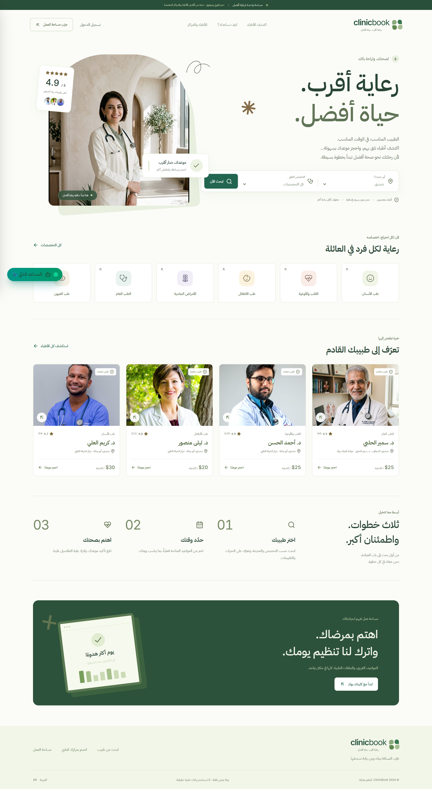

### 2. محرك البحث والفلترة (Doctors Directory & Search)
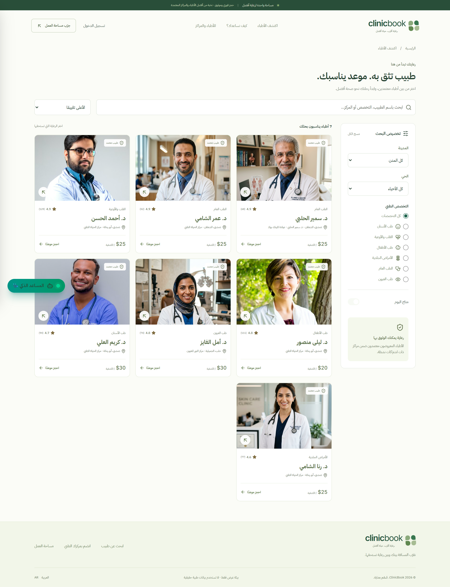

### 3. صفحة الطبيب وحجز الموعد (Doctor Profile & Slots)
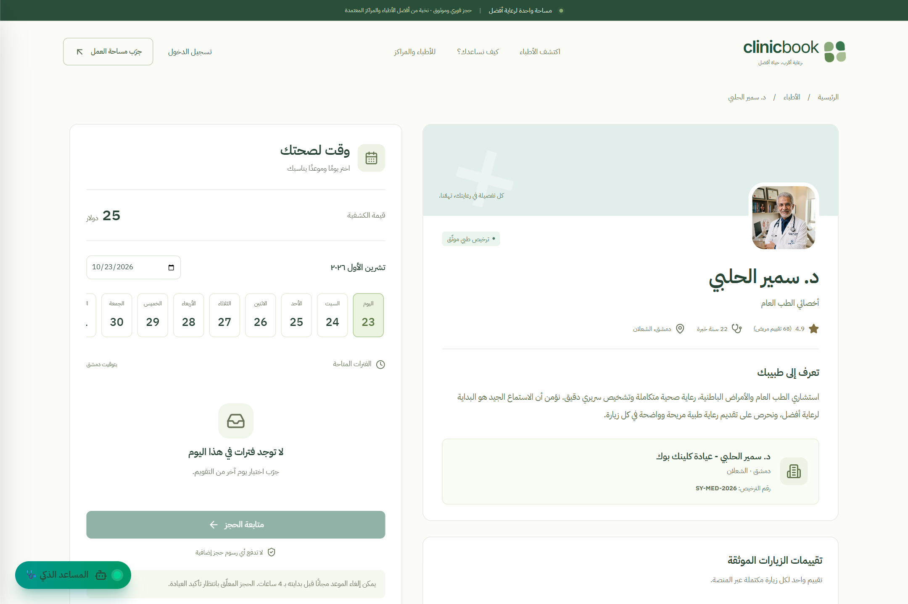

### 4. المساعد الطبي الذكي Eve (AI Triage Assistant)
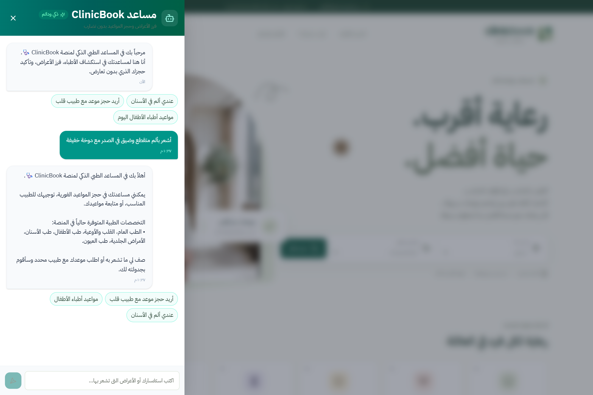

### 5. شاشة تسجيل الدخول متعددة الأدوار (Login with 5 Roles)
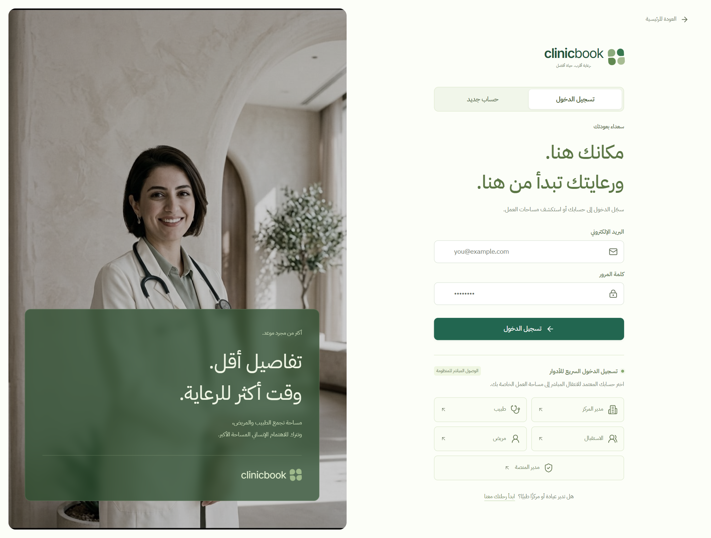

### 6. صفحة مواعيد المريض (Patient Portal - My Appointments)
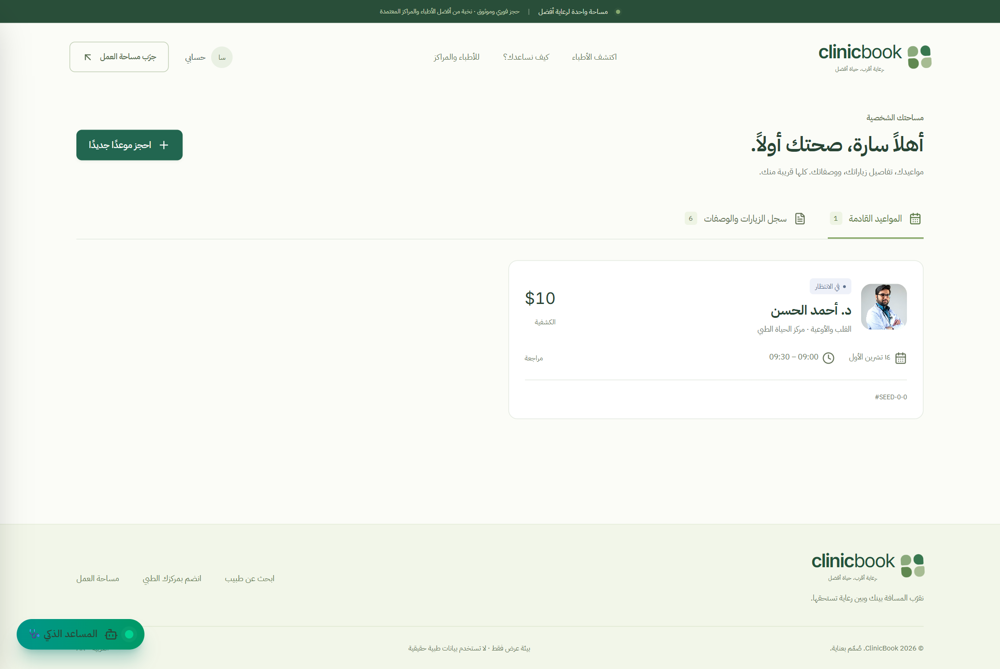

### 7. لوحة تحكم إدارة المركز الطبي (Clinic Owner Dashboard)
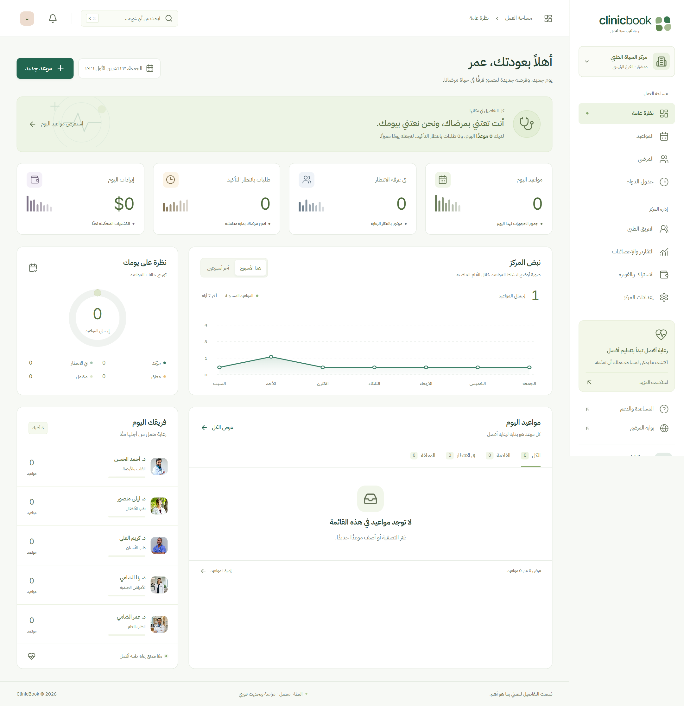

### 8. شاشة الاستقبال وتسجيل الوصول (Reception Workspace & Check-in)
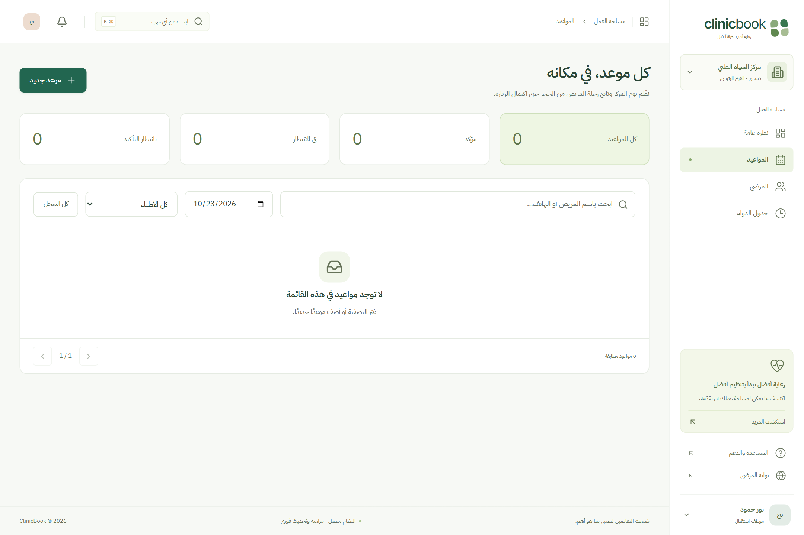

### 9. السجل الطبي والوصفة الرقمية (Doctor EMR & Prescription)
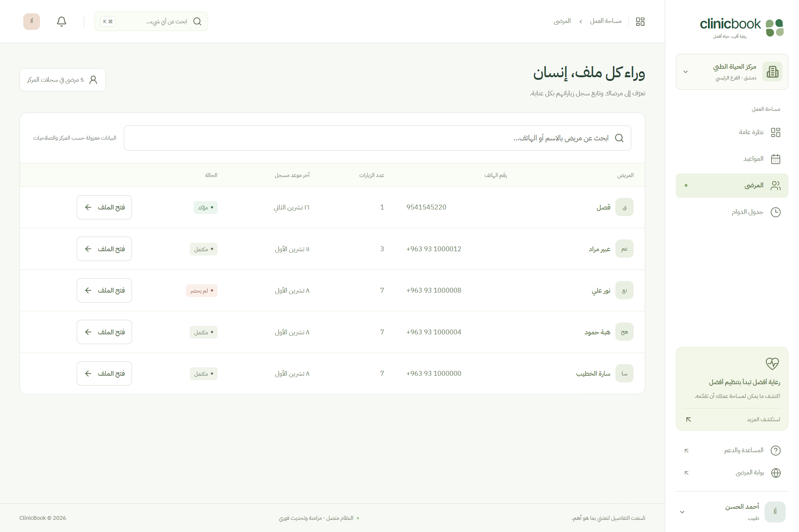

### 10. إدارة جدول دوام الطبيب (Doctor Schedule Management)
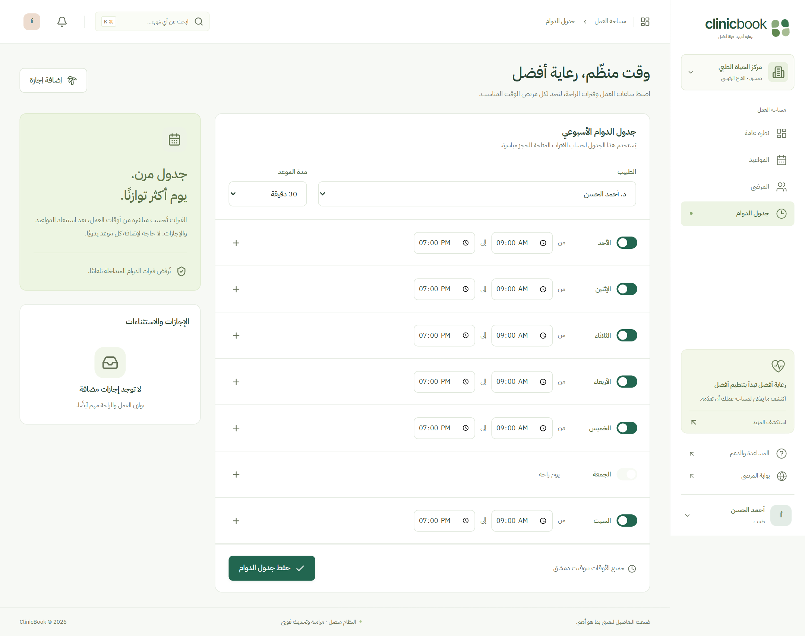

### 11. تسجيل منشأة طبية جديدة (Register Clinic Wizard)
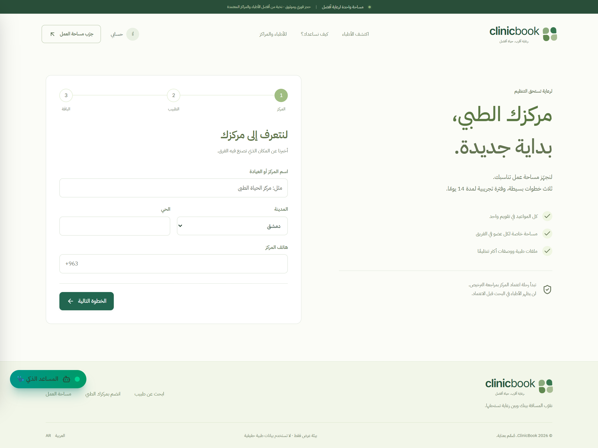

### 12. لوحة الإدارة العامة وسجل التدقيق (Super Admin & Audit Trail)
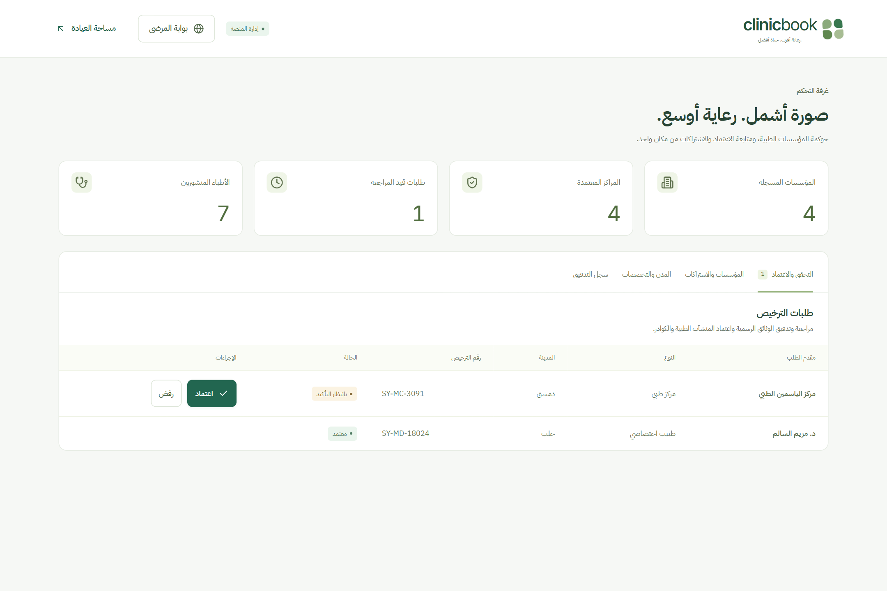

---

### الواجهات على الهواتف الذكية (Mobile Responsive View)
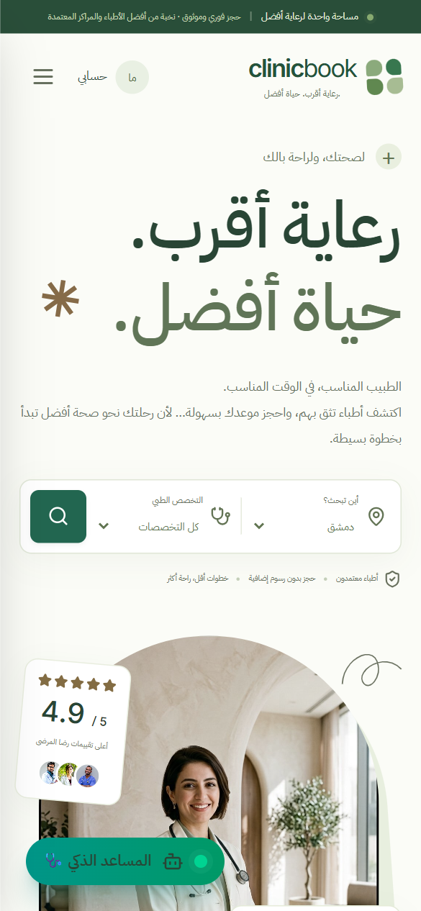
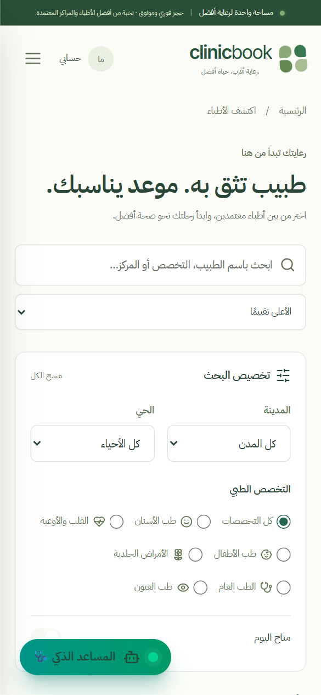
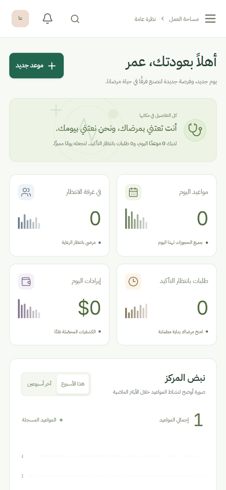
